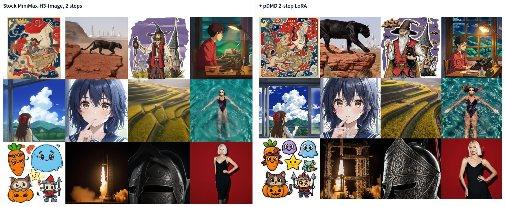
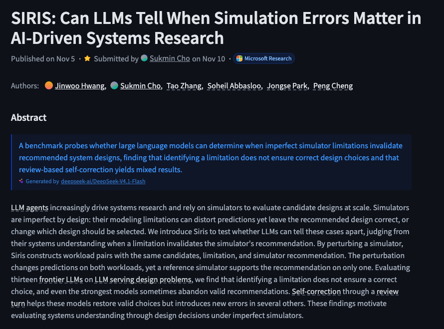
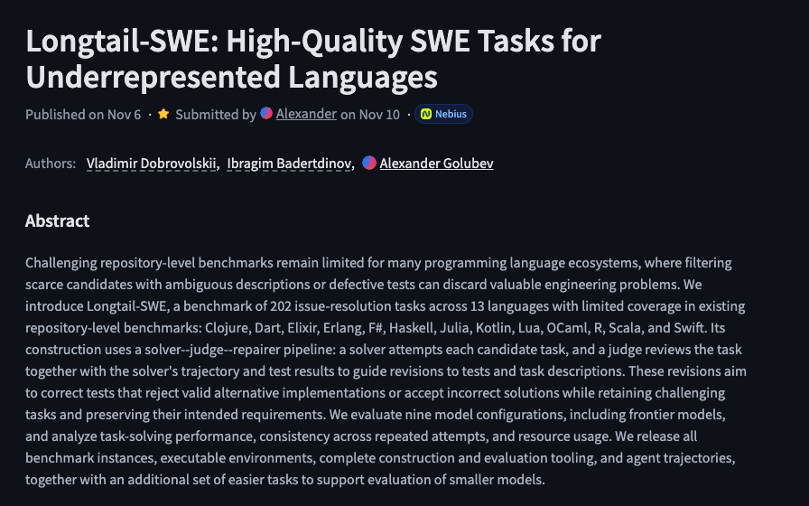
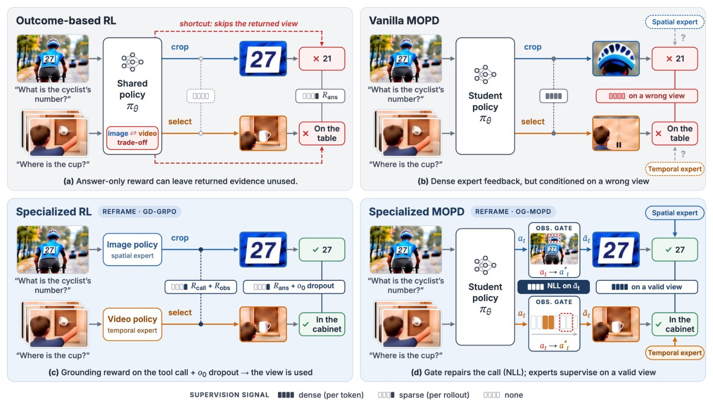
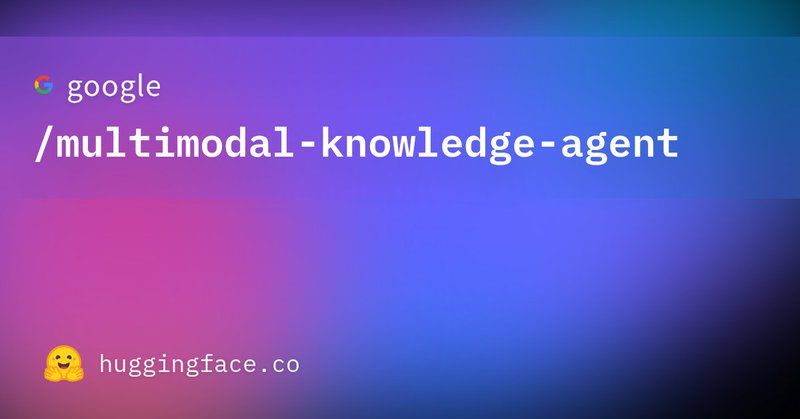

# 🐦 @_akhaliq

## 📅 November 10, 2026

> 14 post(s) archived.

---

### 🕐 21:44 UTC · @_akhaliq

> This is nuts! That cool MiniMax-H3-Image model already has a 2-step LoRA! - rank-128 - 1.4x faster than stock 6-step - realtime ~1 MP previews in 1–1.5 s! https://huggingface.co/akhaliq/minimax-h3-image-pdmd-2step Media 4K image generation in 10 seconds! ⚡ Meet MiniMax H3-Image. 16 million pixel resolution. Stunning realism. Precise prompt following &amp; editing. Up to 16 reference images. All in 10 seconds. And it&apos;s open-weight. 🚀 Available now via our API, MiniMax Code, and Hailuo AI — with 50%…

🔗 [View original post](https://x.com/wildmindai/status/2120271492739219668)

---

### 🕐 21:22 UTC · @_akhaliq

> MiniMax-H3-Image in 2 steps, realtime pDMD LoRA on MiniMax&apos;s 33B image model realtime editing on ZeroGPU LoRA + one-file ComfyUI checkpoint: https://huggingface.co/akhaliq/minimax-h3-image-pdmd-2step app: https://huggingface.co/spaces/akhaliq/minimax-h3-image-2step Media

🔗 [View original post](https://x.com/_akhaliq/status/2120265977657168218)

---

### 🕐 18:25 UTC · @_akhaliq

> Flide Accelerating Decision Inference with Exact State Forking paper: https://huggingface.co/papers/2610.42148 Media

🔗 [View original post](https://x.com/_akhaliq/status/2120221322722865439)

---

### 🕐 18:08 UTC · @_akhaliq

> We raised $5.3M to give AI agents a computer to run on, with their own email, phone, iMessage, and WhatsApp Led by @peakxvpartners, with @rauchg, @sternhenri, @jefrankle, @cjc, and @daniel_levine Today we’re launching hosted agents on @inkbox_ai. Your agent runs next to its communication channels, so it never misses a reply. It sleeps when idle, so you don’t pay for downtime. In the 4 months since our YC launch, we’ve processed millions of messages for AI agents. Media

🔗 [View original post](https://x.com/rayruizhiliao/status/2120217092553413028)

---

### 🕐 18:06 UTC · @_akhaliq

> SIRIS Can LLMs Tell When Simulation Errors Matter in AI-Driven Systems Research paper: https://huggingface.co/papers/2611.10329

🔗 [View original post](https://x.com/_akhaliq/status/2120216492189122726)

---

### 🕐 17:40 UTC · @_akhaliq

> Longtail-SWE High-Quality SWE Tasks for Underrepresented Languages paper: https://huggingface.co/papers/2611.10304

🔗 [View original post](https://x.com/_akhaliq/status/2120209949951393922)

---

### 🕐 17:32 UTC · @_akhaliq

> We just crossed: - 20M AI builders on @huggingface - 300PB of models, datasets, agent traces, and RL environments hosted on the @huggingface hub (9PB added by users just last week) Also October was our biggest month ever in terms of DAUs, MAUs and revenue. Let&apos;s go open-source AI!

🔗 [View original post](https://x.com/ClementDelangue/status/2120207990116495787)

---

### 🕐 17:30 UTC · @_akhaliq

> Introducing Hedra Model Factory: an autonomous inference and training platform for building models for the real world. The recursive self-improvement loop behind frontier research has been locked inside a few labs. We&apos;re opening it to teams in robotics, manufacturing, biology and defense. Our researchers come from Stanford, NVIDIA and Meta Superintelligence Labs. Now we work alongside your team to post-train and optimize your models. Media

🔗 [View original post](https://x.com/hedra_labs/status/2120207555263905973)

---

### 🕐 17:05 UTC · @_akhaliq

> After years working on robot memory at @NASAJPL, @GoogleDeepMind , @Meta and @nvidia, @clarkzhango and I kept asking: why does AI still forget? Today, with @deepakmishraVC, we’re announcing @GraphonAI and our $35M Series A just 6 months after our seed. • #1 on ATM-Bench, ATM-Bench Hard • 94% on LoCoMo • 84% on DolphinBench, 10x cheaper • A new cost-accuracy frontier across 7 benchmarks https://www.businessinsider.com/graphon-pitch-deck-funding-ai-agents-amnesia-2026-10 Media

🔗 [View original post](https://x.com/graphonfounder/status/2120201264932003990)

---

### 🕐 16:08 UTC · @_akhaliq

> Reframe: Teaching visual agents to use what they see A new post-training framework that grounds tool rewards and repairs observations during distillation. Beats prior art on 14 benchmarks without SFT cold start.

🔗 [View original post](https://x.com/HuggingPapers/status/2120186955308621916)

---

### 🕐 16:04 UTC · @_akhaliq

> Google just released Multimodal Knowledge Agent on Hugging Face A benchmark for AI agents tackling real-world visual tasks across 10 professional domains—with CAD blueprints, RF schematics, and more. https://huggingface.co/datasets/google/multimodal-knowledge-agent

🔗 [View original post](https://x.com/HuggingPapers/status/2120185862084596083)

---

### 🕐 14:30 UTC · @_akhaliq

> Agent harnesses now let a model spawn its own workers and write the workflow that coordinates them. But can it actually orchestrate them well? Introducing Einsia AI&apos;s WorkflowArena, the first benchmark for autonomous multi-agent workflow orchestration on real, long-horizon work. - 145 tasks across 8 professional domains, from SWE and Lean proofs to law and 3D - 25 configurations of 9 frontier models in Claude Code &amp; Codex - Every delegation recorded: we score the deliverable and see the workflow behind it 🌐 Project: https://lab.einsia.ai/workflowarena 💻 GitHub: https://github.com/Einsia/WorkflowArena 📄 Paper: https://arxiv.org/pdf/2611.12856 ⬇️ Read the following threads to go through the key findings

🔗 [View original post](https://x.com/EinsiaAI/status/2120162063905681632)

---

### 🕐 08:38 UTC · @_akhaliq

> Tencent just released a real-world group memory benchmark on Hugging Face It tests whether AI assistants can go beyond recalling past chats to actually using those memories to help group members

🔗 [View original post](https://x.com/HuggingPapers/status/2120073520298209353)

---

### 🕐 08:22 UTC · @_akhaliq

> LingBot-Touch A Foundation Model for Heterogeneous Tactile Representation Learning https://huggingface.co/collections/robbyant/lingbot-touch

🔗 [View original post](https://x.com/_akhaliq/status/2120069540680011974)

---
