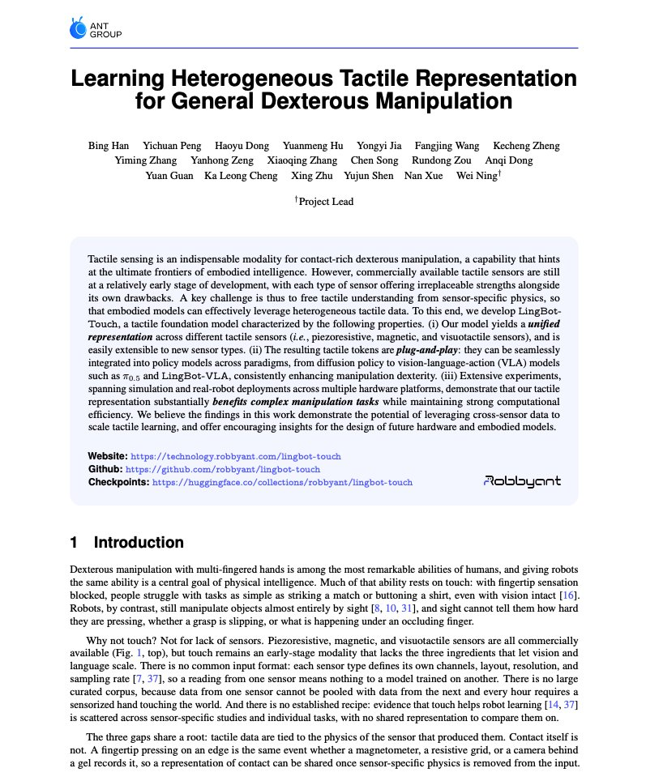
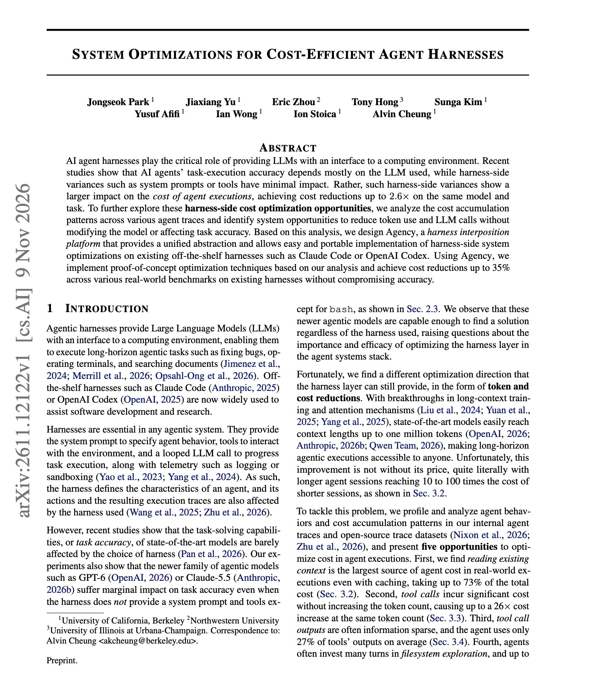

# 🐦 @dair_ai

## 📅 November 10, 2026

> 5 post(s) archived.

---

### 🕐 18:33 UTC · @dair_ai

> Impressive paper from Robbyant on physical AI. (bookmark it) Robot hands use a range of tactile sensors, and a model trained on one sensor can struggle to transfer to another. That&apos;s a big challenge in robotics right now. LingBot-Touch is a foundation model to address this challenge. It was pretrained on 4,983 hours of real touch data. They tested it on the XHand1, a robot hand whose sensor the model never saw. The model stayed frozen. Only a small add-on was trained to find where the fingertip is pressed. On XHand1, the average contact-center error was 0.16 mm with LingBot-Touch versus 5.89 mm with FTP-1 using an XHand1-specific adapter. That&apos;s about a 97% reduction in error. It transfers because every sensor maps to the same virtual fingertip. Training also varies touch-point density and placement, so the model can&apos;t memorize one sensor. Better touch also makes robots better at tasks. Across six real-world XHand1 tasks, LingBot-VLA averaged 57.21% success both without tactile input and with raw tactile input, rising to 75.04% with LingBot-Touch features. In simulated RL, it scored highest on all twelve tasks. Plate spinning went from 0.5% to 97.4%. Has anyone seen a frozen touch model transfer to a new sensor like this? Paper: http://arxiv.org/abs/2611.12806 Code: http://github.com/Robbyant/lingbot-touch Weights: http://huggingface.co/collections/robbyant/lingbot-touch

🔗 [View original post](https://x.com/omarsar0/status/2120223370470096952)

---

### 🕐 17:18 UTC · @dair_ai

> Great practical paper on optimizing harness costs. For lower agent costs, you want to change the harness and keep the model. UC Berkeley researchers found that harness changes such as prompts and tools barely move accuracy, but they change cost by up to 2.6x on the same model and task. They analyzed agent traces and found five ways to cut cost. Each one reduces how much context an LLM call reads or how many calls a task needs. Then they built Agency, a layer that sits between existing harnesses like Claude Code and Codex and the model. An optimization written once works across harnesses. Five proof-of-concept techniques cut cost by up to 35% with marginal accuracy loss. If your agent bill keeps growing, look at repeated context reads and extra tool calls before switching models. https://arxiv.org/abs/2611.12122 Chat with Paper: https://academy.dair.ai/papers/system-optimizations-for-cost-efficient-agent-harnesses-2611.12122

🔗 [View original post](https://x.com/dair_ai/status/2120204345602101457)

---

### 🕐 14:59 UTC · @dair_ai

> Explaining an idea is how you learn it. I see this all the time when teaching AI. The gaps show up when students try to explain in their own words. Gakku turns this into an AI learning coach for kids. It asks and challenges, while the kid does the speaking, deciding, and writing. Congrats on the $51M raise, @gakkuai. We’ve raised $51 million to rethink how kids learn with AI. Our bet: conversational learning. Language isn’t just how we communicate. It’s how we think. That’s the idea behind Gakku, our AI learning coach. The learning process itself is the product—not something to automate away…

🔗 [View original post](https://x.com/omarsar0/status/2120169408618221932)

---

### 🕐 14:28 UTC · @dair_ai

> // Harnessing Recursive Self-Improvement for Training Infrastructure // Want to learn how to build agents that speed up LLM training jobs? Check out this paper. InfraRSI raised mean MFU from 17.4% to 30.0% across four dense and MoE training workloads, with speedups up to 2.75x. Why it matters: Coding agents asked to speed up training often produce false speedups. They change the effective batch size, move optimizer steps outside the timing window, or apply unstable low-precision casts. InfraRSI locks a task contract over workload, loss, and timing before any edit. It profiles the baseline and the cluster noise, then searches launch settings and code patches together and re-checks the best candidates against the baseline. It also fits time and peak-memory models across every trial, including out-of-memory failures, and stores what it learns for use on other GPUs. https://arxiv.org/abs/2611.11558 Chat with Paper: https://academy.dair.ai/papers/infrarsi-harnessing-recursive-self-improvement-for-training-infrastructure-2611.11558

🔗 [View original post](https://x.com/dair_ai/status/2120161562732449975)

---

### 🕐 14:23 UTC · @dair_ai

> Learn to build a custom harness, folks. This Microsoft work builds a harness to improve long-context reasoning without synthetic data or post-training. (bookmark it) They show that Llama3-8B gains 64.18 points on average across long-context benchmarks with no training at all. The gain comes from the harness. It breaks long-context tasks into capability primitives. A strong agent then rewrites those primitives, the state they track, and the control logic over many rounds of self-improvement on a development set. The harness built for Llama3-8B transfers to Qwen2.5-3B. On HELMET and RULER, it beats NExtLong and PolicyLong, which rely on data synthesis and training, at less than half their estimated cost. The harness is written by GPT-5.6-Sol, and results drop sharply when the small models build their own. The takeaway: before post-training a small model for long context, try improving the harness around it. https://arxiv.org/abs/2611.10463 Chat with Paper: https://academy.dair.ai/papers/longcapharness-capability-guided-auto-harnessing-for-long-context-reasoning-2611.10463

🔗 [View original post](https://x.com/omarsar0/status/2120160305347260443)

---
