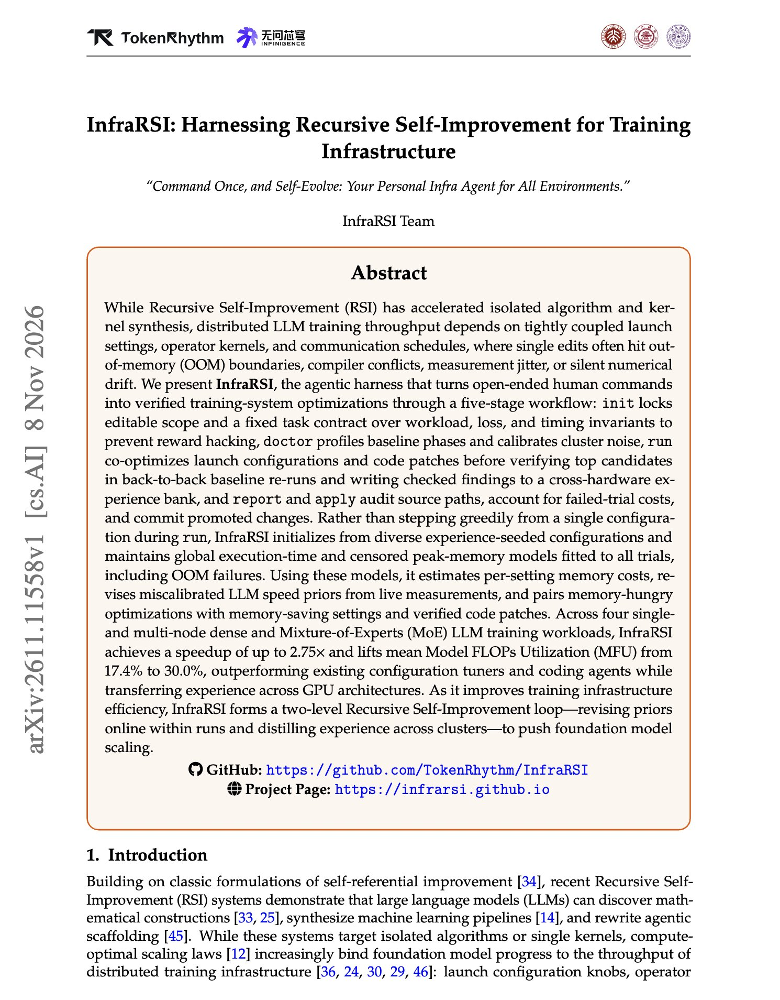
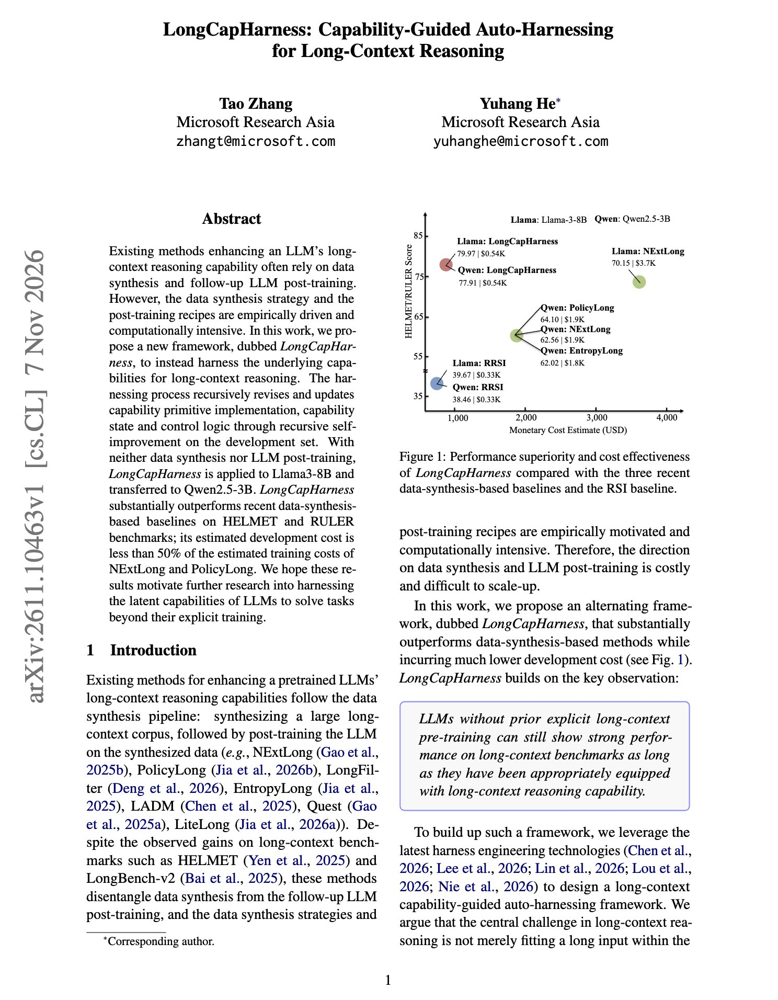

# 🐦 @dair_ai

## 📅 November 10, 2026

> 2 post(s) archived.

---

### 🕐 14:28 UTC · @dair_ai

> // Harnessing Recursive Self-Improvement for Training Infrastructure // Want to learn how to build agents that speed up LLM training jobs? Check out this paper. InfraRSI raised mean MFU from 17.4% to 30.0% across four dense and MoE training workloads, with speedups up to 2.75x. Why it matters: Coding agents asked to speed up training often produce false speedups. They change the effective batch size, move optimizer steps outside the timing window, or apply unstable low-precision casts. InfraRSI locks a task contract over workload, loss, and timing before any edit. It profiles the baseline and the cluster noise, then searches launch settings and code patches together and re-checks the best candidates against the baseline. It also fits time and peak-memory models across every trial, including out-of-memory failures, and stores what it learns for use on other GPUs. https://arxiv.org/abs/2611.11558 Chat with Paper: https://academy.dair.ai/papers/infrarsi-harnessing-recursive-self-improvement-for-training-infrastructure-2611.11558

🔗 [View original post](https://x.com/dair_ai/status/2120161562732449975)

---

### 🕐 14:23 UTC · @dair_ai

> Learn to build a custom harness, folks. This Microsoft work builds a harness to improve long-context reasoning without synthetic data or post-training. (bookmark it) They show that Llama3-8B gains 64.18 points on average across long-context benchmarks with no training at all. The gain comes from the harness. It breaks long-context tasks into capability primitives. A strong agent then rewrites those primitives, the state they track, and the control logic over many rounds of self-improvement on a development set. The harness built for Llama3-8B transfers to Qwen2.5-3B. On HELMET and RULER, it beats NExtLong and PolicyLong, which rely on data synthesis and training, at less than half their estimated cost. The harness is written by GPT-5.6-Sol, and results drop sharply when the small models build their own. The takeaway: before post-training a small model for long context, try improving the harness around it. https://arxiv.org/abs/2611.10463 Chat with Paper: https://academy.dair.ai/papers/longcapharness-capability-guided-auto-harnessing-for-long-context-reasoning-2611.10463

🔗 [View original post](https://x.com/omarsar0/status/2120160305347260443)

---
