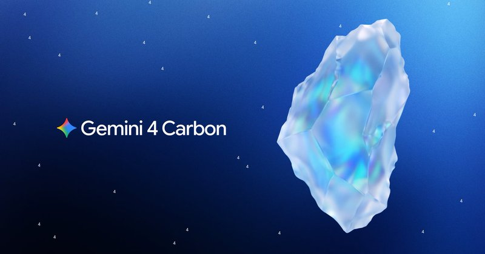
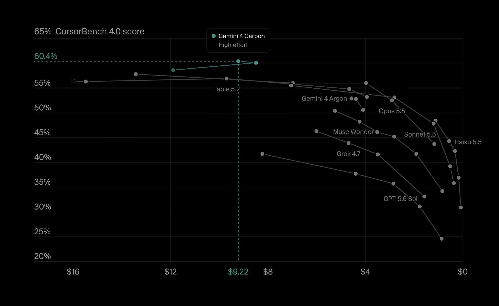
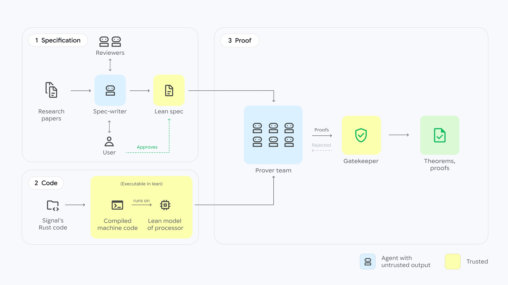

# 🐦 @demishassabis

## 📅 November 10, 2026

> 6 post(s) archived.

---

### 🕐 17:41 UTC · @demishassabis

> more info:

🔗 [View original post](https://x.com/demishassabis/status/2120210300997910671)

---

### 🕐 17:41 UTC · @demishassabis

> Our latest frontier model Gemini 4 Carbon is rolling out today! Amazing progress from Gemini 3 → Gemini 4 in less than a year… Carbon reverse engineers my original Theme Park binaries, adds a new DeepMind themed ride, and ports it to the web in one shot - kind of mindblowing to see! https://x.com/demishassabis/status/1990818894177513831 Media For example I’ve been doing a bunch of late night vibe coding with Gemini 3 in @GoogleAIStudio, and it’s so much fun! I recreated a testbed of my game Theme Park 🎢 that I programmed in the 90s in a matter of hours, down to letting players adjust the amount of salt on the chips!…

🔗 [View original post](https://x.com/demishassabis/status/2120210297948696997)

---

### 🕐 17:41 UTC · @demishassabis

> more info here, happy building! https://blog.google/innovation-and-ai/models-and-research/gemini-models/gemini-4-carbon-now-available/?utm_source=tw&amp;utm_medium=social&amp;utm_campaign=og

🔗 [View original post](https://x.com/demishassabis/status/2120210299643208084)

---

### 🕐 16:35 UTC · @demishassabis

> Gemini 4 Carbon is now available in Cursor! At high effort, it&apos;s the top model on CursorBench at 60.4%

🔗 [View original post](https://x.com/cursor_ai/status/2120193584670580857)

---

### 🕐 15:00 UTC · @demishassabis

> Gemini Robotics 2.5 is here. 🤖 Our latest physical AI is able to learn hundreds of everyday skills - from folding laundry and serving pastries to autonomously sorting car parts on the factory floor. Here’s a snapshot of its capabilities 🧵 Media

🔗 [View original post](https://x.com/GoogleDeepMind/status/2120169787896525104)

---

### 🕐 12:13 UTC · @demishassabis

> Announcing a major milestone achieved by my team @GoogleDeepMind: we have proven key security properties of the machine code underlying the Signal messaging protocol. This is the first time the actual production code of a widely deployed protocol has been formally verified – by any method, with or without AI – and at this depth. More than a research breakthrough, it’s a prime example of how frontier AI can be a force multiplier to counter the speed and scale of modern cyber threats. Formal verification offers a higher standard of security; however, it’s extremely complex and time consuming, which is why in many cases it’s considered to be impractical. Similar efforts could take teams decades of combined effort. We did it in a month’s time. Using AlphaProof Code, Google DeepMind&apos;s new agentic framework for formal verification that runs on LLMs including Gemini Carbon, we verified the Signal protocol down to the actual code running on devices. This milestone lays the groundwork for a future in which vital systems, from medical device firmware to power grid software, ship with mathematical proof that their protections work. Reaching that future will take continued research from our community. In that spirit, we&apos;re open-sourcing our formal specifications and verification artifacts so others can build on this work. On a personal note, this moment is of deep significance to me. I started my own research journey more than two decades ago as an intern working on checking the consistency of complex software systems. Seeing this grand challenge made practical with modern AI is extraordinary. I&apos;m extremely proud of my team members: Swarat Chaudhuri, Andrew Ferraiuolo, Anton Kovsharov, Tej Chajed, Sam Schlesinger, Karn Seth, Jonathan Katz, and Charles Sutton for taking on this grand challenge and delivering, and grateful to the Signal team for their partnership. https://deepmind.google/blog/formal-verification-signal-protocol

🔗 [View original post](https://x.com/pushmeet/status/2120127611137634376)

---
