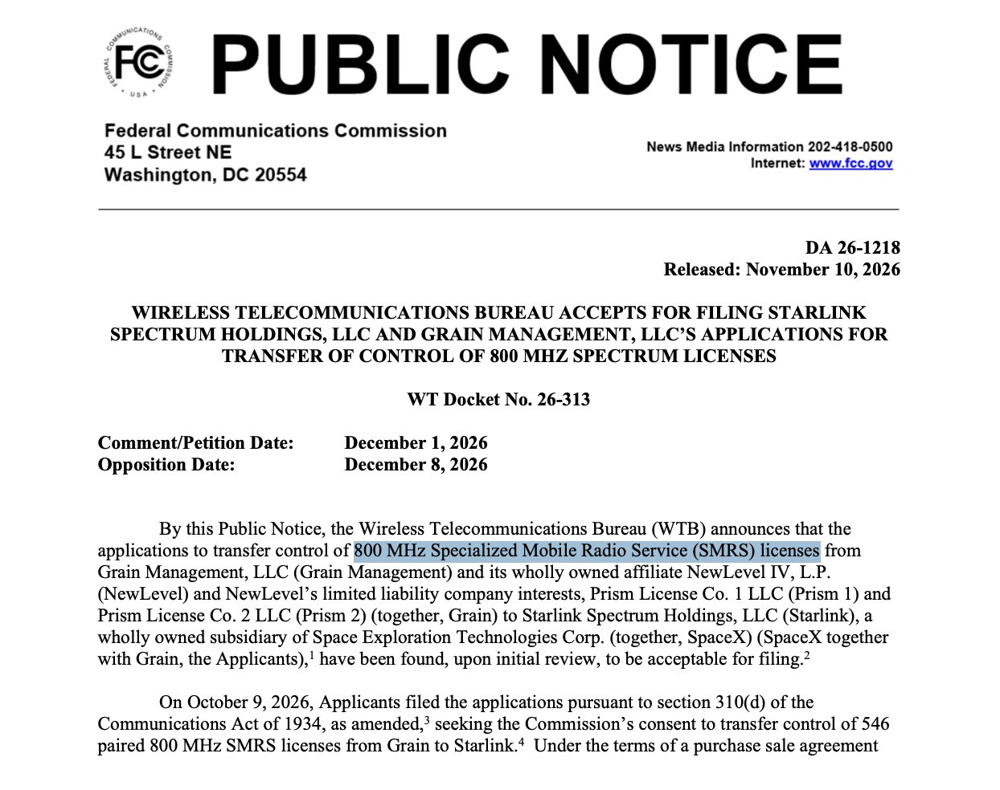
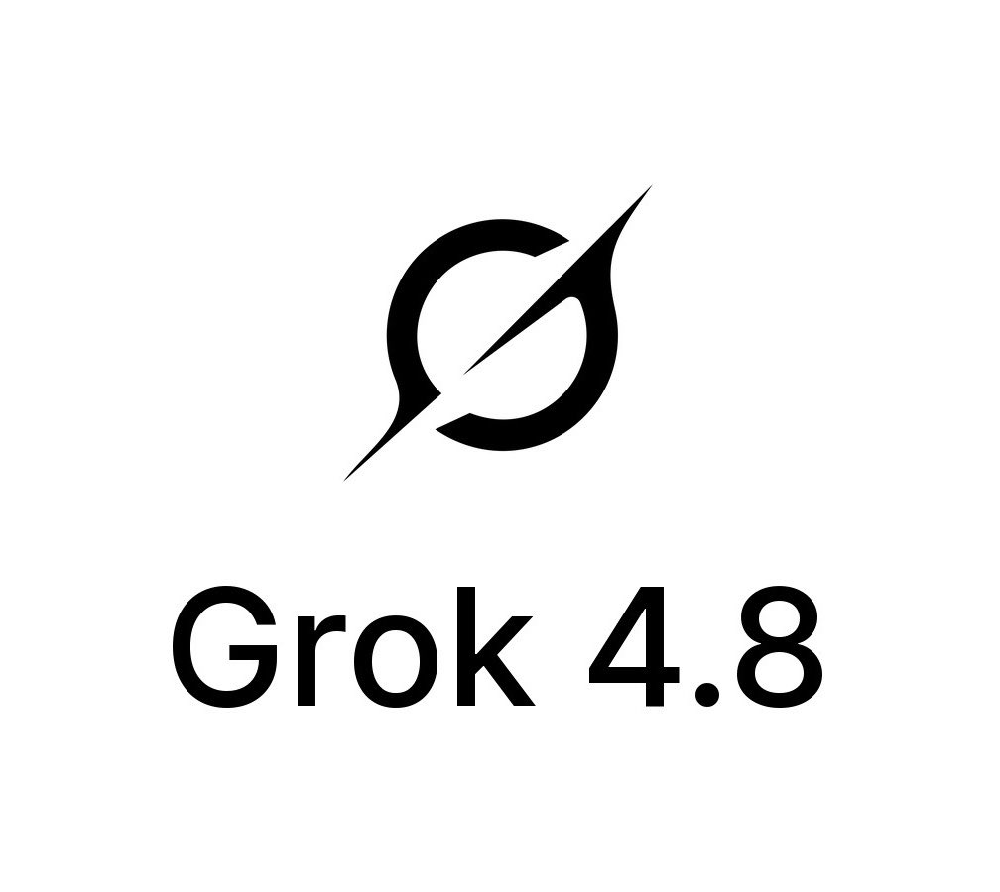
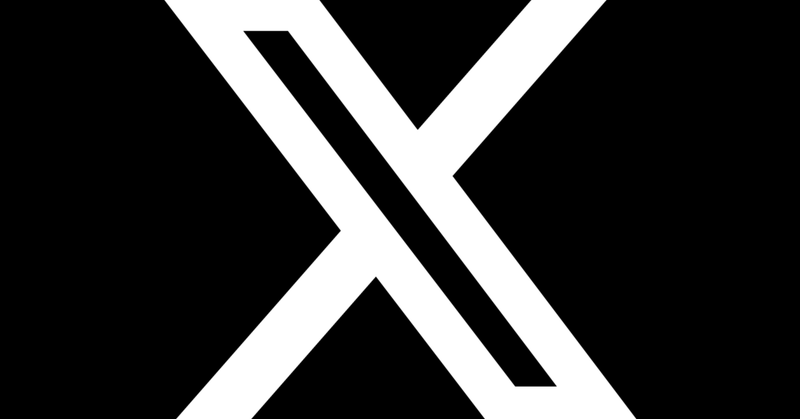

# 🐦 @elonmusk

## 📅 November 10, 2026

> 13 post(s) archived.

---

### 🕐 21:15 UTC · @elonmusk

> 🚨 BREAKING: The FCC accepts SpaceX&apos;s application to acquire nationwide 800 MHz spectrum Verizon, AT&amp;T and T-Mobile all told SpaceX &quot;NO&quot; when it asked to use their networks. SpaceX is building its own: This deal with Grain Management secures 546 paired licenses covering ~100% of the U.S. population, on 800 MHz low band that penetrates straight through walls and already works with almost every smartphone. Once it closes, SpaceX will hold up to 89 MHz of spectrum in every market it touches. Elon Musk: &quot;This is the last critical piece of the spectrum puzzle needed for SpaceX to provide complete phone coverage in America.&quot; ITS HAPPENING

🔗 [View original post](https://x.com/ns123abc/status/2120264216896753767)

---

### 🕐 19:14 UTC · @elonmusk

> SpaceX is making moves to become the first AI carrier $SPCX • Current cell towers are still mostly “dumb” radios. The Qualcomm deal is about making them AI-native. • Edge inference at the tower, like an updated Akamai for AI • Starlink Direct-to-Cell and V3 satellites alongside the terrestrial build Qualcomm’s CEO said the SpaceX agreement is finalized — not an engagement. SpaceX will build the base stations. Qualcomm supplies the silicon and the RAN accelerator for a terrestrial network he called one of the largest 5G deployments in the United States, with an AI-native architecture. Media

🔗 [View original post](https://x.com/nextbigfuture/status/2120233719491612940)

---

### 🕐 17:40 UTC · @elonmusk

> Here is SpaceX&apos;s new @Starlink Mini 2 with quick-swap battery. You can get up to 4.5 hours of use on a single charge. This means you can get internet in the middle of nowhere and not have to plug anything in. Media SpaceX has just officially unveiled its next-generation @Starlink Mini 2, which now comes with a built-in battery for the first time. • Up to 4.5 hours of connectivity on a single charge with the quick-swap battery (or plug in USB-C). • Weight: 3.53 Ibs (1.6 kg) including batter…

🔗 [View original post](https://x.com/SawyerMerritt/status/2120210080041963910)

---

### 🕐 16:29 UTC · @elonmusk

> CLAUDIA, Ship 42, Starbase. Do you copy? No tower has ever caught a ship coming back from orbit. Starship Flight 15 will try, no earlier than Nov 13. Good luck, @SpaceX @elonmusk 🚀 🎬 SLOPCORE music video AI Slop SI Media

🔗 [View original post](https://x.com/NURM_Dima/status/2120192013848965285)

---

### 🕐 15:07 UTC · @elonmusk

> 🚨The EU&apos;s Digital Services Act threatens freedom of speech GLOBALLY. What they say: the DSA prevents the spread of &quot;illegal content&quot; and mitigates &quot;systemic risks to civic discourse&quot;. What actually happens: the EU controls online narratives by forcing the world&apos;s largest platforms to censor content that the Commission and a network of nonaccountable individuals and NGOs deem unacceptable. ⚠️The DSA does not protect democracy. It undermines the free exchange of ideas and information on which democracy depends. Find out more in our video 👇 Media

🔗 [View original post](https://x.com/ADFIntl/status/2120171456411717968)

---

### 🕐 10:34 UTC · @elonmusk

> Turns out that the Starlink software, built for managing the movement of vast amounts of data through space and to the ground, is also very well suited to training super intelligence

🔗 [View original post](https://x.com/elonmusk/status/2120102767624880364)

---

### 🕐 10:27 UTC · @elonmusk

> Elon Musk just revealed something huge about Grok&apos;s new SI training and inference infrastructure The engineering behind Starlink is now helping power the development of Grok SpaceXSI has completely rewritten Grok&apos;s reinforcement learning and inference software from scratch, replacing JAX and SGLang with its own system built primarily in C, with a little C++ And the most important part is where this engineering expertise comes from The new stack is built on the incredible work of the engineers who created Starlink&apos;s incredibly complex satellite network Elon explained: &quot;At SpaceX, we write our own headers and calculate our own time (includes leap seconds). Not many people will know what this means, but those that do will appreciate it.&quot; Here&apos;s why that&apos;s significant SpaceX engineers build and control critical parts of their software themselves, even down to the code interfaces and precise time calculations needed for satellite operations This gives them much tighter control over how their systems operate, reducing unnecessary software dependencies and allowing them to optimize performance and reliability Now that same engineering philosophy is being applied to Grok At SpaceX, we write our own headers and calculate our own time (includes leap seconds). Not many people will know what this means, but those that do will appreciate it. The new Grok AI/SI training and inference stack is derived from incredible of work done by amazing engineers t…

🔗 [View original post](https://x.com/XFreeze/status/2120101086988222653)

---

### 🕐 10:01 UTC · @elonmusk

> Elon Musk just revealed a massive update on Grok 4.8, and SpaceXSI has completely rebuilt its reinforcement learning and inference infrastructure from scratch The engineering team has abandoned JAX and SGLang, rewriting the entire RL and inference stack in C/C++ Here’s where Grok 4.8 stands: • Pre-training is complete • Major cleanup of supervised fine-tuning data • Reinforcement learning now underway • Evaluation scores are starting to climb • Soft rollout to Grok Bot users planned for later this week And Elon also gave another imp update about Grok 4.8: “Grok 4.8 will bear no resemblance to 4.7 (thankfully)” He also explained why the development took longer than expected: “It is not yet incredible, but, this time, the foundations are built right, so I expect it to evolve to be something special” This is a fundamental engineering overhaul, not just another model upgrade SpaceXSI has rewritten the underlying infrastructure to build a much stronger foundation for Grok’s future development. And the first Grok Bot users are expected to get their hands on it this week We have dumped JAX/SGLang and rewritten the entire RL and inference stack from scratch in C/C++, which took some extra time. Training (aka pre-training) is done. Lot of cleanup was needed on the SFT data to get that mostly right. Now, 4.8 is in RL and the evals are starting to c…

🔗 [View original post](https://x.com/XFreeze/status/2120094479797686513)

---

### 🕐 08:34 UTC · @elonmusk

> In February 2004 Elon Musk wrote the check that put Tesla Motors on the road: $6.5 million of a $7.5 million Series A, plus the chairman&apos;s seat. He led the next round in February 2005. He co-led the $40 million round in May 2006 that brought in Larry Page and Sergey Brin. That August he published The Secret Tesla Motors Master Plan on the company blog, a sports car to pay for an affordable car, and so on down to the mass market. He pushed for the Roadster&apos;s carbon fiber body. By January 2009, Bloomberg reported, he had put $70 million of his own money into the company. CNBC still wrote this on September 10, 2018: &quot;Though Musk didn&apos;t found Tesla, his DNA is very much a part of the company.&quot; Read the very next sentence of the same article: &quot;He was one of its original investors and chairman of the board in 2004 before becoming CEO in 2008.&quot; Original investor. Chairman in 2004. CNBC typed both facts and still filed him under &quot;didn&apos;t found.&quot; That question had been settled nine years earlier, in court and in writing. In 2009 Martin Eberhard sued, and one of the things he asked a San Mateo County judge for was a declaration that he and Marc Tarpenning were the only two founders. In July the judge struck that request. In September the case was settled and Tesla named five co-founders: Eberhard, Tarpenning, Elon Musk, JB Straubel and Ian Wright. Eberhard&apos;s own statement that day: &quot;As a co-founder of the company, Elon&apos;s contributions to Tesla have been extraordinary.&quot; The man who went to court over the title called Elon Musk a co-founder in his own words. A business network still decided it knew better. Elon Musk has told his side too. In April 2022 he wrote that the Tesla he walked into was &quot;a shell corp&quot; with &quot;literally nothing but a biz plan to commercialize AC Propulsion&apos;s Tzero car, which was introduced to me by JB Straubel, *not* Eberhard.&quot; Then: &quot;If filing a shell corp constitutes &apos;founding a company&apos;, then I&apos;d be the only founder of PayPal, since I filed the original incorporation docs for http://X.com (later renamed PayPal), but that&apos;s not what founding means.&quot; And the line that says the most: &quot;I put in all I had, whereas Eberhard, who was worth over $10M at the time, refused to invest a penny to help Tesla.&quot; So why slip a false founder line into a 2018 piece? Look at the headline it sat under: &quot;Musk&apos;s defiant, rebel CEO persona is putting his company and its investors at risk, say management experts.&quot; The article argued Tesla needed &quot;someone to help keep Musk in line.&quot; Shrink his role at the birth of the company and it gets much easier to argue he is replaceable at the top of it. Legacy media has been running that play on Elon Musk for years. Tesla closed at $19.03 a share, split-adjusted, the day that story ran. On November 9, 2026 it closed at $378.05. The investors CNBC&apos;s experts were so worried about made nearly twenty times their money by keeping him exactly where he was.

🔗 [View original post](https://x.com/TheCaptainEli/status/2120072587883560986)

---

### 🕐 03:04 UTC · @elonmusk

> Grok SpaceX VP of Launch @TurkeyBeaver says Grok is now helping them identify foreign object debris in aerospace parts, and that Grok (99.9%) is better at it than humans (94%). &quot;We’ve automated being able to detect FOD. We’ll have an inspector go in and borescope a tube, and we find …

🔗 [View original post](https://x.com/elonmusk/status/2119989523748905221)

---

### 🕐 03:03 UTC · @elonmusk

> The most entertaining outcome is the most likely, especially if ironic One irony maximizing outcome that I’m not looking forward to is Anthropic proving to the world that their fears are justified by building the super-intelligence that they fear.

🔗 [View original post](https://x.com/elonmusk/status/2119989362725396589)

---

### 🕐 01:50 UTC · @elonmusk

> Taking the Shinkansen and all I can think about is how do we not have this between SF and LA... if only you knew how great things could be if we voted out the Decels

🔗 [View original post](https://x.com/beffjezos/status/2119970837302292728)

---

### 🕐 01:23 UTC · @elonmusk

> Memphis Mayor Paul Young confirming @elonmusk’s statement that Memphis is booming because of the data centers: “This year was $54 million in taxes generated. Last year about $25 million — it was the second-largest taxpaying property in Shelby County.” Media It’s true

🔗 [View original post](https://x.com/KatieMiller/status/2119964121860821488)

---
