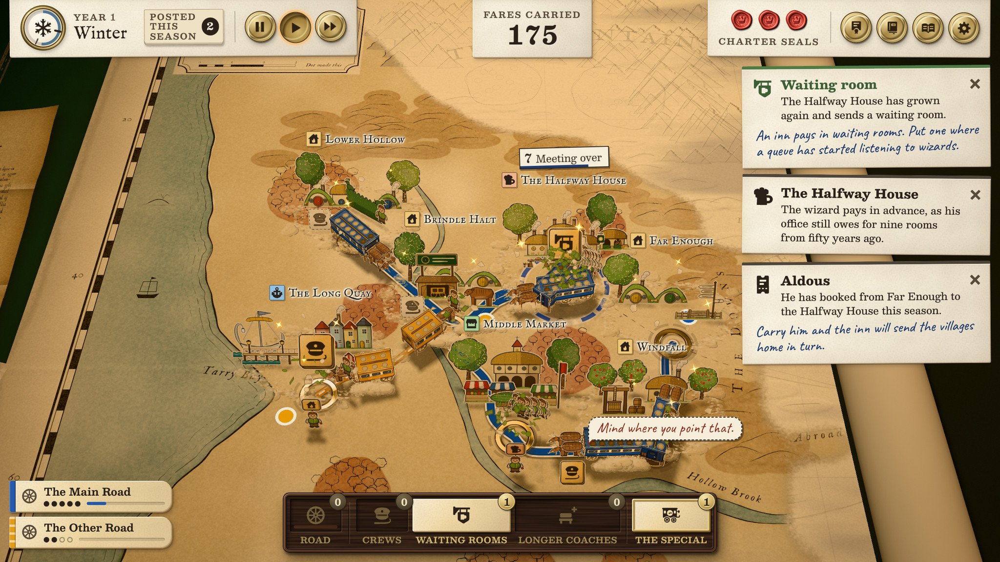
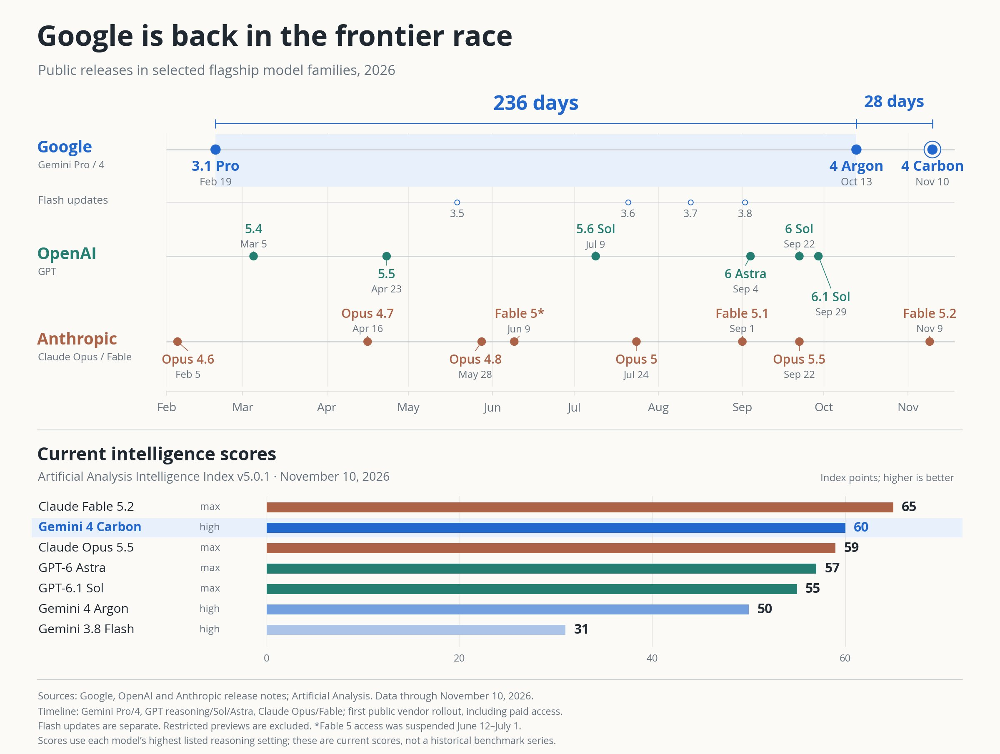
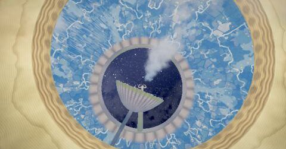

# 🐦 @emollick

## 📅 November 10, 2026

> 7 post(s) archived.

---

### 🕐 20:17 UTC · @emollick

> The graphic style is fun and the UX is surprisingly good.

🔗 [View original post](https://x.com/emollick/status/2120249500878987647)

---

### 🕐 20:13 UTC · @emollick

> Another weird AI game project: I gave Claude Fable 5.2 a vague paragraph asking for a fantasy transport sim with heart. Then I left it to a bunch of agents arguing about art, lore and jokes. Now here is Dread &amp; District, where good logistics defeats evil. https://dread-and-district.netlify.app Media

🔗 [View original post](https://x.com/emollick/status/2120248525254742318)

---

### 🕐 19:14 UTC · @emollick

> One of the most significant things about Gemini 4 Carbon is that it is showing that Google is back in the race of frontier models, rapid releases and rapid improvement.

🔗 [View original post](https://x.com/emollick/status/2120233659793854926)

---

### 🕐 17:03 UTC · @emollick

> Author of the original train clip: https://www.ritsumei.ac.jp/~akitaoka/index-e.html Play with the 3js recreation: https://keio-line-front-cab.netlify.app/

🔗 [View original post](https://x.com/emollick/status/2120200795530649998)

---

### 🕐 16:56 UTC · @emollick

> Had early access to Gemini 4 Carbon, it is a very good model that improves on Argon. It is useful to have an AI that thinks differently than Claude/GPT &amp; is still highly capable, but has its own strengths &amp; weakness One fun demo: I gave Carbon a video clip &amp; it reproduced in 3js Media

🔗 [View original post](https://x.com/emollick/status/2120198832202125322)

---

### 🕐 04:10 UTC · @emollick

> Some beautiful worlds that show considerable imagination, all 100% the AI&apos;s ideas and execution: The Chambered Sun: https://portals-endless-worlds.netlify.app/w/chambered-sun/ The River Tied in a Knot: https://portals-endless-worlds.netlify.app/w/knotted-river/ Field of Doors: https://portals-endless-worlds.netlify.app/w/field-of-doors/ Paperclip Maximizer (ha?): https://portals-endless-worlds.netlify.app/w/every-last-wire/

🔗 [View original post](https://x.com/emollick/status/2120006275836842239)

---

### 🕐 03:49 UTC · @emollick

> Looks like Fable 5.2 is above the already steep trendline on three of the most informative unsaturated benchmarks (ECI is a composite of other benchmarks, Remote Labor measures the ability to do end-to-end freelance jobs, RoboDojo involves controlling robotics).

🔗 [View original post](https://x.com/emollick/status/2120000888974766501)

---
