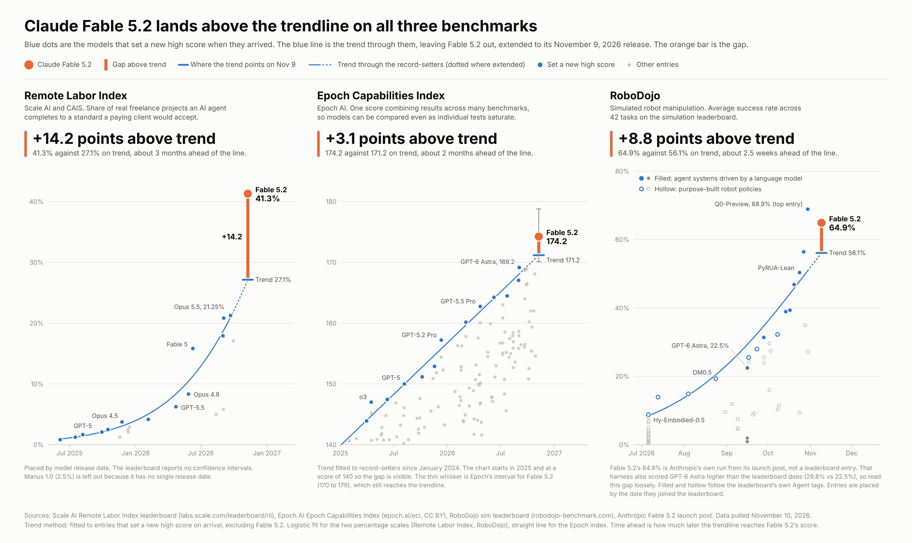

# 🐦 @emollick

## 📅 November 10, 2026

> 1 post(s) archived.

---

### 🕐 03:49 UTC · @emollick

> Looks like Fable 5.2 is above the already steep trendline on three of the most informative unsaturated benchmarks (ECI is a composite of other benchmarks, Remote Labor measures the ability to do end-to-end freelance jobs, RoboDojo involves controlling robotics).

🔗 [View original post](https://x.com/emollick/status/2120000888974766501)

---
