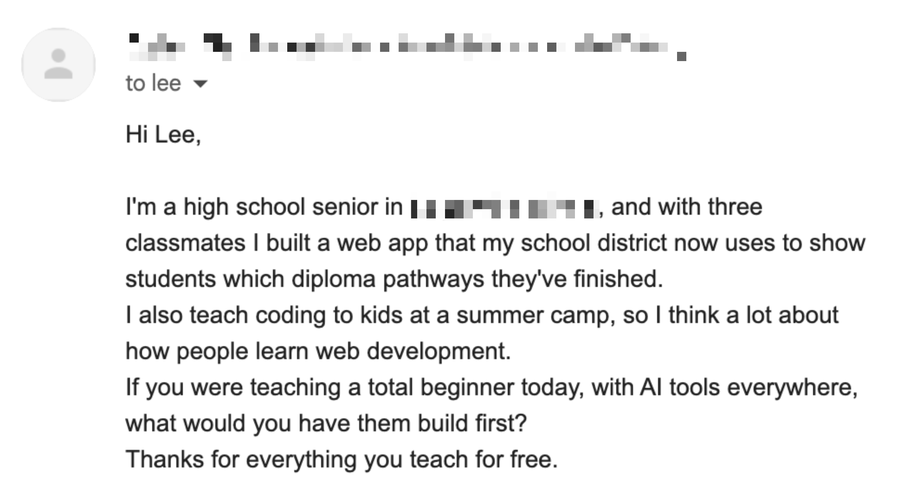

# 🐦 @leerob

## 📅 November 10, 2026

> 1 post(s) archived.

---

### 🕐 15:51 UTC · @leerob

> I got this cold email today about what I&apos;d teach kids interested in web development and programming. I figured I&apos;d share my full response here in case it helps others: — Learning to create software today is a glass half full / half empty situation. You can be optimistic or pessimistic. It is strange and transformative that we no longer write most code by hand. AI has completely changed how software is built. I expect this to change even more dramatically in the coming years, as entirely new programming languages¹ are invented² and adopted. One person might look at this and be pessimistic: what will these computer scientists and programmers do, as AI continues to become superhuman in its intelligence? But the wiser of the bunch will realize there is much to be optimistic about. Those with the agency³ to create and explore their wildest ideas have unlimited power. There has quite frankly never been a better time in the history of humanity to have good ideas⁴. So my advice for those building at summer camps is simple. You have to hone and craft your &quot;idea machine&quot;. You are going to have lots of bad ideas, but you&apos;ll get better at coming up with ideas and refining your taste so you can recognize and act on great ideas sooner. People at summer camps will spend less time reading CS tutorials and more time thinking about the fun or interesting things they want to exist in the world. My favorite way of teaching and getting people interested in software is to first help them build something they are excited about. When they hit roadblocks that require a deeper understanding of a CS concept or something related to web development, only then do we take the time to explain what it is and how it solves their problem. Starting this way, at least for me, seems to get people hooked faster than needing hours and hours of prereqs. There&apos;s more desire to spend time learning the fundamentals after having the &quot;aha!&quot; moment. It&apos;s worth checking out some skills⁵ designed to help encode the best practices for teaching and then plop that into a coding agent or your AI tool of choice and give it a task: teach me about how databases work (or similar). It&apos;s pretty great. It&apos;s also worth remembering that AI models today are the worst they will ever be. You need to learn how to be even more ambitious⁶ with what you ask them. Good luck! — ¹ https://x.com/poteto/status/2119824409087348984 ² https://bend-lang.com ³ https://www.neelnanda.io/blog/44-agency ⁴ https://www.are.na/editorial/notes-on-taste ⁵ https://github.com/mattpocock/skills/blob/main/skills/productivity/teach ⁶ https://felixrieseberg.com/how-to-be-more-ambitious-a-tutorial-for-humans-with-models we are entering a renaissance in programming language and runtime research, and a golden age of software testing and verification it’s time to rewrite all software

🔗 [View original post](https://x.com/leerob/status/2120182450416500819)

---
