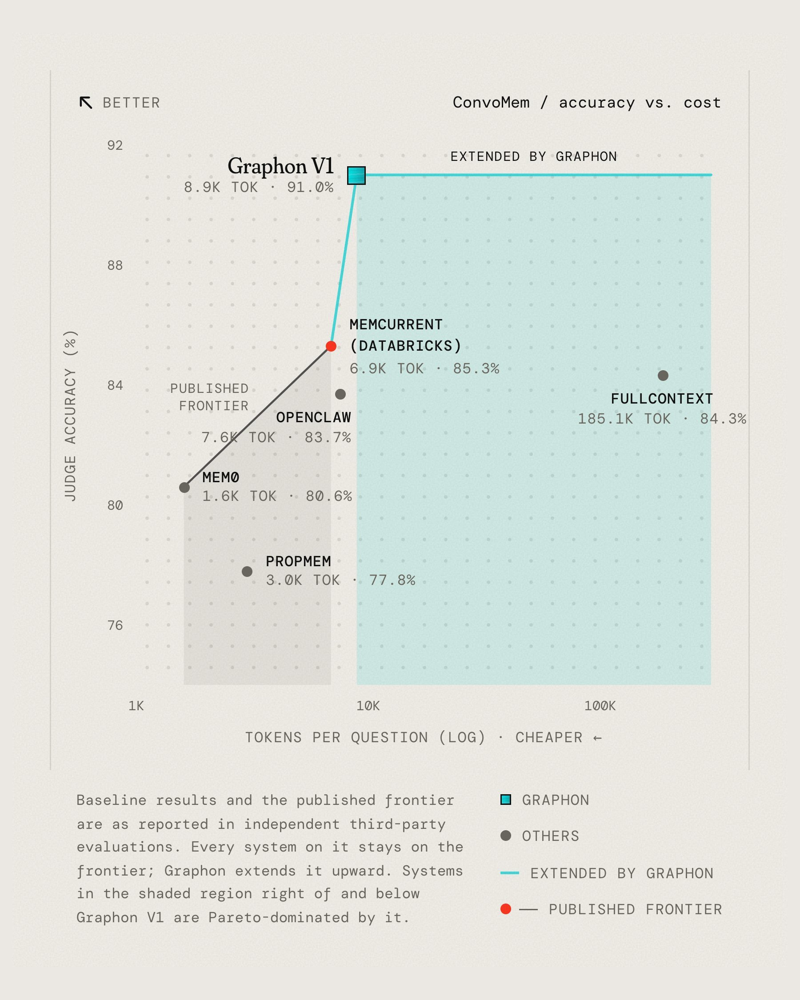

# 🐦 @omarsar0

## 📅 November 10, 2026

> 6 post(s) archived.

---

### 🕐 18:23 UTC · @omarsar0

> Another interesting development in autonomous AI agents. Vorflux just launched 2.0, introducing AutoBots, 24/7 AI coworkers that can manage ongoing engineering work, investigate production issues, review code, and turn customer feedback into product fixes. I&apos;m bullish on agents that can take ownership of responsibilities instead of waiting for humans to assign individual tasks. As models become more capable, I think the next major breakthrough will come from systems that coordinate multiple agents, verify their work, and keep execution moving autonomously. We&apos;re getting closer to self-driving software companies. Today we&apos;re launching @vorfluxai 2.0: AutoBots, 24x7 coworkers that live in Slack. I previously co-founded @Rippling, now $10B+, engg team of 1000s. Engg changes crazy fast now. IDE autocomplete &gt; CLI &gt; Cloud agents &gt; multi-player slack agents Models deliver predictably now. Bot…

🔗 [View original post](https://x.com/omarsar0/status/2120220713579868486)

---

### 🕐 17:49 UTC · @omarsar0

> RSI loops are moving out of the frontier labs. @hedra_labs just launched Model Factory for teams in robotics, manufacturing, biology, and defense. Bring a simulator or RL environment, and their AI scientists run post-training while Hedra researchers steer. They first tested it on their own H3 video model. 34.9 on Physics-IQ vs. 30.3 for H3 Max. Introducing Hedra Model Factory: an autonomous inference and training platform for building models for the real world. The recursive self-improvement loop behind frontier research has been locked inside a few labs. We&apos;re opening it to teams in robotics, manufacturing, biology an…

🔗 [View original post](https://x.com/omarsar0/status/2120212286027543026)

---

### 🕐 17:17 UTC · @omarsar0

> Memory is one of the biggest open problems for AI agents right now. Graphon builds one graph across a company&apos;s documents, emails, images, and videos without a hand-made schema, so new data does not break it. On LoCoMo, it reaches 94% accuracy with only 7.9K tokens of context, higher than giving a frontier model the full history. It is also #1 on ATM-Bench, which tests years of real emails, photos, and videos. After years working on robot memory at @NASAJPL, @GoogleDeepMind , @Meta and @nvidia, @clarkzhango and I kept asking: why does AI still forget? Today, with @deepakmishraVC, we’re announcing @GraphonAI and our $35M Series A just 6 months after our seed. • #1 on ATM-Bench, ATM-Ben…

🔗 [View original post](https://x.com/omarsar0/status/2120204152479400099)

---

### 🕐 15:52 UTC · @omarsar0

> Physical AI is the next frontier. But data is a huge bottleneck. The big challenge is that robots need to see how people work with their hands. That data is hard to collect and label. Memories Upload from @memories_ai turns everyday first-person video into robot training data. Media Today we launch #MemoriesUpload. Robots need internet-scale first-person video of how people get things done. Collecting this at high quality takes hardware, model and infra working together. That&apos;s what we&apos;ve spent over a year building. And already, 3 of the top 5 frontier robo…

🔗 [View original post](https://x.com/omarsar0/status/2120182810195443818)

---

### 🕐 13:11 UTC · @omarsar0

> I&apos;m bullish on new architectures for long-running agents. But long context needs to be practical to serve. Sugar Glider is a new family of LLM architectures from @i14labs built for long contexts. It keeps a fixed-size KV cache as context grows. At one million tokens, i14 reports up to 32x more requests per server than its baseline model. What does this mean in practice? Your agents could keep much longer histories without constantly trimming or summarizing them. And you can choose that memory size at deployment without retraining. Frontier performance at a fraction of the compute. Today at @i14labs we’re launching Sugar Glider, our new family of LLM architectures! Join the waitlist for early access: http://i14.ai Sugar Glider delivers a new Pareto frontier: extreme memory and compute efficiency whilst mai…

🔗 [View original post](https://x.com/omarsar0/status/2120142218316964143)

---

### 🕐 02:51 UTC · @omarsar0

> To what extent the RSI parts were nurfed? Who knows. It’s an interesting intentional decision from them for sure. Open models are going to eat this space and I am here for it. We just need a really good open model that’s really good at this to start putting some pressure. I am testing but haven’t found a solid open model with sparks of RSI. Fable 5.2 is significantly better at chip design, software engineering, biology, and material science. GDPx is the only eval that test these categories at this level of detail. True experts make these tasks, unlike other benchmarks. Notably it is not better at finance, legal, qu…

🔗 [View original post](https://x.com/omarsar0/status/2119986338174812484)

---
