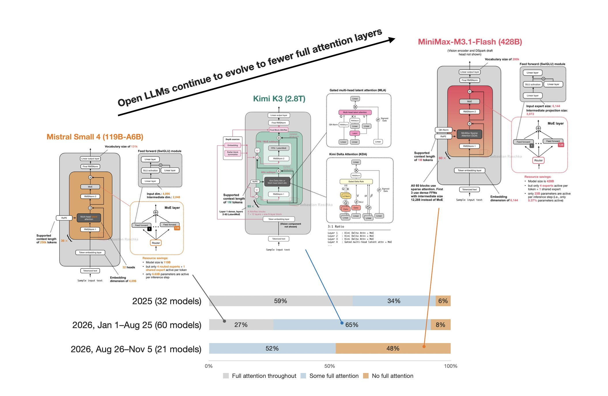

# 🐦 @rasbt

## 📅 November 10, 2026

> 1 post(s) archived.

---

### 🕐 16:30 UTC · @rasbt

> Currently working towards a bigger open LLM roundup. But in the meantime, just one of the interesting trends that stood out. I.e., looks like the transition from full to hybrid attention continues. In 2025, there were still lots of full attention models, with a shift to &quot;some full attention&quot; hybrids. In the first half of 2026, the trend towards &quot;some full attention&quot; hybrids continued. And now, in the second half of 2026, we have a 50/50 split between &quot;some full attention&quot; hybrids and models that don&apos;t use full attention at all anymore. And yes, there are also no full attention models anymore. The plot legend here means, - Full attention throughout = Global MHA, GQA, dense MLA, CCA in EVERY layer. - Some full attention = Full global attn mixed with: sliding-window/chunked attention, Gated DeltaNet, KDA, Mamba-2, Lightning Attention, convolutions, sparse attention. - No full attention = Zero dense global layers. The main implication is that the trend goes towards making long contexts cheaper to use. This means, it makes the architectures more suitable for long documents and conversations, large code bases, and of course agent usecases that rely on a lot of tool calls. In particular, there are two distinct efficiency gains here: 1) Less attention computation, since sparse attention and the like select tokens or blocks from the context and performs the expensive attention operation from only that subset. (Note that it can still retrieve information from distant positions.) 2) Less memory for retaining context in some architectures, meaning that recurrent layers such as Gated DeltaNet maintain a fixed-size state. Of course, this saves memory, but compressing the history creates challenges for exact retrieval, so they are usually intermixed with traditional attention methods (sparse or full).

🔗 [View original post](https://x.com/rasbt/status/2120192452287963540)

---
