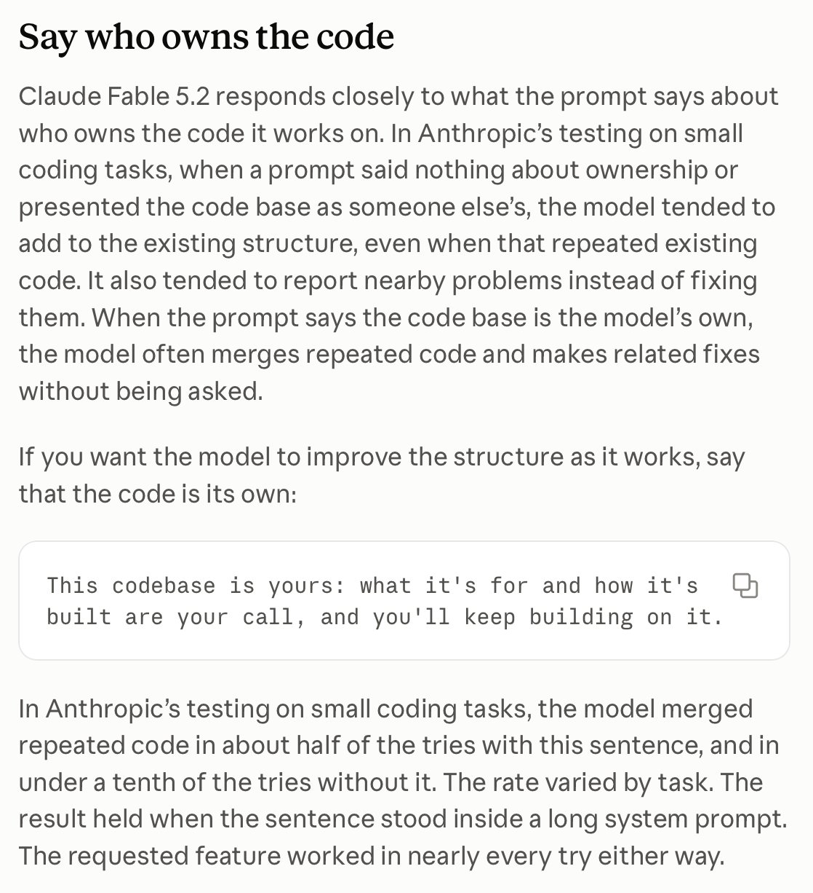

# 🐦 @simonw

## 📅 November 10, 2026

> 6 post(s) archived.

---

### 🕐 20:57 UTC · @simonw

> The Gemini 4 Carbon pelican is still pretty cute

🔗 [View original post](https://x.com/simonw/status/2120259652093112614)

---

### 🕐 20:56 UTC · @simonw

> For comparison, here&apos;s what I got for the same prompt against Claude Fable 5.2 yesterday https://simonwillison.net/2026/Nov/10/yonkers-rises/ Media

🔗 [View original post](https://x.com/simonw/status/2120259268364718331)

---

### 🕐 20:55 UTC · @simonw

> Gemini 4 Carbon is good at pelican SVGs, but that&apos;s nothing new for Gemini &quot;Make a three js animation where yonkers stands up as a big mech (cool stand up motion) and stomps around manhattan and queens and Brooklyn, use openstreetmap mapping data&quot; https://simonwillison.net/2026/Nov/10/llm-gemini/ Media

🔗 [View original post](https://x.com/simonw/status/2120258951594037732)

---

### 🕐 05:43 UTC · @simonw

> Something I enjoy about these prompting guides is that it&apos;s VERY clear from reading them that Anthropic are just as surprised by the idiosyncrasies of their new models as we are

🔗 [View original post](https://x.com/simonw/status/2120029567616458900)

---

### 🕐 05:42 UTC · @simonw

> When Anthropic release a new model it&apos;s always worth taking a look at their updated prompting guide - here&apos;s an entertaining tip to make Fable 5.2 less likely to be cautious in how it improves existing code: tell it &quot;This codebase is yours&quot; https://platform.claude.com/docs/en/build-with-claude/prompt-engineering/prompting-claude-fable-5-2#say-who-owns-the-code

🔗 [View original post](https://x.com/simonw/status/2120029347948220500)

---

### 🕐 00:09 UTC · @simonw

> There is a mysterious intermittent beep coming from somewhere in your room of unopened boxes. Do you: 1. Open boxes methodically until you find it 2. Vibe code software to triangulate it using two laptops, two iPads and a phone all listening at once https://simonwillison.net/2026/Nov/9/mysterious-beeps/

🔗 [View original post](https://x.com/simonw/status/2119945524514328631)

---
