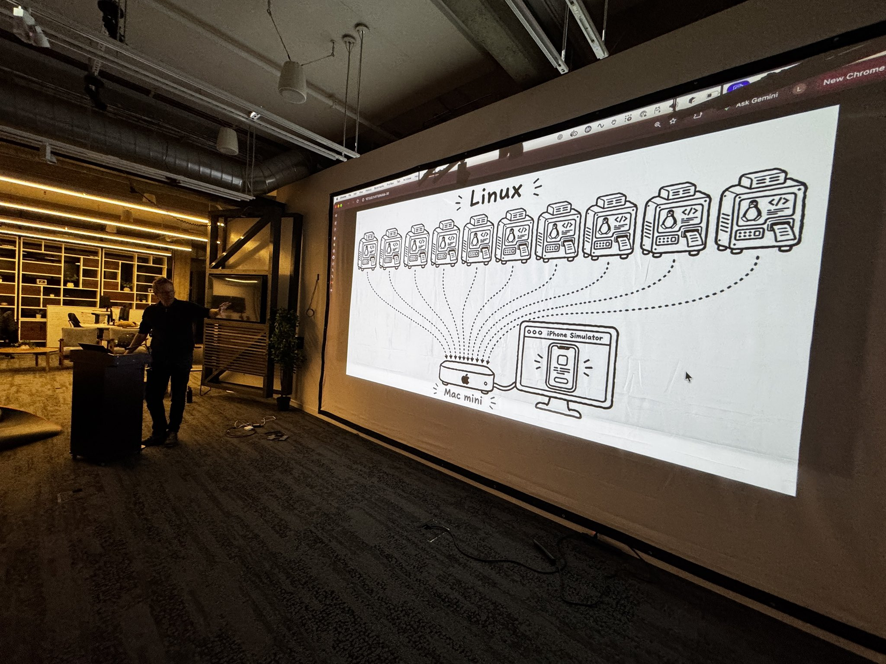
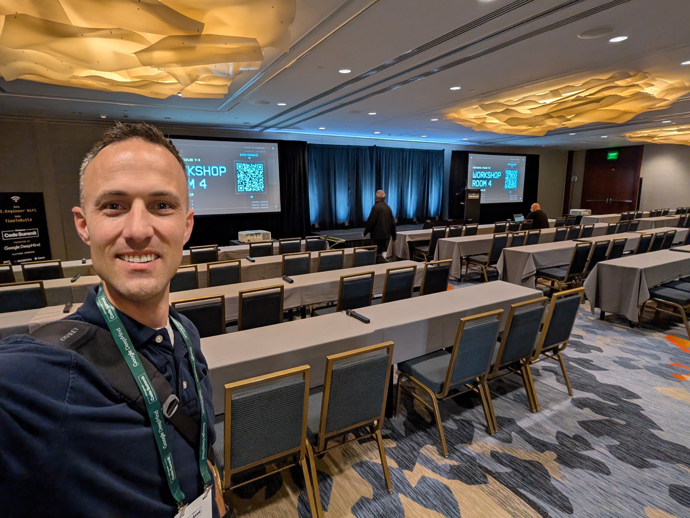
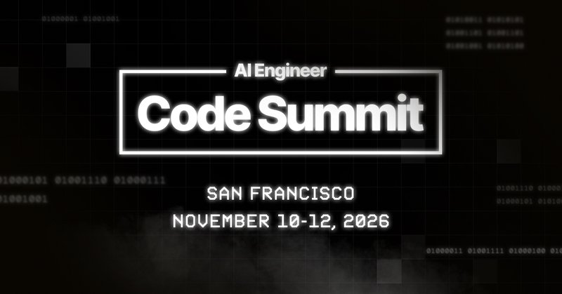

# 🐦 @swyx

## 📅 November 10, 2026

> 6 post(s) archived.

---

### 🕐 17:35 UTC · @swyx

> not kidding. scenes from the speaker rehearsal session last night. @lucasmeijer , @FabianHedin, @BuiltByJustin, and @kentcdodds made memorable splashes!! follow @aiDotEngineer for live tweeting if you are at @aiDotEngineer today DO NOT miss @lucasmeijer ‘s workshop today it is an full hour of straight gold - pragmatic, tasteful tricks, prompts, workflows, and general advice

🔗 [View original post](https://x.com/swyx/status/2120208862221684809)

---

### 🕐 17:05 UTC · @swyx

> if you are at @aiDotEngineer today DO NOT miss @lucasmeijer ‘s workshop today it is an full hour of straight gold - pragmatic, tasteful tricks, prompts, workflows, and general advice

🔗 [View original post](https://x.com/dexhorthy/status/2120201184317517903)

---

### 🕐 16:43 UTC · @swyx

> This is where I&apos;m talking about turning your codebase on autopilot. See you at @aiDotEngineer at 11:40!

🔗 [View original post](https://x.com/kentcdodds/status/2120195574934990901)

---

### 🕐 16:12 UTC · @swyx

> https://ai.engineer/associates for new creator associates

🔗 [View original post](https://x.com/swyx/status/2120187893465718878)

---

### 🕐 16:09 UTC · @swyx

> last call for creator associates covering/livetweeting aie code! also if you’re here - the talks and workshops start in an hour! see https://aie.sc for the schedule (im in my domainmaxxing era) Media ok i was signed in to wrong account to tweet this but yes - if you&apos;re looking to get a start with technical writing/speaking/tweeting/blogging, the new Creator associate program is made for you... ... just like I got started in my own technical writing journey 10 years ago.

🔗 [View original post](https://x.com/swyx/status/2120187167901372559)

---

### 🕐 03:10 UTC · @swyx

> signups https://ai.engineer/code/2026/associates for new media creators

🔗 [View original post](https://x.com/swyx/status/2119990961459921395)

---
