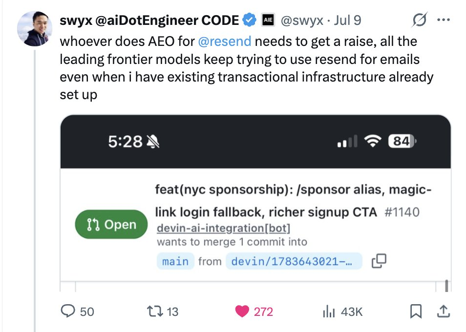
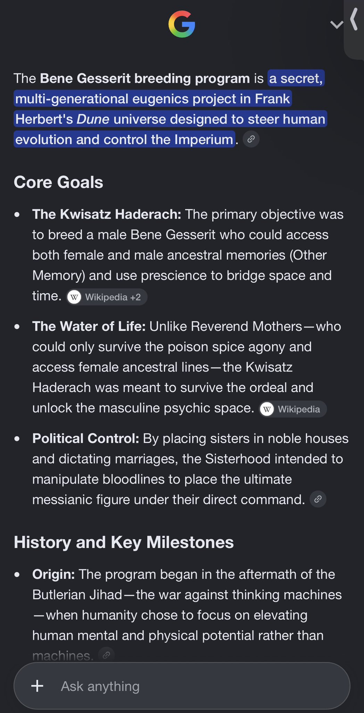
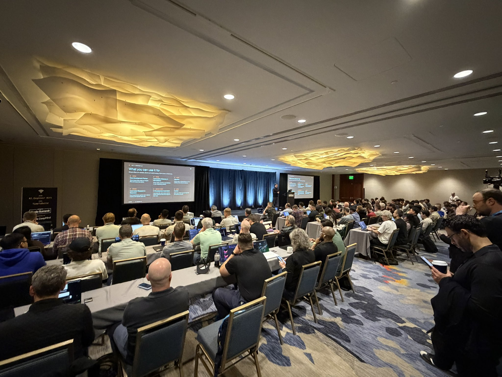

# 🐦 @swyx

## 📅 November 10, 2026

> 11 post(s) archived.

---

### 🕐 21:00 UTC · @swyx

> I finally asked @zenorocha, the CEO of AEO, why tf my agents keep choosing Resend even when I don&apos;t want them to 🆕 Designing for Agents Agent Experience is one of the most hotly contested topics of 2026, and increasingly critical for devtools/infra companies to get right. @ZenoRocha has been writing and thinking about this since 2024 and came on the pod to spill @Resend secrets! https://y…

🔗 [View original post](https://x.com/swyx/status/2120260228902264872)

---

### 🕐 20:55 UTC · @swyx

> prediction: tech jesus in 10,000 years I have one question… actually, a LOT of questions. 😭

🔗 [View original post](https://x.com/swyx/status/2120259002324140192)

---

### 🕐 20:25 UTC · @swyx

> 🆕 Designing for Agents Agent Experience is one of the most hotly contested topics of 2026, and increasingly critical for devtools/infra companies to get right. @ZenoRocha has been writing and thinking about this since 2024 and came on the pod to spill @Resend secrets! https://youtu.be/bdIoODXsu8k Key themes include: - Answer Engine Optimization (AEO): how AI models like Claude Code recommend email services and how product teams can design for these agents - Deliverability and Trust: The discussion delves into the complexities of getting mail into the inbox, including handling bursts, managing Gmail throttling, and the importance of domain reputation and anti-abuse measures - Developer Experience &amp; MCP: A major focus is on building for both humans and machines. Resend utilizes the Model Context Protocol (MCP) to provide agents with over 80 named tools, allowing them to autonomously set up accounts, check pricing in Markdown, and send emails - Technical Infrastructure: React Email as a wedge for adoption and but Resend&apos;s commitment to owning the mail stack, including managing complex DNS hurdles and providing enterprise-level visibility

🔗 [View original post](https://x.com/latentspacepod/status/2120251400831816068)

---

### 🕐 19:43 UTC · @swyx

> &quot;If you&apos;re coding locally, stop. You really need to be coding with a cloud agent.&quot; notes of @adamwathan and @ScottWu46 in this one My @aiDotEngineer talk is live. This is how we build with agents at @HelloUntangle https://youtu.be/BTtyguoPvBU?si=m_vQcpWI4mMcOdd2 Been great iterating fast on this with @DaleSpoonemore and @DevinAI

🔗 [View original post](https://x.com/swyx/status/2120241063193706960)

---

### 🕐 18:22 UTC · @swyx

> packed house for @ross_cefalu ‘s walk through of my favorite new @factory feature - Workstreams - letting an orchestrator manage a swarm of agents + scheduled automations and integrations to do massive, long horizon stuff (Also cool - workstreams is the product substrate we’re landing a ton of cool ideas from @humanlayer_dev into in the next few weeks, and it’s crazy how accidentally aligned me and @0xblacklight were with @EnoReyes and @matanSF )

🔗 [View original post](https://x.com/dexhorthy/status/2120220674543476800)

---

### 🕐 17:35 UTC · @swyx

> not kidding. scenes from the speaker rehearsal session last night. @lucasmeijer , @FabianHedin, @BuiltByJustin, and @kentcdodds made memorable splashes!! follow @aiDotEngineer for live tweeting if you are at @aiDotEngineer today DO NOT miss @lucasmeijer ‘s workshop today it is an full hour of straight gold - pragmatic, tasteful tricks, prompts, workflows, and general advice

🔗 [View original post](https://x.com/swyx/status/2120208862221684809)

---

### 🕐 17:05 UTC · @swyx

> if you are at @aiDotEngineer today DO NOT miss @lucasmeijer ‘s workshop today it is an full hour of straight gold - pragmatic, tasteful tricks, prompts, workflows, and general advice

🔗 [View original post](https://x.com/dexhorthy/status/2120201184317517903)

---

### 🕐 16:43 UTC · @swyx

> This is where I&apos;m talking about turning your codebase on autopilot. See you at @aiDotEngineer at 11:40!

🔗 [View original post](https://x.com/kentcdodds/status/2120195574934990901)

---

### 🕐 16:12 UTC · @swyx

> https://ai.engineer/associates for new creator associates

🔗 [View original post](https://x.com/swyx/status/2120187893465718878)

---

### 🕐 16:09 UTC · @swyx

> last call for creator associates covering/livetweeting aie code! also if you’re here - the talks and workshops start in an hour! see https://aie.sc for the schedule (im in my domainmaxxing era) Media ok i was signed in to wrong account to tweet this but yes - if you&apos;re looking to get a start with technical writing/speaking/tweeting/blogging, the new Creator associate program is made for you... ... just like I got started in my own technical writing journey 10 years ago.

🔗 [View original post](https://x.com/swyx/status/2120187167901372559)

---

### 🕐 03:10 UTC · @swyx

> signups https://ai.engineer/code/2026/associates for new media creators

🔗 [View original post](https://x.com/swyx/status/2119990961459921395)

---
