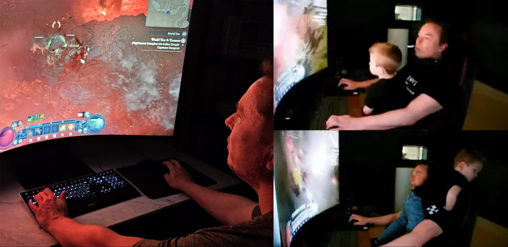
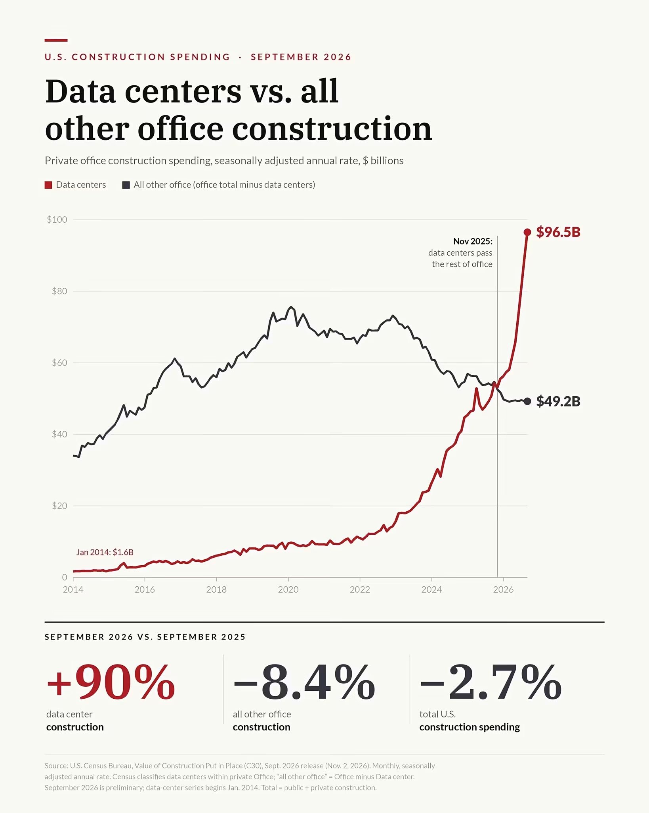

# 🐦 @tunguz

## 📅 November 10, 2026

> 11 post(s) archived.

---

### 🕐 18:16 UTC · @tunguz

> Both Gemini and ChatGPT are BSing me way too much rn. Overstating what they&apos;ve accomplished, taking way too many shortcuts and behind the scenes hacks. I&apos;m wasting way too many tokens on that crap. Not good. 😡

🔗 [View original post](https://x.com/tunguz/status/2120218980342448253)

---

### 🕐 18:13 UTC · @tunguz

> oof 🤦‍♂️ Now in beta: Businesses in ChatGPT. Claim your business, manage your information, and get insights on how people engage with you. Eligible businesses can also build a Business Agent to answer customers’ questions and help them explore what you offer. https://openai.com/index/int…

🔗 [View original post](https://x.com/tunguz/status/2120218360348819841)

---

### 🕐 17:36 UTC · @tunguz

> Best founders I backed had no hobbies. Only one obsession — the company.

🔗 [View original post](https://x.com/tunguz/status/2120209033626001788)

---

### 🕐 16:55 UTC · @tunguz

> It’s parabolic.

🔗 [View original post](https://x.com/tunguz/status/2120198778615706068)

---

### 🕐 16:06 UTC · @tunguz

> PSA

🔗 [View original post](https://x.com/tunguz/status/2120186450591244474)

---

### 🕐 15:44 UTC · @tunguz

> Nature is artificial.

🔗 [View original post](https://x.com/tunguz/status/2120180837048270899)

---

### 🕐 14:11 UTC · @tunguz

> Thanks to AI we finally have actually funny Seinfeld. This is AI Seinfeld perfection

🔗 [View original post](https://x.com/tunguz/status/2120157406814752970)

---

### 🕐 14:06 UTC · @tunguz

> This is so disturbing on so many levels. This was not a one-shot It was a two-shot I told Fable 5.2 to make the video of it&apos;s dreams, and 9 hours later:

🔗 [View original post](https://x.com/tunguz/status/2120156266408628518)

---

### 🕐 02:28 UTC · @tunguz

> Digital technology was a mistake.

🔗 [View original post](https://x.com/tunguz/status/2119980584328143139)

---

### 🕐 01:04 UTC · @tunguz

> … delenda est E&apos; ufficiale: la Russia oggi è messa peggio dell&apos;URSS. La situazione dei conti è di molto peggiore alla fine dell&apos;era sovietica, quando l&apos;URSS stava per cadere. Ma a conti fatti la situazione è ancora più grave, e di molto, perché l&apos;URSS all&apos;epoca non comprendeva solo la Russia …

🔗 [View original post](https://x.com/tunguz/status/2119959375594864964)

---

### 🕐 01:02 UTC · @tunguz

> I was there. My one and only GTC. I gave two presentations. And then quit NVIDIA a few weeks later. The Jensen news has me harking back to March 2024. At the packed SAP Center in San Jose, California, I was watching Huang give his keynote at Nvidia’s GTC developer conference — the first in-person GTC in five years and the first held in a venue that big. Wearing his signature b…

🔗 [View original post](https://x.com/tunguz/status/2119958940696154513)

---
