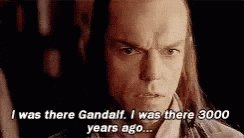

# 🐦 @tunguz

## 📅 November 10, 2026

> 2 post(s) archived.

---

### 🕐 01:04 UTC · @tunguz

> … delenda est E&apos; ufficiale: la Russia oggi è messa peggio dell&apos;URSS. La situazione dei conti è di molto peggiore alla fine dell&apos;era sovietica, quando l&apos;URSS stava per cadere. Ma a conti fatti la situazione è ancora più grave, e di molto, perché l&apos;URSS all&apos;epoca non comprendeva solo la Russia …

🔗 [View original post](https://x.com/tunguz/status/2119959375594864964)

---

### 🕐 01:02 UTC · @tunguz

> I was there. My one and only GTC. I gave two presentations. And then quit NVIDIA a few weeks later. The Jensen news has me harking back to March 2024. At the packed SAP Center in San Jose, California, I was watching Huang give his keynote at Nvidia’s GTC developer conference — the first in-person GTC in five years and the first held in a venue that big. Wearing his signature b…

🔗 [View original post](https://x.com/tunguz/status/2119958940696154513)

---
