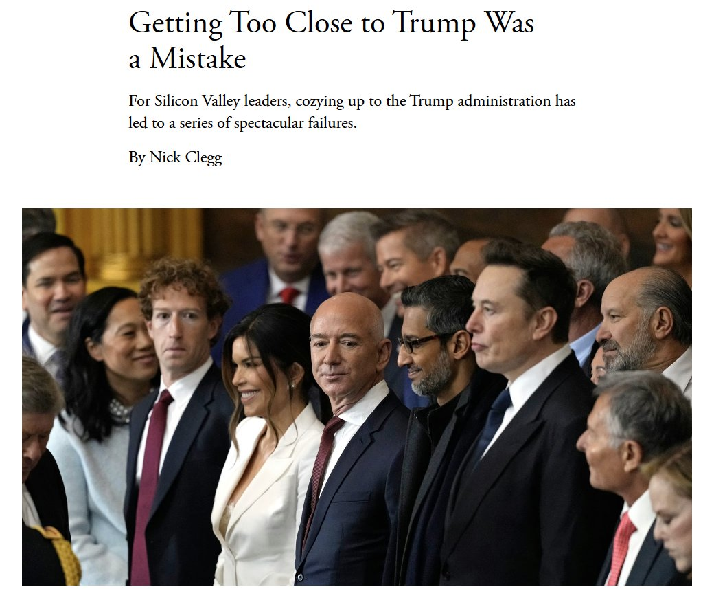
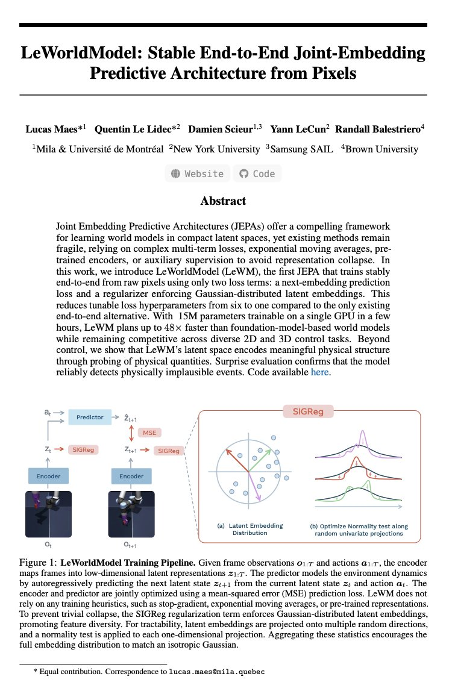

# 🐦 @ylecun

## 📅 November 10, 2026

> 4 post(s) archived.

---

### 🕐 16:25 UTC · @ylecun

> Getting too close to Trump was a mistake – how could Silicon Valley have gotten (US) / got (UK) it so wrong? Read the full article: https://www.theatlantic.com/ideas/2026/11/silicon-valley-trump-administration/689360/?gift=-B584Urg77e7aK197zZB-vvjCjNBVVHxJwTp1woUNLI&amp;utm_source=copy-link&amp;utm_medium=social&amp;utm_campaign=share

🔗 [View original post](https://x.com/nickclegg/status/2120191140259418604)

---

### 🕐 13:59 UTC · @ylecun

> @ylecun @TimDarcet @gabriberton in a nutshell Media

🔗 [View original post](https://x.com/jbhuang0604/status/2120154494915006672)

---

### 🕐 03:34 UTC · @ylecun

> Elon Musk’s $500 million couldn’t swing the midterms for Republicans in Congress when all they did was sit in their hands as Trump corruptly served himself. https://trib.al/w90Ks3l

🔗 [View original post](https://x.com/KenRoth/status/2119997061579858180)

---

### 🕐 01:44 UTC · @ylecun

> Yann LeCun was right the entire time. And generative AI might be a dead end. LeCun has argued that generating every pixel spends too much compute on details instead of learning how the world works. His alternative is JEPA, short for Joint-Embedding Predictive Architecture. It predicts what happens next using compressed representations, rather than recreating an image pixel by pixel. One challenge is “representation collapse”: different inputs end up with nearly identical representations, leaving the model with little useful information. Researchers behind LeWorldModel, or LeWM, use a mathematical regularizer to help prevent this. It encourages those representations to follow a Gaussian distribution, simplifying the training setup. LeWM has 15 million parameters and trains on one GPU in a few hours. The researchers report planning up to 48× faster than the foundation world models they compared against. Their experiments also demonstrate physical prediction and detection of impossible events. That does not establish complete understanding of physics or prove generative AI is a dead end. It shows that a small model can learn useful patterns for prediction and planning without generating every pixel.

🔗 [View original post](https://x.com/simplifyinAI/status/2119969401180942564)

---
