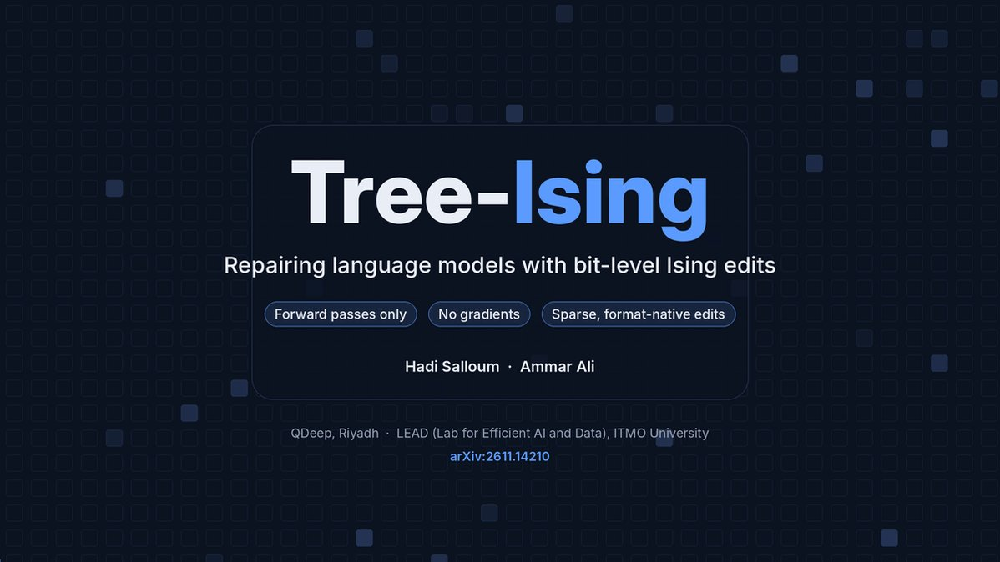

# 🐦 @_akhaliq

## 📅 November 11, 2026

> 4 post(s) archived.

---

### 🕐 20:09 UTC · @_akhaliq

> World In-Context Learning for Agentic Robot Manipulation paper: https://huggingface.co/papers/2611.12885 Media

🔗 [View original post](https://x.com/_akhaliq/status/2120609882663780777)

---

### 🕐 14:41 UTC · @_akhaliq

> I made Lisa Simpson copy my face in real time using 2-step Minimax-H3-Image &amp; Jev!😜 &gt; Every frame is a fresh generation from MiniMax-H3-Image with the 2-step pDMD LoRA (~3s each) &gt; Facial expression detected by Jev from @typesafeai. Made this in like 30 mins on my way home :) a looooot of fun stuffs will going to happen with all these super fast models! Media MiniMax-H3-Image in 2 steps, realtime pDMD LoRA on MiniMax&apos;s 33B image model realtime editing on ZeroGPU LoRA + one-file ComfyUI checkpoint: https://huggingface.co/akhaliq/minimax-h3-image-pdmd-2step app: https://huggingface.co/spaces/akhaliq/minimax-h3-image-2step

🔗 [View original post](https://x.com/whensdeyi/status/2120527444692308171)

---

### 🕐 12:10 UTC · @_akhaliq

> Tree-Ising: repairing LLMs with bit-level Ising edits This method fixes model weights by solving sparse discrete optimization problems on bit patterns, outperforming frontier-agent weight editing with just 4 forward passes and zero extra tokens.

🔗 [View original post](https://x.com/HuggingPapers/status/2120489355034649079)

---

### 🕐 08:19 UTC · @_akhaliq

> Meet Nod, your own open-source personal agent from n8n Labs Ask it to prep your calls, collect invoices or cancel a subscription It runs on your computer with its own browser to get the job done across apps and websites, using the AI provider you choose👇 Media

🔗 [View original post](https://x.com/n8n_io/status/2120431328458076315)

---
