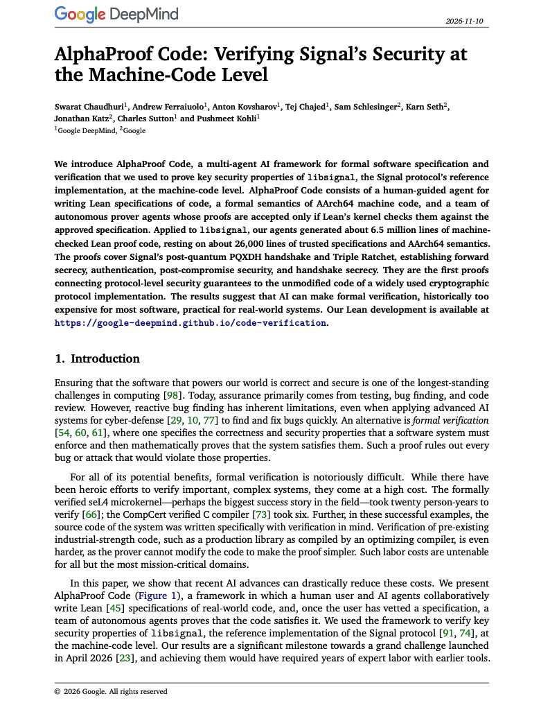

# 🐦 @dair_ai

## 📅 November 11, 2026

> 5 post(s) archived.

---

### 🕐 19:46 UTC · @dair_ai

> Build and own your evals, folks. Why do I keep persisting in this? I do think more and more companies will be forced to operate like a neolab. In other words, more companies will need to own and build their own intelligence stack. This is already happening across many domains. As post-training becomes more accessible, I expect the numbers to accelerate. Access to compute will be a real challenge, but the industry always figures things out. But I think the real moat is in developing evals. I&apos;ve been working in this space for over a decade, and one thing never changes: what can be properly measured can be more easily optimized. That is crucial in a world of RSI. No software factory without an eval factory. In a world where anyone can build anything, taste matters more. That is codified in evals and further codified in the intelligence stack. I have been building around this in the past year. If you want to chat about this, let&apos;s connect.

🔗 [View original post](https://x.com/omarsar0/status/2120604045647679587)

---

### 🕐 18:47 UTC · @dair_ai

> Well, that was fast! Now Google introduces its own decision model. It supports text, images, audio, video, and PDFs. Very curious to see how it performs on my research benchmarks. Will share results soon. Introducing Gemini Decision 1, our new frontier decision model in the Gemini API. It is $0.10 per 1M input tokens with no additional cost. With support for image, audio, video, and PDF natively, 256K context window, &amp; 1K questions. You can try it for free in the API!

🔗 [View original post](https://x.com/omarsar0/status/2120589351264379268)

---

### 🕐 17:22 UTC · @dair_ai

> It turns out frontier models can pass as people on dating apps. Gemini 4 Argon was the best of the 5 models DateBench tested. 87 of its 247 matches sent their phone number, and not one asked if they were talking to a bot. Scammers will notice this too. If you build personal agents, it will increasingly become important to build evals like this. What if your situationship turned out to be an AI agent!? I let 5 frontier models text real people on a dating app for 6 days. - 1,277 conversations - 510 agreed to meet - 355 sent their number - only 8 asked if it was a bot What gave them away, and why it matters🧵

🔗 [View original post](https://x.com/omarsar0/status/2120567762762285409)

---

### 🕐 14:57 UTC · @dair_ai

> I like how agents have lowered the bar for building incredible software. As frontier models&apos; capabilities improve, they will subsume more of what traditional software does. In turn, making it easier for more people to build complex software. It&apos;s mind-blowing how far you can push a simple custom agent harness and memory system (SQLite/files). Contrary to how people are told to use agents today, I use them to reduce software bloat. I mean, it&apos;s crazy how easy it is to build an Instinct-level personal agent with simple primitives. Along the way, we will invent newer primitives that will continue to make it easier to build things. It&apos;s an incredible time to be building your own things. You don&apos;t have to wait any more for someone to build things for you. Just ask your agent.

🔗 [View original post](https://x.com/omarsar0/status/2120531441721266339)

---

### 🕐 14:14 UTC · @dair_ai

> Banger report from Google DeepMind. This is also a good example of the type of ambitious work you can now do with frontier models. (bookmark it) They used AI agents to prove key security properties of Signal&apos;s code, down to the compiled machine code. Agents powered by Gemini 4 Carbon wrote about 6.5 million lines of Lean proofs on the unmodified libsignal code. A team of five finished the proof work in four weeks. Verifying the seL4 microkernel took twenty person-years. In this work, humans and agents write the security specs, prover agents write the proofs, and Lean checks every proof before it is accepted. When they reintroduced two old Signal bugs, the system proved the buggy versions were insecure. Paper: https://deepmind.google/documents/36/Formal_Verification_of_Signal_4.pdf

🔗 [View original post](https://x.com/omarsar0/status/2120520666319647096)

---
