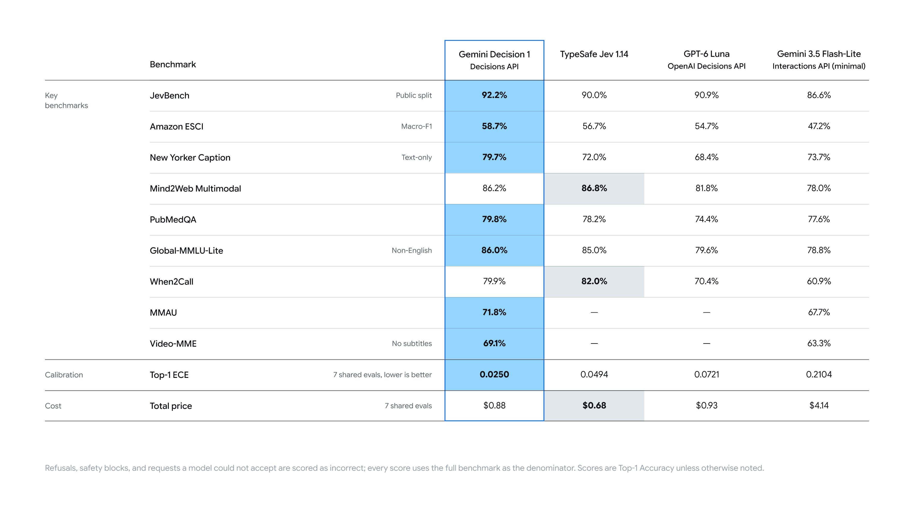

# 🐦 @demishassabis

## 📅 November 11, 2026

> 4 post(s) archived.

---

### 🕐 19:51 UTC · @demishassabis

> Ok. Carbon is *really* good at code.

🔗 [View original post](https://x.com/martin_casado/status/2120605476341891261)

---

### 🕐 18:16 UTC · @demishassabis

> Introducing Gemini Decision 1, our new frontier decision model in the Gemini API. It is $0.10 per 1M input tokens with no additional cost. With support for image, audio, video, and PDF natively, 256K context window, &amp; 1K questions. You can try it for free in the API!

🔗 [View original post](https://x.com/OfficialLoganK/status/2120581433639198885)

---

### 🕐 17:57 UTC · @demishassabis

> i think i like carbon more than fable

🔗 [View original post](https://x.com/willcb/status/2120576632771780834)

---

### 🕐 17:12 UTC · @demishassabis

> Super proud to announce AlphaGenome 2 - our new DNA sequence model! 🧬 It predicts the impact of DNA variants in different specific cell types - unlocking crucial information for understanding complex diseases. Available for academic research via our API: https://www.alphagenomedocs.com/ Your heart, brain, and immune system share the same DNA sequence. So how can a single-letter change affect disease in some cells, while sparing the rest? AlphaGenome 2 is our new AI model that zooms in on specific cells to help scientists understand what drives disease. 🧵

🔗 [View original post](https://x.com/demishassabis/status/2120565316619284734)

---
