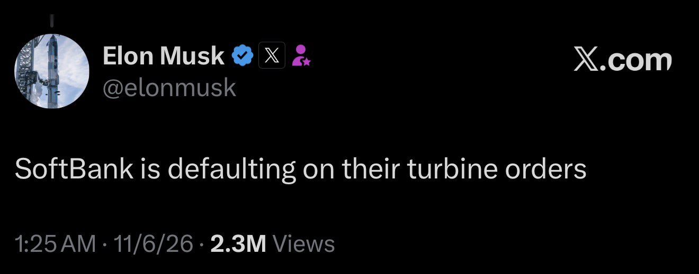

# 🐦 @elonmusk

## 📅 November 11, 2026

> 2 post(s) archived.

---

### 🕐 08:25 UTC · @elonmusk

> Portable, lightning-fast Internet that works anywhere on Earth where Starlink is legal! Introducing Mini 2, the next-generation portable Starlink. Get up to 4.5 hours of connectivity on a single charge with the quick-swap battery, or plug in with USB-C. With built-in Wi-Fi, all you need is a clear view of the sky to get online in 60 seconds. Preorders are now open …

🔗 [View original post](https://x.com/elonmusk/status/2120432718639145404)

---

### 🕐 02:26 UTC · @elonmusk

> Taps the sign Masayoshi Son’s SoftBank reserved enough gas turbines to generate the power of six Hoover Dams. It cost the company billions of dollars in losses. https://on.wsj.com/4AkINFX

🔗 [View original post](https://x.com/KatieMiller/status/2120342384445898866)

---
