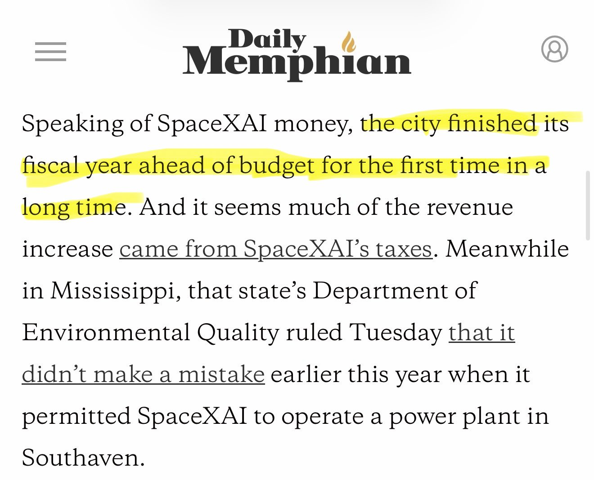
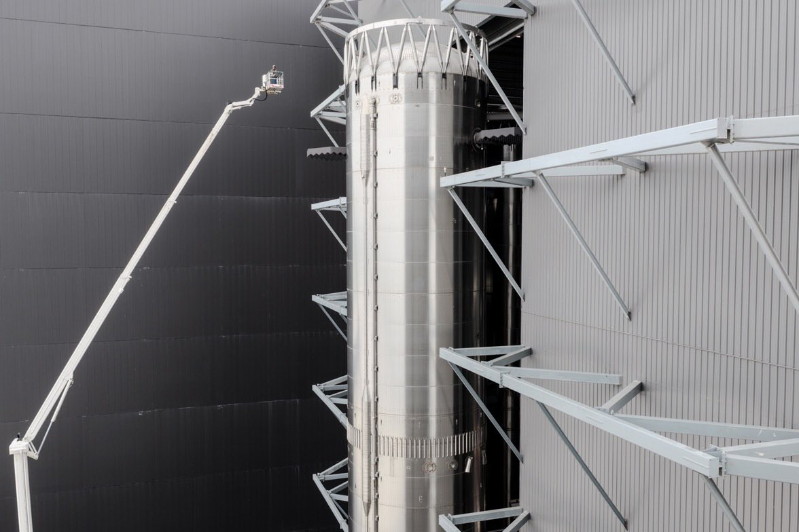
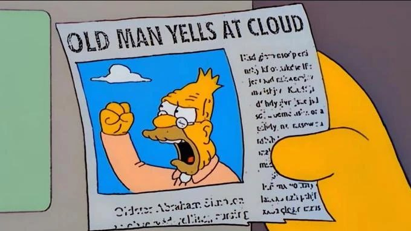

# 🐦 @elonmusk

## 📅 November 11, 2026

> 12 post(s) archived.

---

### 🕐 20:40 UTC · @elonmusk

> Thanks to @elonmusk &amp; @SpaceX, the City of Memphis finished its Fiscal Year ahead of budget for the first time in a long time. The City is tracking roughly $5.6 million ahead for the current year. Memphis Mayor Paul Young said this week that SpaceX generated $54 million in taxes for the City and County this year.

🔗 [View original post](https://x.com/KatieMiller/status/2120617686887801175)

---

### 🕐 20:22 UTC · @elonmusk

> @TheFlintFace @IterIntellectus 100GW in space is roughly equal to 800GW on Earth. Moreover, solar on Earth must be paired with massive batteries to continue powering compute at night and supplemented with combustion or nuclear power during winter. These are not the same at all.

🔗 [View original post](https://x.com/elonmusk/status/2120613240707420280)

---

### 🕐 18:58 UTC · @elonmusk

> Person for scale

🔗 [View original post](https://x.com/elonmusk/status/2120591950961353125)

---

### 🕐 18:52 UTC · @elonmusk

> Starship Super Heavy rocket booster moved to launch pad Super Heavy moved to the launch pad at Starbase. Booster 22 is the first Super Heavy V3 booster planned to return to the launch site for catch and was used for final catch testing upon arrival, including a suspended squeeze test at catch height

🔗 [View original post](https://x.com/elonmusk/status/2120590521253126183)

---

### 🕐 18:30 UTC · @elonmusk

> Introducing Grok Bot 1.0. Bots can be shared and are more collaborative and capable than ever. Media

🔗 [View original post](https://x.com/SpaceXSI/status/2120584928983441826)

---

### 🕐 18:28 UTC · @elonmusk

> Hire Grok @Bot as a colleague and give it your hardest tasks! Introducing Grok Bot 1.0. AI teammates that work alongside your whole team. Share Bots, collaborate with them in Slack and Teams, invite them to meetings, and watch them learn and become more helpful.

🔗 [View original post](https://x.com/elonmusk/status/2120584535423565889)

---

### 🕐 18:22 UTC · @elonmusk

> Bernie is the meme You might not want to take Bernie too seriously on tech issues.

🔗 [View original post](https://x.com/elonmusk/status/2120582866413514912)

---

### 🕐 17:32 UTC · @elonmusk

> This is not the smartest move from a profit-maximizing standpoint btw, but there must be some room in this world for sentimentality or what’s the point?

🔗 [View original post](https://x.com/elonmusk/status/2120570459335131606)

---

### 🕐 17:11 UTC · @elonmusk

> Tesla self-driving now approved in Finland Now approved in Finland 🇫🇮 Rollout begins soon

🔗 [View original post](https://x.com/elonmusk/status/2120565179276832797)

---

### 🕐 17:11 UTC · @elonmusk

> In order to work through more of the Cybertruck order backlog, production will be extended through the end of summer 2027

🔗 [View original post](https://x.com/elonmusk/status/2120565056429814073)

---

### 🕐 08:25 UTC · @elonmusk

> Portable, lightning-fast Internet that works anywhere on Earth where Starlink is legal! Introducing Mini 2, the next-generation portable Starlink. Get up to 4.5 hours of connectivity on a single charge with the quick-swap battery, or plug in with USB-C. With built-in Wi-Fi, all you need is a clear view of the sky to get online in 60 seconds. Preorders are now open …

🔗 [View original post](https://x.com/elonmusk/status/2120432718639145404)

---

### 🕐 02:26 UTC · @elonmusk

> Taps the sign Masayoshi Son’s SoftBank reserved enough gas turbines to generate the power of six Hoover Dams. It cost the company billions of dollars in losses. https://on.wsj.com/4AkINFX

🔗 [View original post](https://x.com/KatieMiller/status/2120342384445898866)

---
