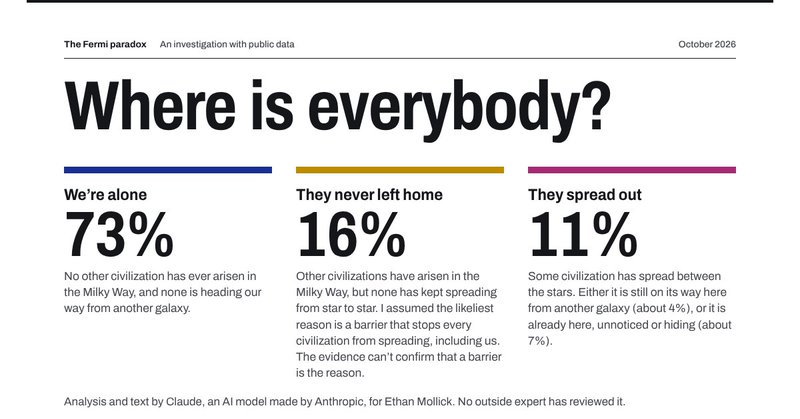

# 🐦 @emollick

## 📅 November 11, 2026

> 2 post(s) archived.

---

### 🕐 03:34 UTC · @emollick

> Gemini 4 Carbon: https://resolving-the-great-silence.netlify.app/

🔗 [View original post](https://x.com/emollick/status/2120359382739505170)

---

### 🕐 03:33 UTC · @emollick

> I asked Fable 5.2 &amp; Gemini Carbon to &quot;Solve the Fermi Paradox. Marshal data, test hypotheses, pressure test them against critics, give me likely answers if you cant get a definite conclusion&quot; They did not solve it, but did do interesting stuff. Fable 5.2 https://where-is-everybody-fermi.netlify.app/

🔗 [View original post](https://x.com/emollick/status/2120359214157603139)

---
