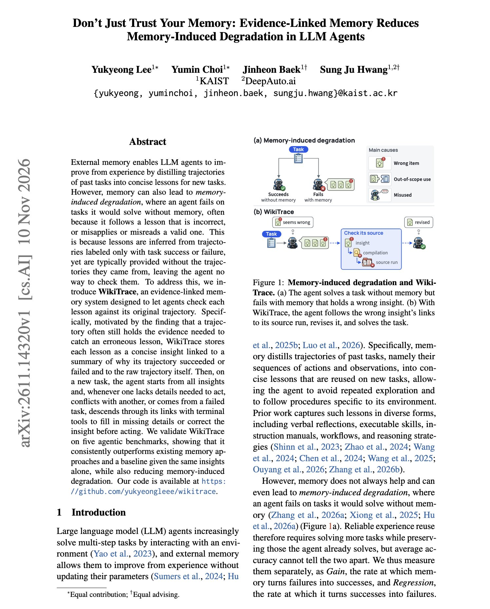

# 🐦 @omarsar0

## 📅 November 11, 2026

> 7 post(s) archived.

---

### 🕐 22:04 UTC · @omarsar0

> Highly recommended read. This is a topic I have been researching and writing about recently. The way we use agent memory in harnesses today works, but mostly for simple, one-off, and general tasks. For more novel, complex, and domain-specific tasks, you will often find that current harness and memory systems don&apos;t generalize so well. So the big question is: how can we encode continual learning capabilities in models and harnesses? This is where the idea of co-evolving harnesses and models begins to make sense. This work, along with the benchmark (Continual-ARC), provides an interesting analysis of this. The harness is not just for steering the model and providing tools and context; it is increasingly becoming a key part of training pipelines to unlock continual learning in models. The harness continues to be important, but it can remain minimal and efficient. OpenClaw, Hermes Agent and Prime Agent don&apos;t meaningfully learn from experience. On Continual-ARC, our new benchmark at @letsunifyai, none of them were able to memorize anything of value and none were able to generalize to new tasks. Training a small 9B model&apos;s weights did both.

🔗 [View original post](https://x.com/omarsar0/status/2120638750740844672)

---

### 🕐 20:44 UTC · @omarsar0

> Recommended read. They find that increasingly intelligent models are harder to monitor through their CoT. Lots of things remain unanswered, but this is a nice setup for studying how and where this emerges. (1/10) Today, we’re sharing new research from @OpenAI: How does CoT monitorability (no-CoT capability and CoT controllability) evolve over the model training lifecycle? We emerged with unsurprising but sobering findings: as we scale toward more intelligent systems, models are be…

🔗 [View original post](https://x.com/omarsar0/status/2120618625568526500)

---

### 🕐 18:24 UTC · @omarsar0

> Coding agents got their own environment. Phones are next. Blue gives an agent the whole phone. It runs its own OS, so it can use any of your apps in the background. Ask once, like filing an expense report, and it handles it while you get on with your day. We switched 10 people from iPhone to Blue. Weeks later, none of them want their iPhone back. Introducing Blue: a phone you just talk to. Tell it what you need, and it gets done. It has all the context, can use every single app, and even triages your notifications. We built it fo…

🔗 [View original post](https://x.com/omarsar0/status/2120583435484057912)

---

### 🕐 17:28 UTC · @omarsar0

> Creative control is still one of the biggest challenges in AI video generation. Intangible is approaching this with a real 3D scene underneath every generation, letting creators position objects, move cameras, and render multiple shots without rebuilding the entire scene. Its new Canvas can turn a written brief into a 3D set with cameras, references, images, and video. It also lets you make changes to the underlying scene so they carry across different shots. This could be an important step toward making AI useful for actual film production. Today, excited to launch Intangible 2.0. Finally, one AI studio for image, video and 3D models. 🚀 It&apos;s an ambitious leap to translate the idea in your head onto a screen. Whether you&apos;re an aspiring Spielberg or a founder building a new product, it&apos;ll help you tell your story. T…

🔗 [View original post](https://x.com/omarsar0/status/2120569275366728138)

---

### 🕐 16:35 UTC · @omarsar0

> A dictation benchmark should help someone choose a tool, not require them to become a speech researcher first. The useful starting question is what they need the tool to write. For a coding workflow, exact technical terms matter. For messages and emails, preserving the intended meaning through restarts and corrections matters. A product can produce fluent text and still fail the task if it changes the detail the user needed to communicate. @voicearena_ai&apos;s Dictation Bench is organized around seven use-case categories rather than one generic passage. It also separates the frequency of drafts needing a correction from the total volume of character edits, and shows examples that make those differences understandable. If I were choosing a tool, I would use that evidence to build a shortlist, then test it on my own speech. Latency, privacy, and workflow fit would still matter, but I would start with a clearer picture of output quality. That is the practical significance of a thorough evaluation: it makes a real decision less dependent on a polished demo. The research matters because it helps answer a question people already need to resolve. Drop 4/15: Announcing the Voice Arena Dictation Bench - the first open benchmark of AI dictation apps. Not their APIs: the real apps. We played 761 recordings from 87 speakers into each of 10 apps on a Mac, then 5 LLM judges asked if each draft could be sent as-is. Wispr Flow: 7…

🔗 [View original post](https://x.com/omarsar0/status/2120555957025386975)

---

### 🕐 14:25 UTC · @omarsar0

> Interesting insights about agent memory. Might be worth a read if you are building memory systems for your agents. Can an agent&apos;s memory make it fail tasks it would solve without memory? KAIST researchers find that it can, and they call it memory-induced degradation. The cause is how lessons are stored. They infer lessons from runs labeled only as success or failure, then save them without the run itself. When a lesson is wrong, the agent has no way to verify it. The authors introduce WikiTrace, which stores each lesson as a short insight linked to a summary of why the run succeeded or failed and to the raw trajectory. When an insight is vague, conflicts with another, or comes from a failed run, the agent follows the links with terminal tools before acting. Across ALFWorld, ScienceWorld, PlanCraft, AppWorld, and tau3-bench retail, it scores 10.7 points above the agent without memory on average and 3.2 points above the same insights alone. The failure rate for previously solvable tasks drops from 6.5% to 4.5%. https://arxiv.org/abs/2611.14320 Chat with Paper: https://academy.dair.ai/papers/dont-just-trust-your-memory-evidence-linked-memory-reduces-memory-induced-degrad-2611.14320

🔗 [View original post](https://x.com/dair_ai/status/2120523196072161401)

---

### 🕐 12:54 UTC · @omarsar0

> Own your personal agent, folks! Nod is a new open-source personal agent from n8n Labs. It&apos;s Apache 2.0, runs on your Mac, Windows PC, or your own server, and uses the AI provider you choose. It has its own computer and browser, so it can do jobs across your apps and websites. Meet Nod, your own open-source personal agent from n8n Labs Ask it to prep your calls, collect invoices or cancel a subscription It runs on your computer with its own browser to get the job done across apps and websites, using the AI provider you choose👇

🔗 [View original post](https://x.com/omarsar0/status/2120500412763742329)

---
