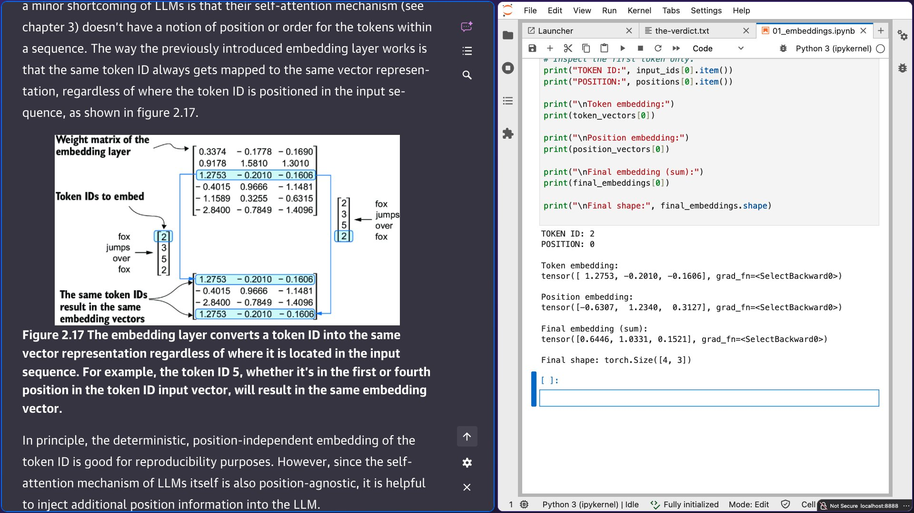

# 🐦 @rasbt

## 📅 November 11, 2026

> 2 post(s) archived.

---

### 🕐 18:47 UTC · @rasbt

> i&apos;ve never learned as much as when building things from scratch. currently working through build a large language model by @rasbt, and it&apos;s one of the best ways i&apos;ve found to actually understand how llms work. still struggling to visualize all those dimensions.

🔗 [View original post](https://x.com/brianrey_x/status/2120589317575954770)

---

### 🕐 14:09 UTC · @rasbt

> Hillclimbing: Make the model better (best intentions). Benchmarking: Measure how much better (best effort). Benchmaxxing: Make the numbers look better (best optics). We gotta have a conversation about hill climbing vs benchmarking vs benchmaxxing

🔗 [View original post](https://x.com/rasbt/status/2120519373999816955)

---
