# 🐦 @swyx

## 📅 November 11, 2026

> 18 post(s) archived.

---

### 🕐 23:17 UTC · @swyx

> “Software is gonna be so fucking back.” .@CompleteSkeptic is full of bangers and you will have to listen to his full talk at @aiDotEngineer, but for now, here is our top-10 of his pearls: 1“We’ve been announcing AGI three months away for two years now.” Meanwhile, go outside San Francisco and a lot of the world looks unchanged. Where the fuck is all the automation? 2“You get Einstein 95% of the time, but Mr. Bean 5% of the time.” And if you can’t tell which is which, how are you supposed to automate anything? 3“I do believe RLHF is part of the problem.” His complaint: we optimized models for assistance, with a human checking the result, and then expected them to reliably do work on their own. 4“The bitterest lesson is doing the right task.” Diogo thinks that compute matters more than algorithms, data matters more than compute, and choosing the right task matters most. You get what you optimize for. 5“I think the world still has LLM Stockholm Syndrome.” We keep designing around the limitations of today’s models. Why is the best we can come up with still the same software, cheaper to write, with a chatbot on the side? 6“What if we can program with common sense, with intention, with human understanding?” Very passionate talk! He suggests: put intelligence into the software’s inner loop. What could we build if understanding intent became a building block we could actually rely on? 7“Real fucking engineering by people who care a lot about the end result.” Break tasks down, build stages you can verify, and actually manage state. Why should every agent rediscover the same codebase patterns over and over? 8“There’s an asymmetric advantage for people who are, like, bad actors and don’t give a shit.” That’s his explanation for slop: unreliable output is much easier to tolerate when everyone else pays the cost of reading, checking, and filtering it. 9“I call this software research. That’s not a joke.” Explore what software could become, including weird things with no obvious business case. Build something because you can. Maybe one percent of those ideas leads to something awesome. There is going to be SaaSopalooza! (I don’t know how to write this word but you got me) 10“Software is gonna be so fucking back.” The future he wants is one where “can we automate this?” becomes “how much work will it take?”

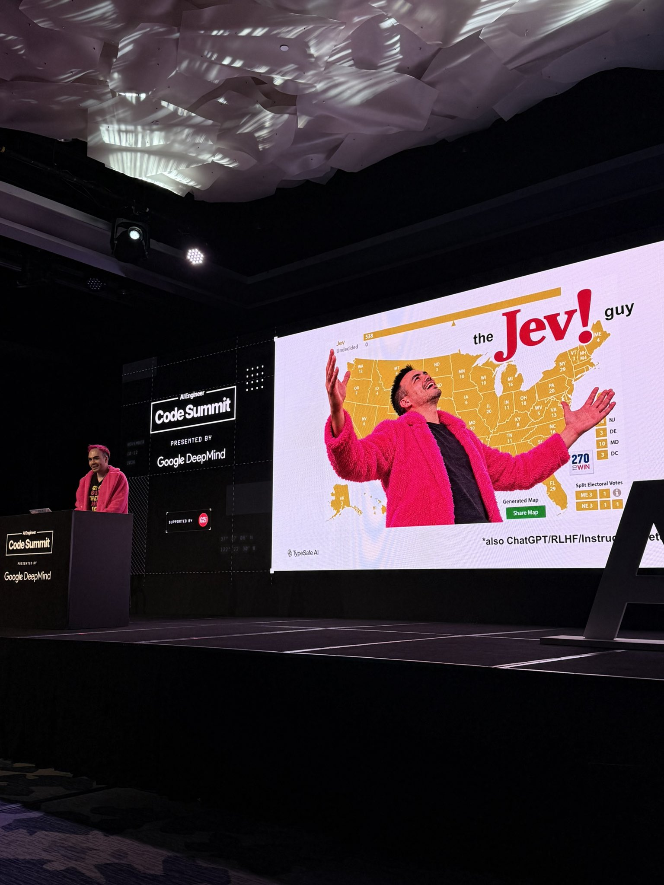

🔗 [View original post](https://x.com/TheTuringPost/status/2120657299249533135)

---

### 🕐 22:12 UTC · @swyx

> this person is a real former employee that we parted ways with that email domain is not one we use TIL you can report phishing directly from gmail using the three dot menu warning to other fans of @swyx this email account is trying to fake-book folks on podcasts, likely as a scheduling-link phishing scam. ty friend for fielding my &quot;this looks sus&quot; text 😎

🔗 [View original post](https://x.com/swyx/status/2120640864787841513)

---

### 🕐 22:11 UTC · @swyx

> next on stream - @CompleteSkeptic and @typesafeai take over for Jev Day! standing room only for @poteto’s keynote

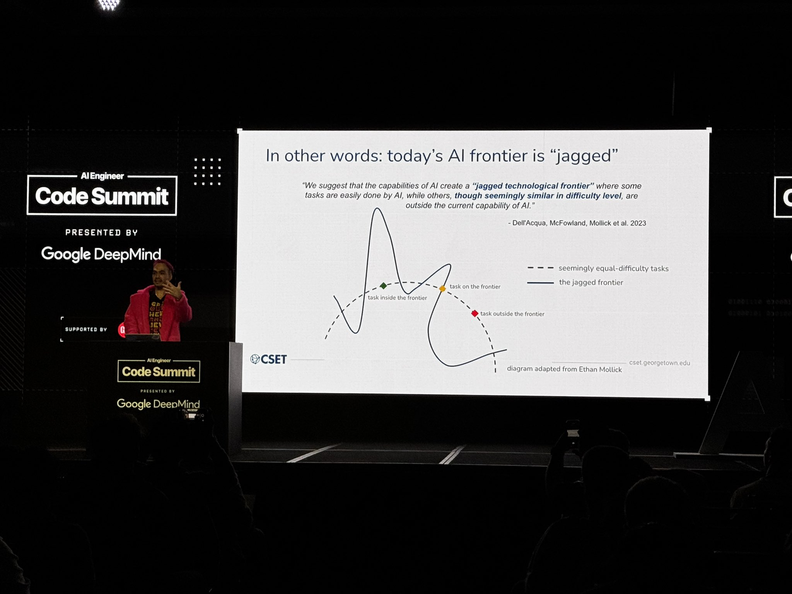

🔗 [View original post](https://x.com/swyx/status/2120640558184206508)

---

### 🕐 20:53 UTC · @swyx

> Swyx gave me the “closing keynote” of AIE code, aka everyone is tired or flying out so if you’re not one of those please come to mine tomorrow at 5pm it’s called “the sweet side of the bitter lesson”

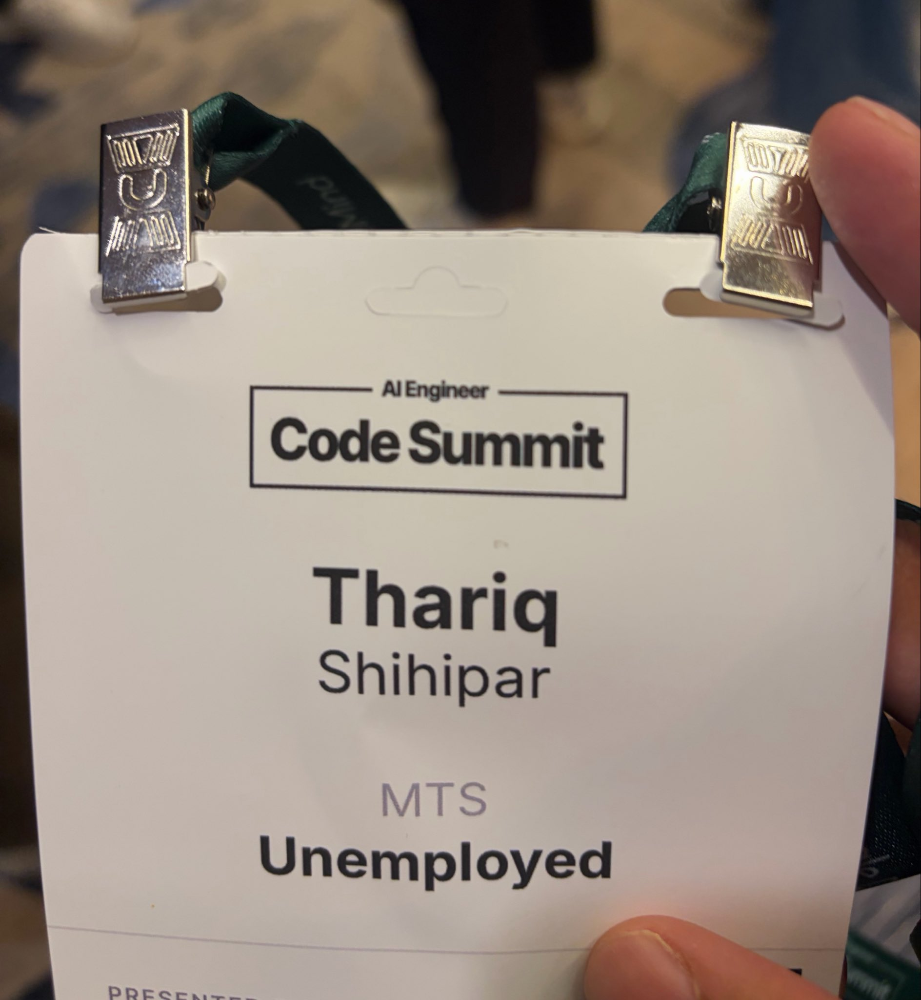

🔗 [View original post](https://x.com/trq212/status/2120620900785820143)

---

### 🕐 18:19 UTC · @swyx

> standing room only for @poteto’s keynote going live in 10mins! https://www.youtube.com/watch?v=ZZ19zhYnDKY

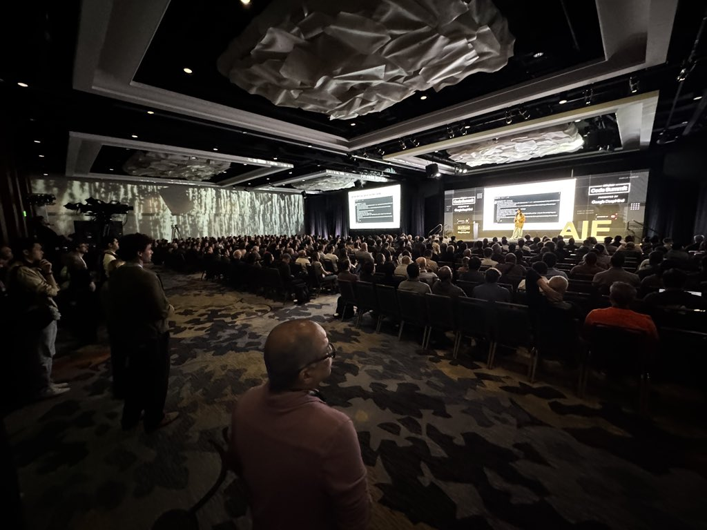

🔗 [View original post](https://x.com/swyx/status/2120582147107078356)

---

### 🕐 17:32 UTC · @swyx

> @swyx amazing episode with @joinHandshake. Really practical behind the scenes look at the data industry and I think there’s a lot of gold in here. Go listen if you have a few mins today https://share.snipd.com/episode/9bc342b0-fe16-440a-ac60-35b86106db93

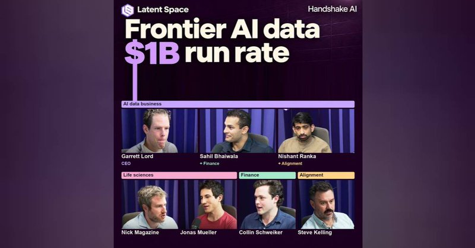

🔗 [View original post](https://x.com/DBredvick/status/2120570469157920830)

---

### 🕐 17:24 UTC · @swyx

> These awesome ladies are killing it at @aiDotEngineer code! 👩‍💻 IIRC this is the first all female keynote start at AIE? @swyx ? Back to back: @nserrino - 10X inference @lydiahallie - @claudeai best practices @michellechen - Cloudflare being a neolab @poteto - poteto poteto The Code Summit livestream starts in 30 minutes. @nserrino (@gimletlabs) on 10x faster AI. @lydiahallie (@AnthropicAI) on Claude Code best practices. 9 AM PT. Watch free: https://www.youtube.com/live/ZZ19zhYnDKY Presented by @GoogleDeepMind.

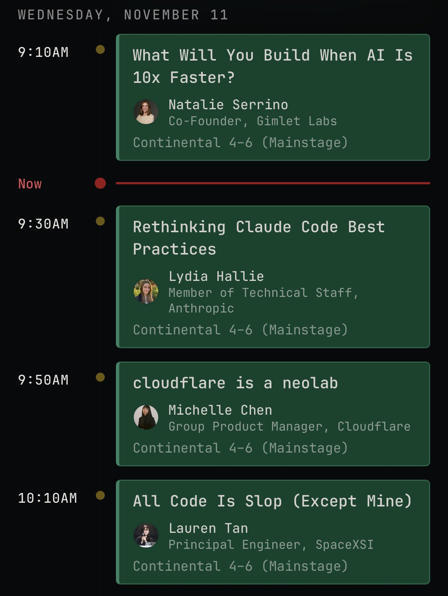

🔗 [View original post](https://x.com/altryne/status/2120568343480713360)

---

### 🕐 17:20 UTC · @swyx

> https://www.youtube.com/live/ZZ19zhYnDKY

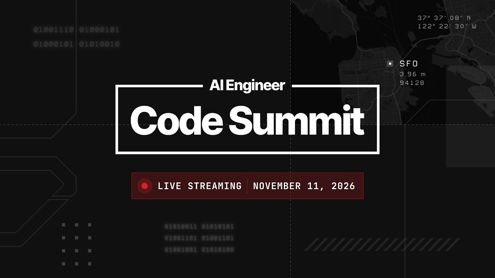

🔗 [View original post](https://x.com/swyx/status/2120567361355042957)

---

### 🕐 17:00 UTC · @swyx

> livestream starting now!! Media Media The Code Summit livestream starts in 30 minutes. @nserrino (@gimletlabs) on 10x faster AI. @lydiahallie (@AnthropicAI) on Claude Code best practices. 9 AM PT. Watch free: https://www.youtube.com/live/ZZ19zhYnDKY Presented by @GoogleDeepMind.

🔗 [View original post](https://x.com/swyx/status/2120562425015791625)

---

### 🕐 16:36 UTC · @swyx

> Come see @NinaLopatina and I at Build Lab @aiDotEngineer Code to one shot a Slack Agent or Web Wpp and compete for prizes (mac mini, GPU, beats headphones) We are also doing talks starting at 1:15pm this afternoon on how our factories that power build lab work, see you there!

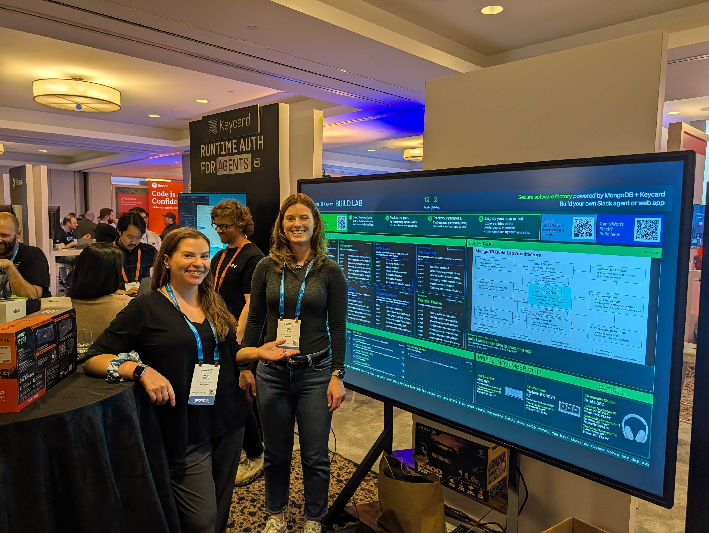

🔗 [View original post](https://x.com/vtahowe/status/2120556274790420635)

---

### 🕐 10:41 UTC · @swyx

> https://www.youtube.com/watch?v=ZZ19zhYnDKY

🔗 [View original post](https://x.com/swyx/status/2120466878812536971)

---

### 🕐 04:41 UTC · @swyx

> this is my engines thread https://x.com/joshpxyne/status/2120207063624327602?s=46 The internet is dead. We’ve raised $35M total funding led by Khosla and Hanabi to bring it to life. @coframe is a growth engine for your website/ads/more which tests, personalizes, &amp; learns 24/7. It’s working. Dropbox increased conversion by 158%. Replit, 410%. Cash App, 60%.

🔗 [View original post](https://x.com/swyx/status/2120376333142569316)

---

### 🕐 04:27 UTC · @swyx

> i had a preview of his keynote and you guys don’t know what youre in for in thursday. literally had to agree to embargo to get this talk on board (it is not the full story) tune in to the aie live stream 9am-6pm tmr and thursday!! I can&apos;t believe so few of you follow Melvin... He&apos;s the VP of post training here in Google DeepMind. He&apos;s very active internally making things happen, and a wonderful human who listens to everyone.

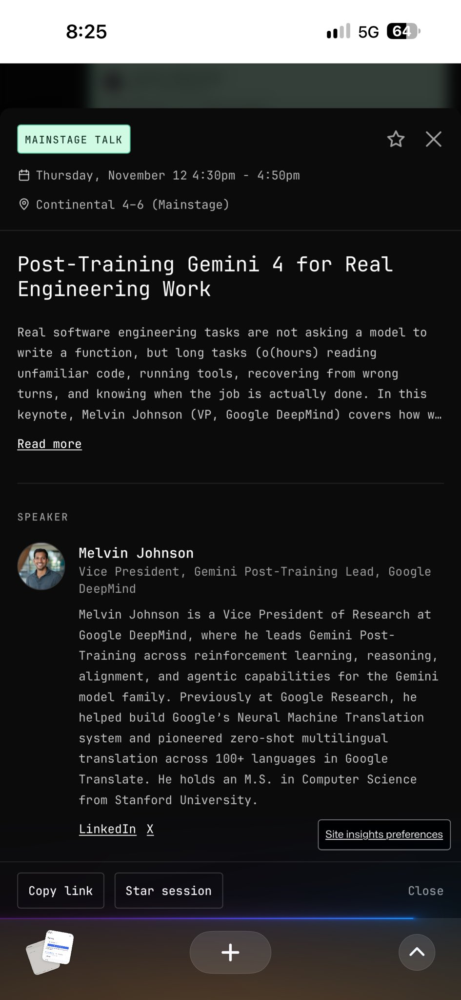

🔗 [View original post](https://x.com/swyx/status/2120372817720197357)

---

### 🕐 04:00 UTC · @swyx

> Appreciate everyone who showed up to my talk on Local AI at AIE Code today

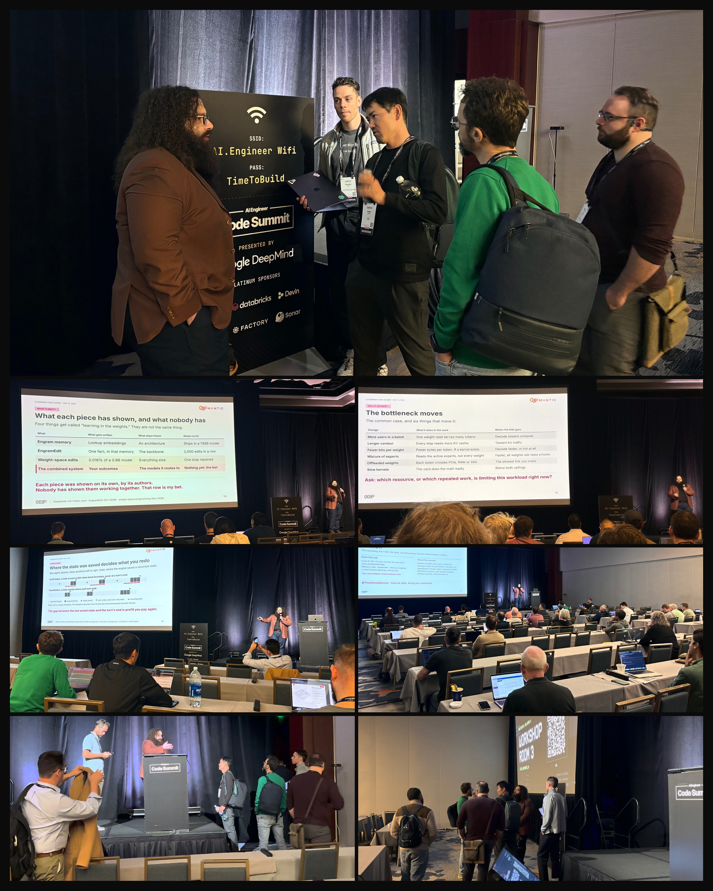

🔗 [View original post](https://x.com/TheAhmadOsman/status/2120366089788076073)

---

### 🕐 03:05 UTC · @swyx

> Early vibes at AIE are dope! Excited for tomorrow! As always an incredible group of folks, and knuckleheads @aiDotEngineer

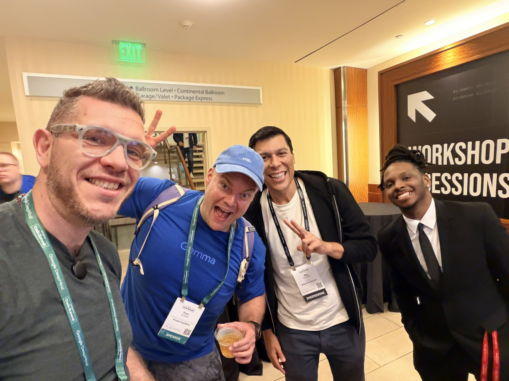

🔗 [View original post](https://x.com/altryne/status/2120352142603243697)

---

### 🕐 01:46 UTC · @swyx

> Super cool stickers @swyx !!!

🔗 [View original post](https://x.com/TheTuringPost/status/2120332228060422269)

---

### 🕐 01:35 UTC · @swyx

> Hot AGI pilled at @aiDotEngineer ! Say hi if you are here! And if you are not watch all the talks online - content is always incredible

🔗 [View original post](https://x.com/TheTuringPost/status/2120329613180338336)

---

### 🕐 00:37 UTC · @swyx

> Just arrived at @aiDotEngineer and got my headshot taken at the @AnthropicAI booth! In case you can&apos;t make it, he&apos;s how that feels hahah! Keep a follow I&apos;ll be documenting my @aiDotEngineer journey till the live ThursdAI pod live from the floor here! Media

🔗 [View original post](https://x.com/altryne/status/2120314958902944103)

---
