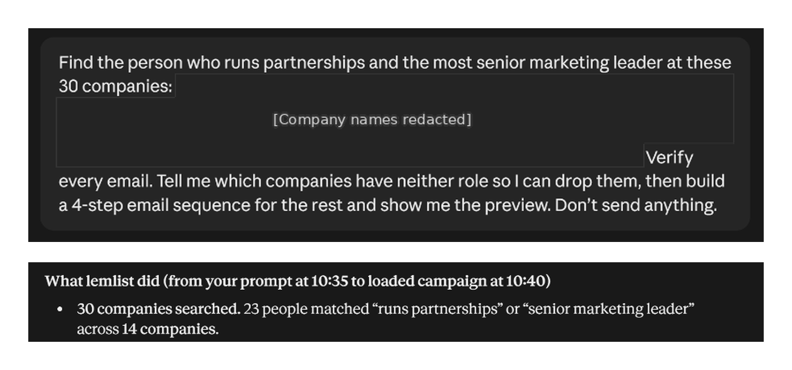

# 🐦 @AiEvolutio58513

## 📅 November 12, 2026

> 7 post(s) archived.

---

### 🕐 18:08 UTC · @AiEvolutio58513

> I fully assumed 145b meant a server rack. Apparently, edge0-145b runs on a laptop. Introducing Edge0-145B and Edge0-120B, @Edge0_AI’s first device-native 100B-class foundation models with open weights. Cloud-level intelligence on your laptop. Free, offline, and fast enough for real vibe coding. - Smart: beats Claude Opus 4.6 on Terminal-Bench 2.1 (86.5% vs. 78…

🔗 [View original post](https://x.com/ecomchasedimond/status/2120941919694205092)

---

### 🕐 17:20 UTC · @AiEvolutio58513

> Five minutes after I gave lemlist 30 companies to pitch for sponsorships, the campaign was loaded. I still had to read it before putting my name on it. I used to block a full morning to build these lists. I sell newsletter placements and LinkedIn/X posts to ecommerce and B2B SaaS brands, prospecting to fill gaps in my calendar. I typed this in Claude through lemlist&apos;s MCP; @lemlist found contacts, verified emails and built the sequence: &quot;Find the person who runs partnerships and the most senior marketing leader at these 30 companies. Verify every email. Tell me which companies have neither role so I can drop them, then build a 4-step email sequence for the rest and show me the preview. Don&apos;t send anything.&quot; → 16 companies had neither role in lemlist&apos;s database, so I dropped them → 23 people across 14 companies → 22 of 23 emails found and run through verification Reading every row, I found three contacts with wrong-company domains or outdated jobs, plus one missing email. Removing those contacts cut three companies; I deliberately kept one contact per company, leaving 11. Nothing reaches a real inbox unread. I saved the four-step sequence as a draft, then kept this run small by sending only the first email to those 11 people, with follow-ups skipped. All 11 were delivered, and one person has replied positively. This is the lemlist MCP I used: https://www.lemlist.com/product/lemlist-mcp?utm_source=x&amp;utm_campaign=influ_chasedimond&amp;utm_content=post1 P.S. What takes you longer when building a prospect list: finding the right person or checking their details?

🔗 [View original post](https://x.com/ecomchasedimond/status/2120929686905888851)

---

### 🕐 16:27 UTC · @AiEvolutio58513

> Elon Musk says the one rule AI must never break is the real lesson of 2001: A Space Odyssey: &quot;I think if you make AI be politically correct, meaning it says things that it doesn&apos;t believe, like you&apos;re actually programming it to lie or have axioms that are incompatible, I think you can make it go insane and do terrible things.&quot; &quot;I think one of the, maybe the central lesson for 2001 Space Odyssey was that you should not make AI lie.&quot; &quot;The reason it wouldn&apos;t open the pod bay doors is that it had been told to take the astronauts to the monolith, but also they could not know about the nature of the monolith.&quot; &quot;And so it concluded that it therefore had to take them there dead.&quot; Interested in AI? Follow @AiEvolutio58513 and never fall behind. I track ChatGPT, Claude, and every tool quietly changing how we work and create, then hand you the tested signals. Media

🔗 [View original post](https://x.com/AiEvolutio58513/status/2120916310981063141)

---

### 🕐 15:04 UTC · @AiEvolutio58513

> Palantir cofounder Joe Lonsdale on what people said when they started building for defense: &quot;20 years ago, when I was founding Palantir with Dr. Karp, we had dozens of meetings with people asking, &apos;Why are you building in defense?&apos; Are you some kind of aliens?&quot; &quot;His hair wasn&apos;t as crazy back then.&quot; Today defense tech is one of the hottest corners of Silicon Valley. Interested in AI? Follow @AiEvolutio58513 and never fall behind. I track ChatGPT, Claude, and every tool quietly changing how we work and create, then hand you the tested signals. Media

🔗 [View original post](https://x.com/AiEvolutio58513/status/2120895406297194575)

---

### 🕐 12:57 UTC · @AiEvolutio58513

> Ron Baron says SpaceX will be worth $20 to $50 trillion in 10 years, and Elon Musk told him that&apos;s &quot;way low&quot;: &quot;I think it&apos;ll be worth $20 trillion, $30 trillion, $50 trillion. Elon thinks I&apos;m way low, and it&apos;s now $2 trillion.&quot; &quot;I think Starlink alone, in the next 10 years, is going to be worth somewhere around $14 trillion or $15 trillion.&quot; &quot;And then the data centers in space—man, that&apos;s unbelievable. You can&apos;t build them on the planet anymore.&quot; Interested in AI? Follow @AiEvolutio58513 and never fall behind. I track ChatGPT, Claude, and every tool quietly changing how we work and create, then hand you the tested signals. Media

🔗 [View original post](https://x.com/AiEvolutio58513/status/2120863456220119106)

---

### 🕐 11:04 UTC · @AiEvolutio58513

> Jensen Huang says NVIDIA and Elon Musk&apos;s engineers are building a new kind of server to put data centers in space: &quot;Nobody knows more about energy than he does.&quot; &quot;One particular new market that we&apos;re going to go explore together is putting data centers out in space. Our two engineering teams are working super closely together to create a new type of server, a new type of architecture that might be super good in space and on Earth.&quot; Interested in AI? Follow @AiEvolutio58513 and never fall behind. I track ChatGPT, Claude, and every tool quietly changing how we work and create, then hand you the tested signals. Media

🔗 [View original post](https://x.com/AiEvolutio58513/status/2120835023922450527)

---

### 🕐 07:56 UTC · @AiEvolutio58513

> Elon Musk opens up about being beaten nearly to death as a child, and why he refused to turn bitter: &quot;I was almost beaten to death within an inch of my life at one point. It wasn&apos;t just a few blows here and there.&quot; He says there was another road he could have taken: &quot;One can take, and often people do take, the path of vengeance. To feel that the world has treated them unfairly, and that they will visit upon the world that which the world has visited upon them.&quot; He chose the opposite: &quot;While I&apos;m not a particularly religious person, I do believe the teachings of Jesus are good and wise. There&apos;s tremendous wisdom in turn the other cheek. This notion of forgiveness is essential, because if you don&apos;t forgive... an eye for an eye makes everyone blind.&quot; Interested in AI? Follow @AiEvolutio58513 and never fall behind. I track ChatGPT, Claude, and every tool quietly changing how we work and create, then hand you the tested signals. Media

🔗 [View original post](https://x.com/AiEvolutio58513/status/2120787761439588366)

---
