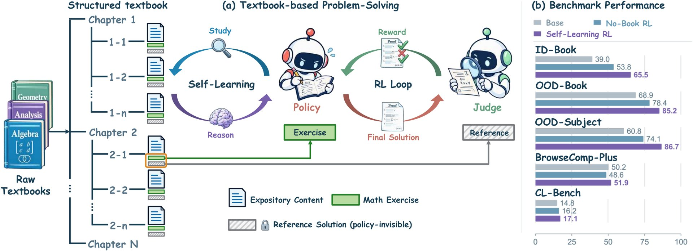
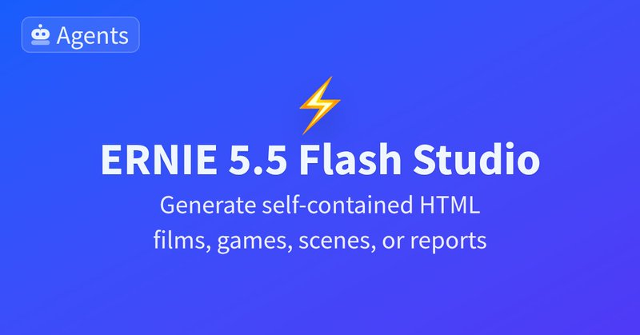

# 🐦 @_akhaliq

## 📅 November 12, 2026

> 7 post(s) archived.

---

### 🕐 16:08 UTC · @_akhaliq

> Teaching LLMs to self-learn from textbooks RL framework with fine-grained rewards autonomously retrieves, studies, and applies knowledge from long-form references, raising proof accuracy from 51.5% to 79.5%.

🔗 [View original post](https://x.com/HuggingPapers/status/2120911649905193266)

---

### 🕐 16:00 UTC · @_akhaliq

> Your laptop isn&apos;t built for running agents. Introducing @instabox_sh: cloud computers for AI agents. We provide multi-OS sandboxes (Linux, Android, Mac, Windows) with GPU and CPU. We launched in beta &lt;1 month ago, and today, users have created 1M+ boxes. Give agents their own cloud computers so they don&apos;t fight over the same memory, CPU, and ports on your laptop. Close your laptop, and they keep working. Get started today → http://instabox.sh Media

🔗 [View original post](https://x.com/hanghuang_/status/2120909505290756137)

---

### 🕐 15:41 UTC · @_akhaliq

> 2,000,000,000 PCs sit on people&apos;s desks today. The next billion computers? They’ll be autonomous computers, driven by agents. Introducing box by @Simular: one computer for ChatGPT, Claude, Codex, Gemini, DeepSeek and all your other agents. With box, agents open apps, run the terminal, fill in forms, and stay signed in for whatever tasks come next. Media

🔗 [View original post](https://x.com/SimularAI/status/2120904821373096408)

---

### 🕐 14:51 UTC · @_akhaliq

> MOSS-Image-SFT with @_akhaliq’s 4-step LoRA generating an image in 7.02s on an iPhone 18 Pro Max. Media MOSS-Image-SFT in just 4 steps. ⚡ @_akhaliq &apos;s community distillation has reached 16.5K+ downloads on Hugging Face. Thanks for building and sharing! Try it on your own prompts ↓

🔗 [View original post](https://x.com/jeethu/status/2120892219670618567)

---

### 🕐 12:10 UTC · @_akhaliq

> SteerDistill: Quantizing LLM agents without losing their skills A frozen BF16 teacher steers the quantized student through its failures, refining guidance until the correction passes local verification. Distilled back, the student runs alone—W4A16 scores stay within 1 point of BF16 across 3 models and 5 benchmarks. Media

🔗 [View original post](https://x.com/HuggingPapers/status/2120851723564761469)

---

### 🕐 11:50 UTC · @_akhaliq

> Ernie 5.5 flash preview https://huggingface.co/spaces/akhaliq/ernie-5.5-flash-preview

🔗 [View original post](https://x.com/_akhaliq/status/2120846711908364596)

---

### 🕐 05:24 UTC · @_akhaliq

> VoxMel Wavelet-Factorized Autoregressive Mel-Spectrogram Modeling for Zero-Shot Speech Synthesis models: https://huggingface.co/VoxDance-Lab Media

🔗 [View original post](https://x.com/_akhaliq/status/2120749548851368358)

---
