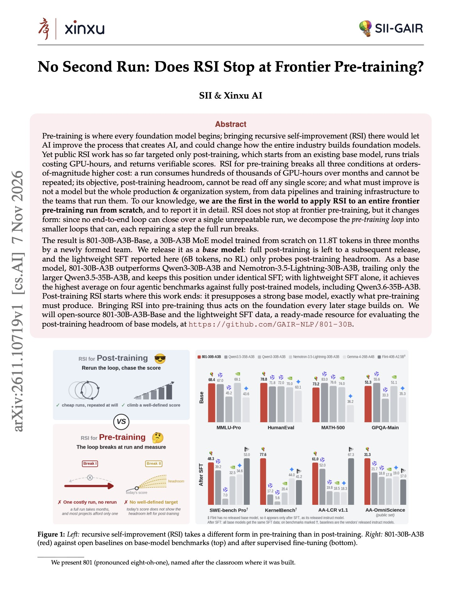
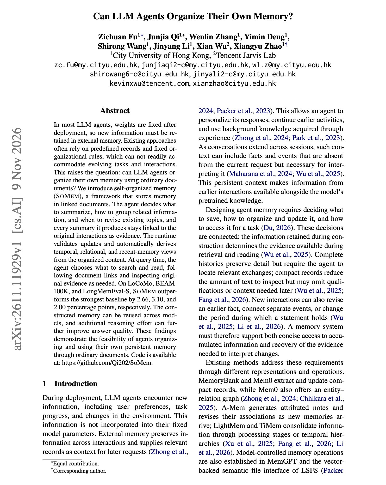

# 🐦 @dair_ai

## 📅 November 12, 2026

> 2 post(s) archived.

---

### 🕐 15:16 UTC · @dair_ai

> Recursive self-improvement is one of the most discussed ideas in AI right now. Banger paper on RSI for frontier pre-training. They claim to be the first in the world to apply RSI to an entire frontier pre-training run from scratch. This work uses agent-driven loops on a single frontier pre-training run and produced 801-30B-A3B, an open 30B MoE base that beats Qwen3-30B-A3B and Nemotron-3.5-Lightning-30B-A3B. Pre-training is hard to improve with one big loop. A run costs hundreds of thousands of GPU-hours and happens once, and its real goal is headroom for post-training. So they split the work into smaller loops that can close. Agents debug infrastructure and data, check post-training headroom with tiny SFT runs, and turn expert judgment into metrics for data pipelines. A shared context store keeps negative results across teams. With only 6B tokens of SFT and no RL, the model had the highest average on four agentic benchmarks against fully post-trained models, including Qwen3.6-35B-A3B. https://arxiv.org/abs/2611.10719 Chat with Paper: https://academy.dair.ai/papers/no-second-run-does-rsi-stop-at-frontier-pre-training-2611.10719

🔗 [View original post](https://x.com/dair_ai/status/2120898418801525191)

---

### 🕐 14:37 UTC · @dair_ai

> Super interesting work on agent memory. (this is a must-read) It discusses whether agents can manage their own memory. If so, what would that self-organized memory look like? This is the closest implementation that I have seen to my own memory system. I mostly use linked documents with my agents, and it has been working extremely well. It works well because frontier models have gotten better at persisting external knowledge. The problem: Memory systems usually fix the schema in advance, with set record types and rules for how to group them. The solution: SoMem gives the agent ordinary linked documents instead. The agent decides what to summarize, which topics to create, and when to revise them. Every summary links back to the original interaction as evidence, and the runtime builds time, relation, and recency views on top. At question time, the agent chooses what to search and follows links to the source when it needs to check. SoMem beat the strongest baseline by 2.66 points on LoCoMo, 3.10 on BEAM-100K, and 2.00 on LongMemEval-S. Memory built by one model also worked when read by another. If your agent already reads and writes files, try letting it organize memory as linked notes before adding a vector store. https://arxiv.org/abs/2611.11929 Chat with Paper: https://academy.dair.ai/papers/can-llm-agents-organize-their-own-memory-2611.11929

🔗 [View original post](https://x.com/omarsar0/status/2120888604402815485)

---
