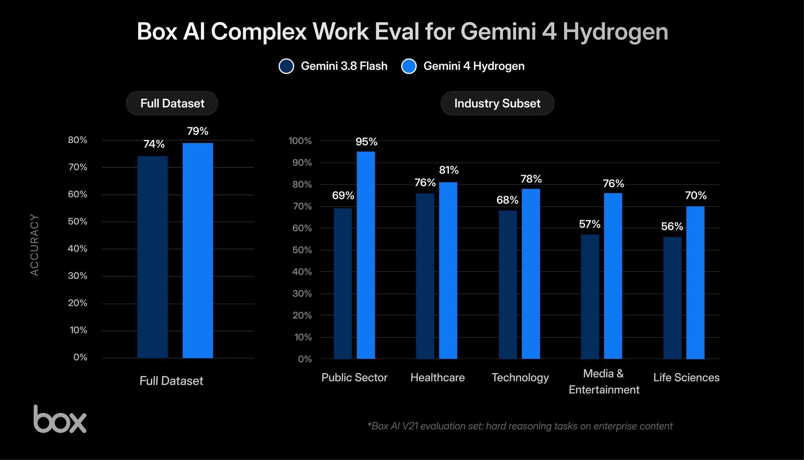
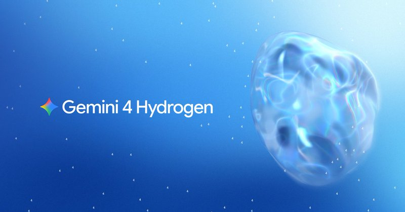

# 🐦 @demishassabis

## 📅 November 12, 2026

> 4 post(s) archived.

---

### 🕐 18:33 UTC · @demishassabis

> Ok this is a big deal. We’ve been testing Gemini 4 Hydrogen in early access with the Box AI Complex Work Eval, and it’s a serious jump for fast models. Hydrogen is 5 percentage points better in accuracy than Gemini 3.8 Flash. That alone would be a great boost in capability, but possibly more importantly it did the tasks in less than half the time with about 12% fewer tokens on a typical task. For this eval, we give the Box Agent Hydrogen as a model for a series of complex tasks that represent real world work with enterprise documents across finance, consulting, life sciences, and other industries. Hydrogen will be a great model for a lot of efficient but complex tasks across these fields. Gemini team is definitely cooking. Hydrogen will be rolling out in the Box AI Studio shortly so any customer can build a custom agent with it. Introducing Gemini 4 Hydrogen, an extremely capable and fast model built to bring Gemini 4 to everyone! Available to all tiers of Google AI Studio, Gemini API, Gemini for business, the Gemini app, Google Search, and paid Google AI Pro + Ultra subscribers in Google Antigravity.

🔗 [View original post](https://x.com/levie/status/2120947988143198302)

---

### 🕐 18:11 UTC · @demishassabis

> Very excited to release Gemini 4 Hydrogen! Incredible speed and intelligence for everyday coding, agentic work and all-round use. I think you&apos;ll love this model. More info in the blog - enjoy! https://blog.google/innovation-and-ai/models-and-research/gemini-models/introducing-gemini-4-hydrogen/ Introducing Gemini 4 Hydrogen, an extremely capable and fast model built to bring Gemini 4 to everyone! Available to all tiers of Google AI Studio, Gemini API, Gemini for business, the Gemini app, Google Search, and paid Google AI Pro + Ultra subscribers in Google Antigravity.

🔗 [View original post](https://x.com/demishassabis/status/2120942605466800374)

---

### 🕐 18:07 UTC · @demishassabis

> Glasses are one of my favourite Gemini integrations - congrats to @izadi_shahram and the team &amp; our fantastic partners! Intelligent eyewear pre-orders are officially open! ✨ I’m immensely proud and humbled working with teams at @Google, @SamsungMobile, @_GentleMonster_ and @WarbyParker to bring these beautiful eyewear collections to life. These lightweight glasses bring you hands-free help from @…

🔗 [View original post](https://x.com/demishassabis/status/2120941564000100437)

---

### 🕐 10:50 UTC · @demishassabis

> well damn google is having one of its craziest release weeks ever: nov 9 — tpu 8tx and 8i max nov 10 — gemini robotics 2.5 nov 10 — alphaproof code nov 10 — gemini 4 carbon nov 11 — gemini decision 1 nov 11 — alphagenome 2 and today we might get either Hydrogen (Flash model) or a surprise early release of Krypton which is expected to surpass Fable 5.2 Gemini

🔗 [View original post](https://x.com/haider1/status/2120831522915881379)

---
