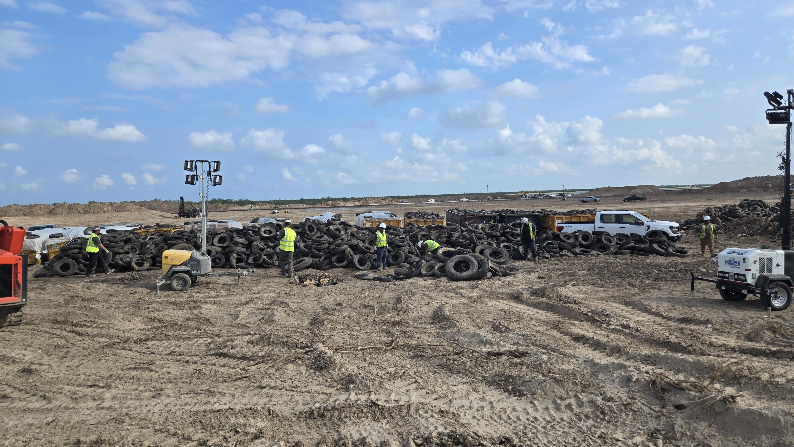

# 🐦 @elonmusk

## 📅 November 12, 2026

> 10 post(s) archived.

---

### 🕐 16:46 UTC · @elonmusk

> These are the community benefits if @SpaceX builds their planned $50 billion Arizona Supercomputing Campus: • 6,500 jobs (1,000 permanent, 5,500 construction). • Up to $103M annually in new property tax revenue. • 10-40% lower electricity bills projected for local SSVEC residential customers. • Up to $250M in one-time county sales tax revenue. • Up to $460M annually in additional benefits for Arizona electric cooperative members. • $3.6B in grid upgrades funded by SpaceX at no cost to cooperative members. • 24 GWh of battery storage to improve grid stability and reliability. • Additional solar energy to reduce strain on the local grid. • Minimal water usage, with no new wells and zero ongoing industrial water consumption projected. • Aquifer and wildlife protection, including conservation initiatives. • Reduced noise and light pollution through noise mitigation and dark-sky protections. • Support for local schools, infrastructure, businesses, and essential services. SpaceX has just unveiled a massive new $50 billion Supercomputing Campus that they want to build in Cochise County, Arizona. All info: • Up to 6 GW across the 9 supercomputing buildings • Construction starts 2027 • Size of each supercomputing building: ~493,000 square feet. • To…

🔗 [View original post](https://x.com/SawyerMerritt/status/2120921108979351607)

---

### 🕐 16:10 UTC · @elonmusk

> SpaceX community benefits SpaceX builds the infrastructure of the future. And we’re committed to making sure the communities where we build share in the benefits → https://spacex.com/updates#building-the-future

🔗 [View original post](https://x.com/elonmusk/status/2120912138772369758)

---

### 🕐 16:09 UTC · @elonmusk

> Development of the Starbase supercompute site is creating an opportunity to address decades of environmental neglect. Portions of the property were used for unauthorized dumping dating back to the 1960s. We&apos;re undertaking cleanup efforts to remove decades of accumulated debris, including scrap metal, discarded appliances, old tanks, fiberglass insulation, construction materials, and thousands of illegally dumped tires

🔗 [View original post](https://x.com/SpaceX/status/2120911969087607288)

---

### 🕐 14:31 UTC · @elonmusk

> A sad day for NVIDIA, developers, America, and all humanity. Jensen founded and ran one of the few companies to reach a massive scale while driving massive continued innovation and ubiquity, while others fell into the trap of ever-increasing extraction. Congrats to everyone at NVIDIA, and to Jensen, the man who saved GDC 2015 by launching a new GPU line at State of Unreal! 😀 Now the world’s top 2 companies operate awesome untaxed pro-developer ecosystems.

🔗 [View original post](https://x.com/TimSweeneyEpic/status/2120887322312921465)

---

### 🕐 06:10 UTC · @elonmusk

> 11 years ago 2015, Colbert: “You’re a billionaire trying to do good things. Superhero or supervillain? You have to choose one.” Elon: shows him a robot snake that plugs itself into your car Colbert: “Is that thing going to attack me in my sleep?” Elon, completely deadpan: “For the prototype,…

🔗 [View original post](https://x.com/elonmusk/status/2120761225529168312)

---

### 🕐 06:07 UTC · @elonmusk

> Chill vibes Lofi beats to self-drive to

🔗 [View original post](https://x.com/elonmusk/status/2120760435813306525)

---

### 🕐 05:59 UTC · @elonmusk

> Try Grok @Bot grok bot is the BEST AI agent orchestrator right now and THIS is the best setup i’ve EVER seen https://youtu.be/1cWZ7Ekff6E?si=YkcMxxhffksv48LX it runs claude code for engineering and paper for design here is the FULL setup and how to copy it:

🔗 [View original post](https://x.com/elonmusk/status/2120758305047904548)

---

### 🕐 05:12 UTC · @elonmusk

> Robotaxi works 168 hours a week Robotaxi now runs 24/7 Every city we&apos;re available in

🔗 [View original post](https://x.com/elonmusk/status/2120746428720988408)

---

### 🕐 04:31 UTC · @elonmusk

> Bot 1.0 is out! Introducing Grok Bot 1.0. AI teammates that work alongside your whole team. Share Bots, collaborate with them in Slack and Teams, invite them to meetings, and watch them learn and become more helpful.

🔗 [View original post](https://x.com/mntruell/status/2120736167385788749)

---

### 🕐 03:47 UTC · @elonmusk

> All systems are looking good, and weather is favorable for liftoff. Propellant load is about to begin for Falcon 9’s launch of the USSF-627 mission from California → https://spacex.com/launches/ussf627

🔗 [View original post](https://x.com/SpaceX/status/2120725054933635188)

---
