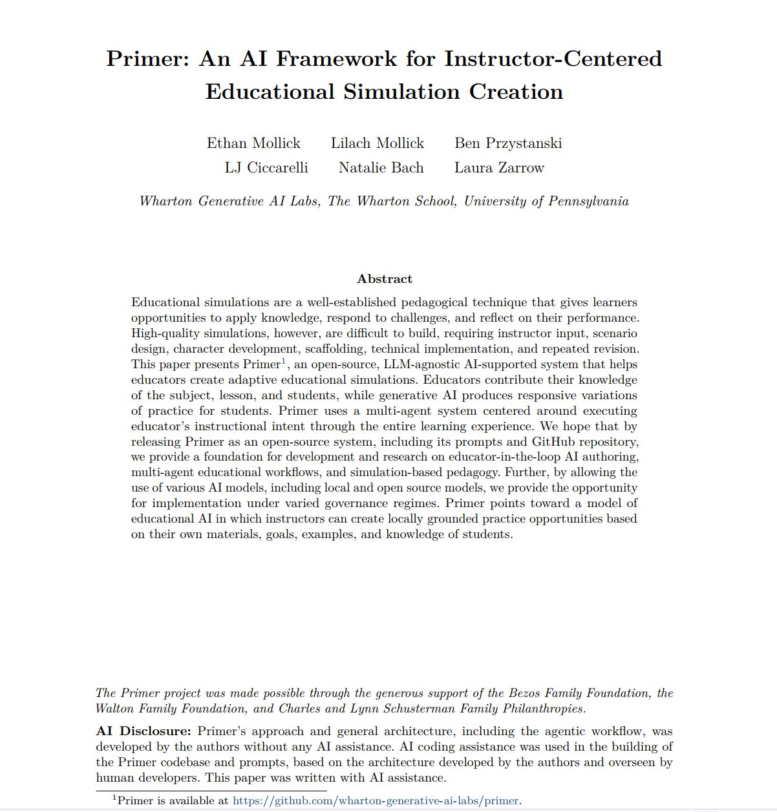
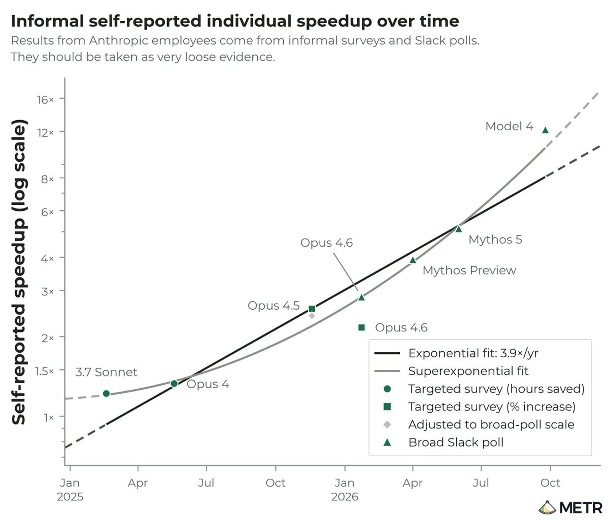

# 🐦 @emollick

## 📅 November 12, 2026

> 9 post(s) archived.

---

### 🕐 22:22 UTC · @emollick

> With Lilach Mollick Ben Przystanski, LJ Ciccarelli, Natalie Bach, and Laura Zarrow, and with thanks to the Bezos Family Foundation, the Walton Family Foundation &amp; Charles and Lynn Schusterman Family Philanthropies. Paper: https://papers.ssrn.com/sol3/papers.cfm?abstract_id=7696720 Github: https://github.com/wharton-generative-ai-labs/primer

🔗 [View original post](https://x.com/emollick/status/2121005842044469746)

---

### 🕐 22:10 UTC · @emollick

> We believe that AI, when used properly, can have a large positive impact on education, but the major AIs are not built for learning out-of-the-box. We wanted to make sure we gave control to educators so they can make choices. (Yes, it is named after the Primer from Diamond Age)

🔗 [View original post](https://x.com/emollick/status/2121002669250675075)

---

### 🕐 22:03 UTC · @emollick

> 🚨 Our Generative AI Lab is releasing Primer: an agent-driven system where a teacher talks through lessons &amp; gets back a playable simulation for their students, grounded in pedagogy. We hope educators &amp; researchers build on it. Paper/prompts/code are open: https://gail.wharton.upenn.edu/primer/

🔗 [View original post](https://x.com/emollick/status/2121001056637431873)

---

### 🕐 20:06 UTC · @emollick

> Leaving aside everything else about this research done by METR at Anthropic, it validates vibe-testing. It is my experience with the quality of the past years of Anthropic AI models (&amp; AI consensus on X). Yes, NewSonnet 3.7 was the most obviously above expectation model of 2025.

🔗 [View original post](https://x.com/emollick/status/2120971399271473405)

---

### 🕐 19:01 UTC · @emollick

> The comments are terrible, do not read them, they will make you mad.

🔗 [View original post](https://x.com/emollick/status/2120955139238588585)

---

### 🕐 18:29 UTC · @emollick

> Neat expansion on Portals to visualize The Culture (I had one Banks world in the original 466 Portals, but no GSVs etc.) Original version: https://portals-endless-worlds.netlify.app/ Repo: https://github.com/emollick/ai-portals Inspired by @emollick’s Portals, I used his repo and Fable to build Portals for Iain M. Banks Culture novels: https://sonic-sphinx-9qsd.here.now #theculture #iainmbanks

🔗 [View original post](https://x.com/emollick/status/2120947095280795823)

---

### 🕐 14:05 UTC · @emollick

> What a mess 😕

🔗 [View original post](https://x.com/levie/status/2120880718868045973)

---

### 🕐 02:42 UTC · @emollick

> We should spend more effort thinking about how to preserve craft and augment it, automation is seductive but not an inevitable path.

🔗 [View original post](https://x.com/emollick/status/2120708681788485676)

---

### 🕐 02:34 UTC · @emollick

> You don’t have to love powerlooms or hate hand weaving to recognize a powerloom when you see one. Lots of intellectual tasks that used to be pure craft &amp; which, therefore, could never be industrialized might soon be subject to the logic of industrialization. Not an easy change.

🔗 [View original post](https://x.com/emollick/status/2120706817584234858)

---
