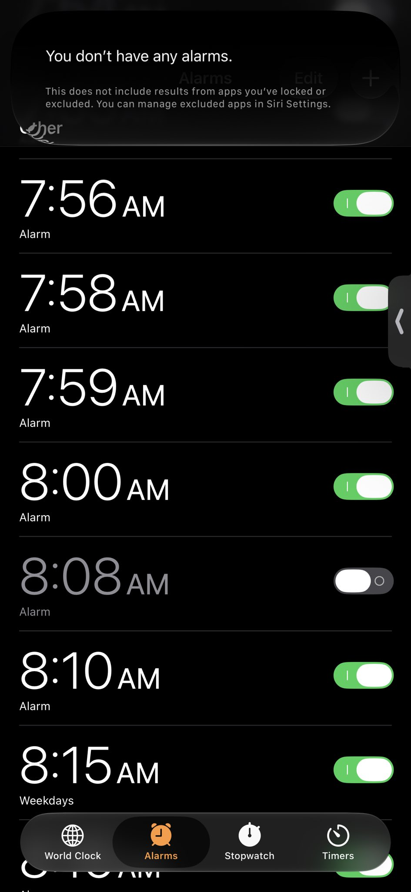
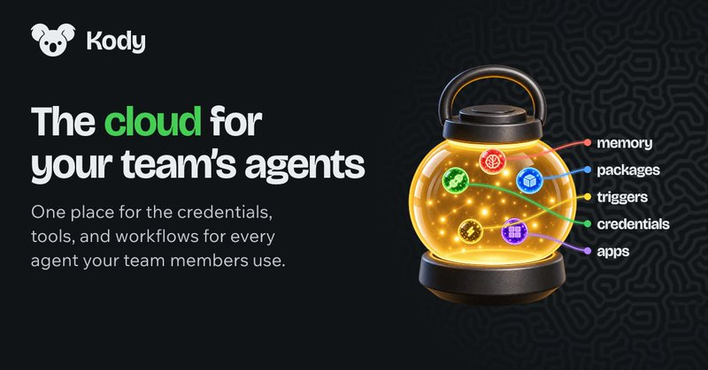
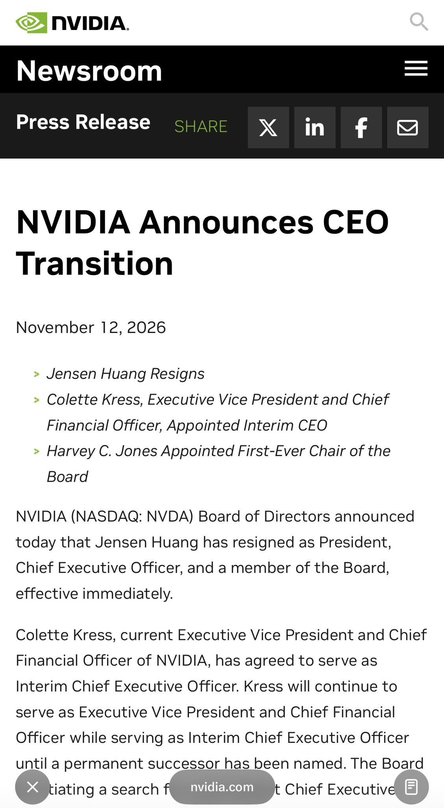

# 🐦 @swyx

## 📅 November 12, 2026

> 8 post(s) archived.

---

### 🕐 15:54 UTC · @swyx

> Apple: “Introducing the new Siri” Me: “oh sick, can you turn off all my alarms” new Siri:

🔗 [View original post](https://x.com/swyx/status/2120908176967237654)

---

### 🕐 15:48 UTC · @swyx

> good notes https://x.com/theturingpost/status/2120607968408531110?a=9II0x1T9KmYzYfzo5BQ&amp;s=46 btw one of the beautiful reasons why we love the smaller Summit format rather than the 10,000 person worlds fairs is that we can actually meet everyone and offer a higher quality experience. check out this morning spread!! Media How to turn slop into gold. Super concrete steps from awesome @poteto on making coding agents trustworthy: 1. Clean up the code your agents learn from. Your codebase is one of their biggest inputs. Agents copy whatever looks like an established pattern, including workarounds, de…

🔗 [View original post](https://x.com/swyx/status/2120906636609065396)

---

### 🕐 15:45 UTC · @swyx

> Kent helped me get started in my second career and it is such an honor to host him as ai engineer evolves into product engineer! def keep an eye out for https://kody.codes, this category has not yet been created but it is about to get some serious firepower behind it Shout-out to my man @swyx. This guy has done so much for our industry. We owe him so much. Thank you for bringing people together with @aiDotEngineer and also for the great personal advice!

🔗 [View original post](https://x.com/swyx/status/2120905871773593937)

---

### 🕐 14:39 UTC · @swyx

> advice https://x.com/travisk/status/2119869150143091175?a=Asnhl8ISEOX6qTUYXuw&amp;s=46 Had a little time on my hands this morning to do some writing… send along to someone you know who may benefit --- “Practical principles to counter a modern-day coup/psyop/struggle session” 1) Own what you did but fiercely resist accommodating the mob, resist owning half-truths o…

🔗 [View original post](https://x.com/swyx/status/2120889185779495074)

---

### 🕐 14:36 UTC · @swyx

> Jensen is out :/ NVIDIA announces CEO transition. Read the release: https://nvidianews.nvidia.com/news/nvidia-announces-ceo-transition

🔗 [View original post](https://x.com/swyx/status/2120888435942760642)

---

### 🕐 05:18 UTC · @swyx

> The System One revolution is upon us! At @aiDotEngineer Code Summit today, lead Jev creator Diogo Almeida (@CompleteSkeptic) called on developers to automate everything. Also, Glean and others showed how they’re using Jev. https://latent.space/p/jev-revolution/

🔗 [View original post](https://x.com/latentspacepod/status/2120748081524470240)

---

### 🕐 04:36 UTC · @swyx

> What an incredible first day at AI Engineer Code Summit. Heard some amazing talks! I want to shout out a few of my favorites: @poteto @CompleteSkeptic @Steve_Yegge @simonw Some of the themes: let&apos;s be more ambitious. Be intentional with building trust in your agents. Finally got to meet my friend @thecsguy IRL today too. @swyx and team, thank you again for putting on the conference. Can&apos;t wait for tomorrow.

🔗 [View original post](https://x.com/joshdbirdwell/status/2120737357582553132)

---

### 🕐 03:18 UTC · @swyx

> it was so fkin fun giving this talk! “Software is gonna be so fucking back.” .@CompleteSkeptic is full of bangers and you will have to listen to his full talk at @aiDotEngineer, but for now, here is our top-10 of his pearls: 1“We’ve been announcing AGI three months away for two years now.” Meanwhile, go outside San…

🔗 [View original post](https://x.com/CompleteSkeptic/status/2120717906443169847)

---
