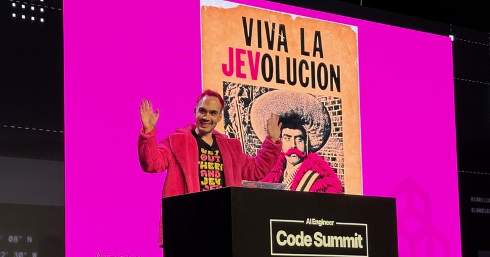
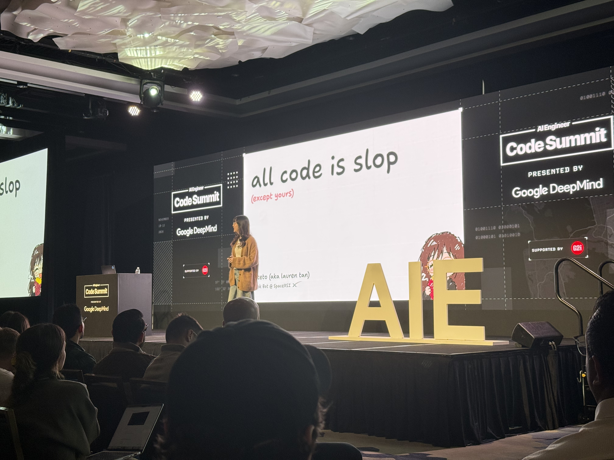

# 🐦 @swyx

## 📅 November 12, 2026

> 2 post(s) archived.

---

### 🕐 05:18 UTC · @swyx

> The System One revolution is upon us! At @aiDotEngineer Code Summit today, lead Jev creator Diogo Almeida (@CompleteSkeptic) called on developers to automate everything. Also, Glean and others showed how they’re using Jev. https://latent.space/p/jev-revolution/

🔗 [View original post](https://x.com/latentspacepod/status/2120748081524470240)

---

### 🕐 04:36 UTC · @swyx

> What an incredible first day at AI Engineer Code Summit. Heard some amazing talks! I want to shout out a few of my favorites: @poteto @CompleteSkeptic @Steve_Yegge @simonw Some of the themes: let&apos;s be more ambitious. Be intentional with building trust in your agents. Finally got to meet my friend @thecsguy IRL today too. @swyx and team, thank you again for putting on the conference. Can&apos;t wait for tomorrow.

🔗 [View original post](https://x.com/joshdbirdwell/status/2120737357582553132)

---
