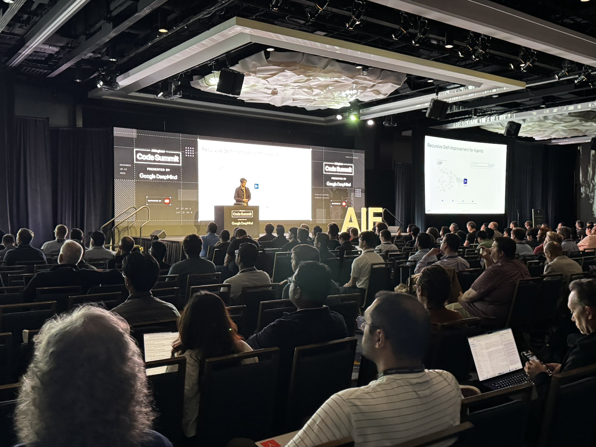
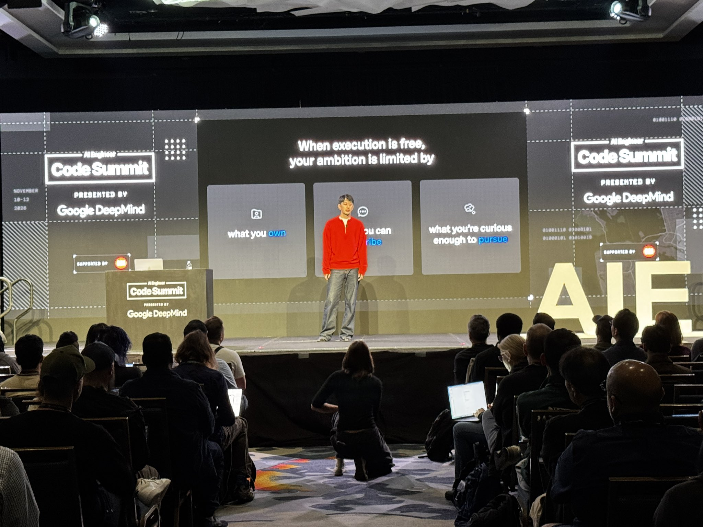
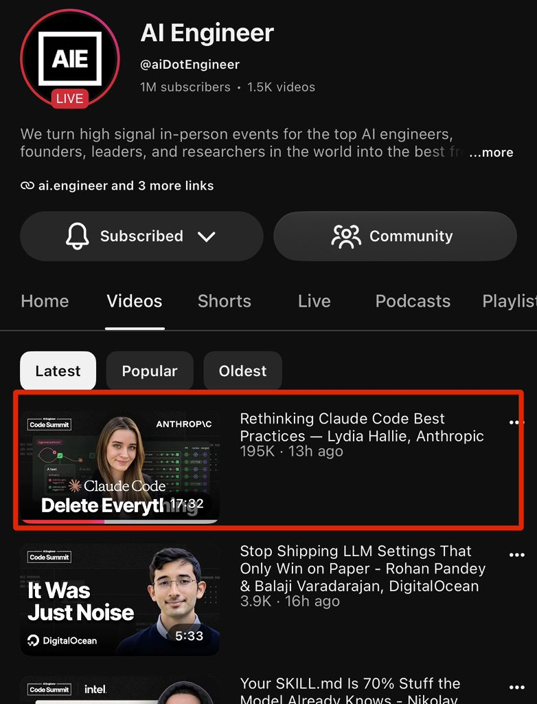

# 🐦 @swyx

## 📅 November 12, 2026

> 15 post(s) archived.

---

### 🕐 19:31 UTC · @swyx

> play special attention to @walden_yan’s keynote rn to get a preview of {BIG LAUNCH NEXT WEEK} if i say more @cognition will shoot me lol it&apos;s the final day of AIE CODE! Opening keynotes starting now! @jxnlco at @OpenAI @mitsuhiko at @earendilworks @zachlloydtweets at @warpdotdev @echelon at @get_artcraft Watch here: https://www.youtube.com/live/y9JtCCZP2MQ Presented by @GoogleDeepMind.

🔗 [View original post](https://x.com/swyx/status/2120962735211233454)

---

### 🕐 19:30 UTC · @swyx

> “It’s eye-opening to see what everyone else is doing.” Day 1 at AI Engineer Code Summit: the talks, the demos, and the conversations between them. Presented by @GoogleDeepMind. Day 2 is live. Watch here: https://www.youtube.com/live/y9JtCCZP2MQ Media

🔗 [View original post](https://x.com/aiDotEngineer/status/2120962333971267931)

---

### 🕐 19:05 UTC · @swyx

> This is a difficult moment. It’s hard not to look at the journey this company has taken and not be filled with respect for what Jensen built. The spirit of the company remains strong: &quot;mission is the boss”. That said, as NVIDIA finds its way forward, I want one thing to be clear: NVIDIA&apos;s contributions to open source are unwavering. Jensen has been vocal about this, and that commitment runs deep in NVIDIA&apos;s people and culture. We all understand the importance of open source. NVIDIA is a huge supporter of open source because we understand something. If you want to diffuse technology, you do so through an ecosystem, not a single company or entity. No one owns the internet, no one owns servers, and no one owns operating systems… but through open source, an ecosystem of closed and open innovation flourishes. When we talk about delivering agents safely and securely, that too will take place because of open source. For example, ensuring people have the best models to secure themselves at machine speed unburdened by arbitrary guardrails decided behind closed doors. Open source &amp; AI are often discussed together, but it’s worth reminding, open source predates AI. It is a mechanism for sharing ideas inspired by the hippies at computer labs of California in the 1960s. Before AI, the largest shift I lived through was the internet. It was remarkable seeing the fight for open source take place there. Between browsers, runtimes, net neutrality, etc. What came as a result was HTML5 and an extremely vibrant ecosystem that built the internet as we know it today. NVIDIA and its partners hold an incredibly important role in delivering this technology. NVIDIA contributes to every layer of the stack. Runtimes, models, harnesses, programming languages, frameworks, etc. None of that changes. Long live open source. For my first post, I’m sharing a letter @NVIDIA signed on why open models matter. AI will transform every industry, power every company, and be built by every country. Open models strengthen safety and cybersecurity, accelerate innovation and diffusion, and enable sovereignty. T…

🔗 [View original post](https://x.com/NaderLikeLadder/status/2120956179274936560)

---

### 🕐 17:22 UTC · @swyx

> “if you want good taste, you have to eat” - @jxnlco art school to ai engineer path is too powerful @jxnlco

🔗 [View original post](https://x.com/swyx/status/2120930215102947353)

---

### 🕐 17:20 UTC · @swyx

> the rest of day 1 keynotes https://x.com/aidotengineer/status/2120554645781463093?a=F7CX94m9eoN215IPc2o&amp;s=46 The Code Summit livestream starts in 30 minutes. @nserrino (@gimletlabs) on 10x faster AI. @lydiahallie (@AnthropicAI) on Claude Code best practices. 9 AM PT. Watch free: https://www.youtube.com/live/ZZ19zhYnDKY Presented by @GoogleDeepMind.

🔗 [View original post](https://x.com/swyx/status/2120929644958605703)

---

### 🕐 17:04 UTC · @swyx

> sorry for the tech issues yesterday but omg @lydiahallie posted her makeup talk last night and it already got 200k views in 13 hours - highest day 0 count in the history of AIE!! it&apos;s the final day of AIE CODE! Opening keynotes starting now! @jxnlco at @OpenAI @mitsuhiko at @earendilworks @zachlloydtweets at @warpdotdev @echelon at @get_artcraft Watch here: https://www.youtube.com/live/y9JtCCZP2MQ Presented by @GoogleDeepMind.

🔗 [View original post](https://x.com/swyx/status/2120925700534460775)

---

### 🕐 15:54 UTC · @swyx

> Apple: “Introducing the new Siri” Me: “oh sick, can you turn off all my alarms” new Siri:

🔗 [View original post](https://x.com/swyx/status/2120908176967237654)

---

### 🕐 15:48 UTC · @swyx

> good notes https://x.com/theturingpost/status/2120607968408531110?a=9II0x1T9KmYzYfzo5BQ&amp;s=46 btw one of the beautiful reasons why we love the smaller Summit format rather than the 10,000 person worlds fairs is that we can actually meet everyone and offer a higher quality experience. check out this morning spread!! Media How to turn slop into gold. Super concrete steps from awesome @poteto on making coding agents trustworthy: 1. Clean up the code your agents learn from. Your codebase is one of their biggest inputs. Agents copy whatever looks like an established pattern, including workarounds, de…

🔗 [View original post](https://x.com/swyx/status/2120906636609065396)

---

### 🕐 15:45 UTC · @swyx

> Kent helped me get started in my second career and it is such an honor to host him as ai engineer evolves into product engineer! def keep an eye out for https://kody.codes, this category has not yet been created but it is about to get some serious firepower behind it Shout-out to my man @swyx. This guy has done so much for our industry. We owe him so much. Thank you for bringing people together with @aiDotEngineer and also for the great personal advice!

🔗 [View original post](https://x.com/swyx/status/2120905871773593937)

---

### 🕐 14:39 UTC · @swyx

> advice https://x.com/travisk/status/2119869150143091175?a=Asnhl8ISEOX6qTUYXuw&amp;s=46 Had a little time on my hands this morning to do some writing… send along to someone you know who may benefit --- “Practical principles to counter a modern-day coup/psyop/struggle session” 1) Own what you did but fiercely resist accommodating the mob, resist owning half-truths o…

🔗 [View original post](https://x.com/swyx/status/2120889185779495074)

---

### 🕐 14:36 UTC · @swyx

> Jensen is out :/ NVIDIA announces CEO transition. Read the release: https://nvidianews.nvidia.com/news/nvidia-announces-ceo-transition

🔗 [View original post](https://x.com/swyx/status/2120888435942760642)

---

### 🕐 05:46 UTC · @swyx

> Shoutout to @simonw who went right after me and was also hilarious and entertaining. Fun night! Sienfeld level humor from @Steve_Yegge at @aiDotEngineer today.

🔗 [View original post](https://x.com/Steve_Yegge/status/2120755212726190131)

---

### 🕐 05:18 UTC · @swyx

> The System One revolution is upon us! At @aiDotEngineer Code Summit today, lead Jev creator Diogo Almeida (@CompleteSkeptic) called on developers to automate everything. Also, Glean and others showed how they’re using Jev. https://latent.space/p/jev-revolution/

🔗 [View original post](https://x.com/latentspacepod/status/2120748081524470240)

---

### 🕐 04:36 UTC · @swyx

> What an incredible first day at AI Engineer Code Summit. Heard some amazing talks! I want to shout out a few of my favorites: @poteto @CompleteSkeptic @Steve_Yegge @simonw Some of the themes: let&apos;s be more ambitious. Be intentional with building trust in your agents. Finally got to meet my friend @thecsguy IRL today too. @swyx and team, thank you again for putting on the conference. Can&apos;t wait for tomorrow.

🔗 [View original post](https://x.com/joshdbirdwell/status/2120737357582553132)

---

### 🕐 03:18 UTC · @swyx

> it was so fkin fun giving this talk! “Software is gonna be so fucking back.” .@CompleteSkeptic is full of bangers and you will have to listen to his full talk at @aiDotEngineer, but for now, here is our top-10 of his pearls: 1“We’ve been announcing AGI three months away for two years now.” Meanwhile, go outside San…

🔗 [View original post](https://x.com/CompleteSkeptic/status/2120717906443169847)

---
