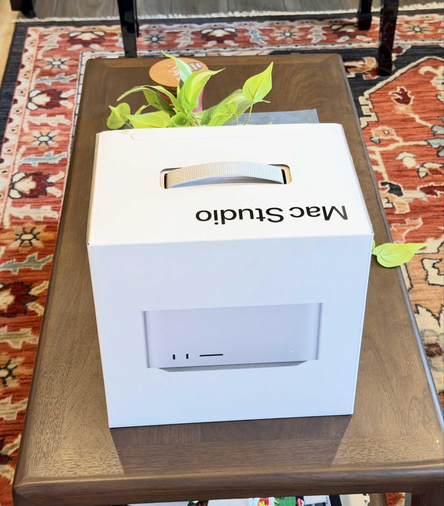

# 🐦 @tunguz

## 📅 November 12, 2026

> 15 post(s) archived.

---

### 🕐 18:01 UTC · @tunguz

> Le Big Mac

🔗 [View original post](https://x.com/tunguz/status/2120940110917337259)

---

### 🕐 14:50 UTC · @tunguz

> Don&apos;t look at me, I told you to use XGBoost.

🔗 [View original post](https://x.com/tunguz/status/2120892076539687294)

---

### 🕐 14:47 UTC · @tunguz

> Compartmentalization was a luxury. Personal, professional, political, economical, and technological are now way too intertwined.

🔗 [View original post](https://x.com/tunguz/status/2120891302376071351)

---

### 🕐 14:35 UTC · @tunguz

> The next NVIDIA alumni get together is gonna be lit!

🔗 [View original post](https://x.com/tunguz/status/2120888102264947136)

---

### 🕐 14:33 UTC · @tunguz

> Yes If you solve this in under 15 seconds 🤔 You are officially Smart 🔥

🔗 [View original post](https://x.com/tunguz/status/2120887720834732111)

---

### 🕐 14:31 UTC · @tunguz

> Both Jensen and I are now ex Nvidians!

🔗 [View original post](https://x.com/tunguz/status/2120887187311059345)

---

### 🕐 14:22 UTC · @tunguz

> There are layers to the game that you people can’t even conceive of.

🔗 [View original post](https://x.com/tunguz/status/2120884909464224202)

---

### 🕐 12:26 UTC · @tunguz

> I have credible evidence that Anthropic is two weeks away from building a model that can build a nuclear weapon.

🔗 [View original post](https://x.com/tunguz/status/2120855630722544072)

---

### 🕐 12:19 UTC · @tunguz

> I can neither confirm nor deny the rumors that I am on the shortlist for the next NVIDIA CEO.

🔗 [View original post](https://x.com/tunguz/status/2120854043014865280)

---

### 🕐 12:13 UTC · @tunguz

> Interesting Only about 1 in 6 Americans say their neighbors don&apos;t care about them at all, among the lowest shares of 140 countries and third-lowest among wealthy nations (behind Iceland and Switzerland).

🔗 [View original post](https://x.com/tunguz/status/2120852440778174636)

---

### 🕐 11:47 UTC · @tunguz

> And Peloponnesian war is just around the corner ...

🔗 [View original post](https://x.com/tunguz/status/2120845850788388877)

---

### 🕐 11:23 UTC · @tunguz

> AI labs are the new city states.

🔗 [View original post](https://x.com/tunguz/status/2120839814949798212)

---

### 🕐 00:12 UTC · @tunguz

> The good news: Anthropic will find the cure for every disease. The bad news: only Anthropic employees will be able to afford them. Anthropic CEO predicts cancer, Alzheimer&apos;s, heart disease, mental illness will be cured in less than 10 years ACCELERATE

🔗 [View original post](https://x.com/tunguz/status/2120671038266634316)

---

### 🕐 00:09 UTC · @tunguz

> And we still have almost two months to go before 2027 ...

🔗 [View original post](https://x.com/tunguz/status/2120670199712231459)

---

### 🕐 00:05 UTC · @tunguz

> All right, I am buying a leather jacket.

🔗 [View original post](https://x.com/tunguz/status/2120669249815409041)

---
