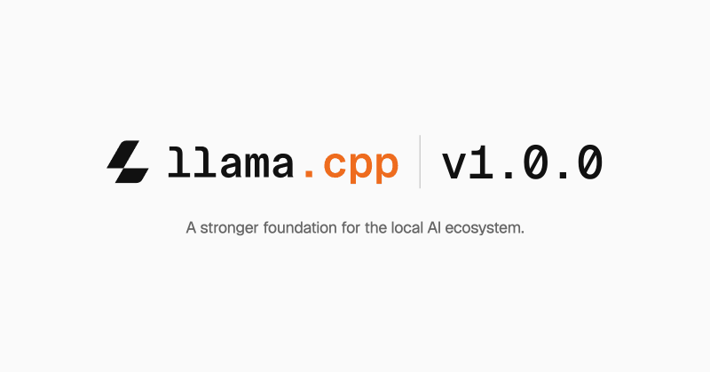

# 🐦 @_akhaliq

## 📅 November 13, 2026

> 3 post(s) archived.

---

### 🕐 17:27 UTC · @_akhaliq

> G-STAR Group-Scaled Token Capacity for Deeply Compressed Autoregressive Generation paper: https://huggingface.co/papers/2611.13004 Media

🔗 [View original post](https://x.com/_akhaliq/status/2121293765889663321)

---

### 🕐 15:58 UTC · @_akhaliq

> Back in 2012, AlexNet was trained on two NVIDIA gaming GPUs. Jensen understodd what that meant before almost anyone else, and bet the company on it. A couple weeks ago he spent a good chunk of a meeting with us nerding out on our little $400 open-source microrobot. Why it runs hot, which chip would get more FLOPs, how many watts it would draw 🤓 His latest big bet has been open models, his very first post on X 👇 If open models had only one champion, this week would have been the end. They have millions of builders, including plenty inside NVIDIA who’ve been messaging us the same thing: keep building in the open. We will. For my first post, I’m sharing a letter @NVIDIA signed on why open models matter. AI will transform every industry, power every company, and be built by every country. Open models strengthen safety and cybersecurity, accelerate innovation and diffusion, and enable sovereignty. T…

🔗 [View original post](https://x.com/Thom_Wolf/status/2121271570505072733)

---

### 🕐 14:17 UTC · @_akhaliq

> llama.cpp v1.0.0 is now available https://huggingface.co/blog/ggml-org/llama-cpp-v1

🔗 [View original post](https://x.com/ggerganov/status/2121246103312212124)

---
