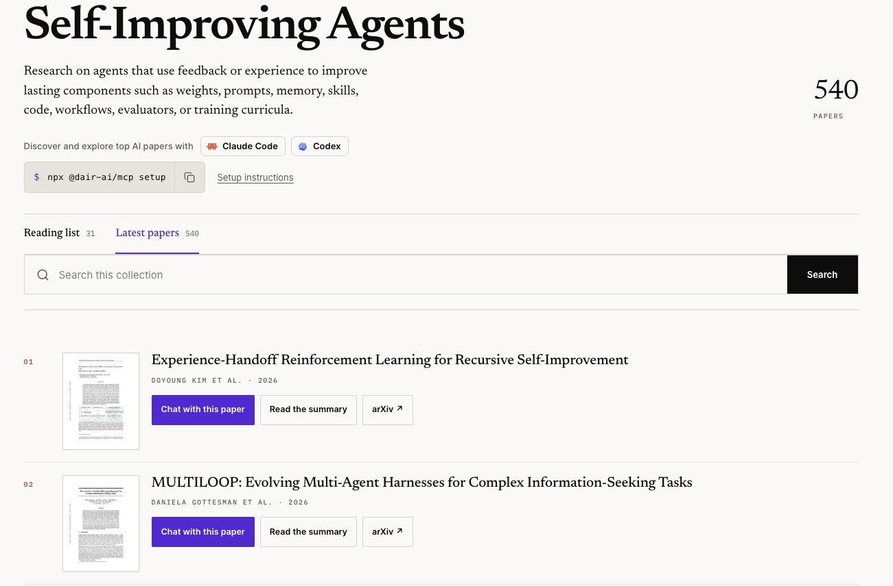

# 🐦 @dair_ai

## 📅 November 13, 2026

> 4 post(s) archived.

---

### 🕐 20:13 UTC · @dair_ai

> Highly recommended read. My notes: I have recently started independent research on co-evolved models. My focus has been on co-evolving models and harnesses. This work focuses on memory writing specifically for continual learning. Why is this a big deal? As you work with an agent, it should get better at your tasks, but that obviously doesn&apos;t happen easily, and current external memory systems often aren&apos;t enough. This has less to do with memory systems (there are many great ones out there) and more to do with the model&apos;s awareness and judgment about when to act. To illustrate, imagine an AI agent spends a week fixing bugs in the same project. We would expect it to learn how the project works and avoid repeating mistakes. Giving it a place to save notes lets it carry that knowledge into later tasks. But choosing what belongs in those notes requires judgment. This work looks at how to train that judgment with RL. They essentially teach an agent to discover useful information while working and write memories that help it succeed on later tasks. A trained 4B parameter model reached a score similar to GPT-5.4 and Claude Opus 4.7. RIME uses one model in two roles. As the actor, it works on a task using its existing memory. As the writer, it reviews what happened and updates the notes available for the next task. The training rewards each role differently. The writer receives credit when performance on the next few tasks improves relative to performance on the recent tasks. This gives it a reason to preserve information that will help later. The comparison is an approximate training signal, since other actions and memory updates also affect those results. The actor earns a reward for completing its task and an additional reward for discoveries that reach memory. An AI judge compares the old and new notes, looking for useful additions, corrected beliefs, and concrete leads. This encourages the agent to investigate enough to learn something reusable. Rewriting the same notes in different words earns little credit. The researchers found that these abilities need to develop together. A writer depends on the information the actor discovers, and an actor depends on the knowledge the writer preserves. One big question I have here is efficiency and, obviously, how it all integrates into harnesses and workflows. I think approaches like this can save a lot of tokens and turns. While this is on a small scale, it&apos;s great to see it working already. It feels like a more feasible approach for continual learning. Frontier models are getting better at retaining knowledge, but I think efficient continual learning will still require touching the weights, which is where open-weight models will play a huge role. How can we train LLMs to write memories from experience collected on the fly to as best as possible solve the next task, i.e., optimize for both capability and &quot;continual learning&quot; ability? In our new post, we study this question in the setting continual learning over a sequence…

🔗 [View original post](https://x.com/omarsar0/status/2121335666457944226)

---

### 🕐 16:22 UTC · @dair_ai

> Introducing our new AI Paper Collections. You can now track highly recommended papers and tools for harness engineering and recursive self-improvement. Updates daily! Built on our in-house paper curation tools. You can also chat with the papers via our paper chat tool or MCP tools. Harness Engineering: https://academy.dair.ai/papers/collections/harness-engineering?view=latest RSI: https://academy.dair.ai/papers/collections/self-improving-agents?view=latest

🔗 [View original post](https://x.com/omarsar0/status/2121277499673895121)

---

### 🕐 14:47 UTC · @dair_ai

> Great paper on decision models for long-horizon agents. For agent RL, you want the decision model to evaluate completed trajectories and leave action selection to the policy. Decision models output a typed distribution, such as a probability for each option. As actors on ALFWorld, all six models tested (three decision models and three general LLMs) went for an easier subgoal before the one that had to come first. Shown the full trajectory and asked whether each action helped, the same models gave credit to the steps they skipped while acting. Used as a teacher for GRPO, one of the decision models raised a Qwen2.5-1.5B policy from 72.8% to 82.9% success on ALFWorld and from 56.8% to 71.4% on WebShop, including on tasks it rarely completes as an actor. https://arxiv.org/abs/2611.17167 Chat with Paper: https://academy.dair.ai/papers/actor-judge-or-teacher-understanding-decision-models-in-long-horizon-agents-2611.17167

🔗 [View original post](https://x.com/omarsar0/status/2121253509333201244)

---

### 🕐 14:47 UTC · @dair_ai

> Great paper from Google on building benchmarks for data agents. Static data-agent benchmarks saturate quickly and can&apos;t target a specific skill. SynthCorp generates the data instead. It simulates routine business events and disruptions on a virtual calendar, and those events fill relational tables, a document store, and a data catalog that stay consistent with each other. Every operation goes into a simulation log, so the gold answer for each task is derived from the log and checked without manual annotation. The first release has seven data estates with up to 1,000 tables and 256 tasks across five domains. Tasks that chain several business events together still make state-of-the-art agents fail. https://arxiv.org/abs/2611.14765 Chat with Paper: https://academy.dair.ai/papers/synthcorp-a-platform-for-creating-benchmarks-for-data-agents-2611.14765

🔗 [View original post](https://x.com/dair_ai/status/2121253508083306814)

---
