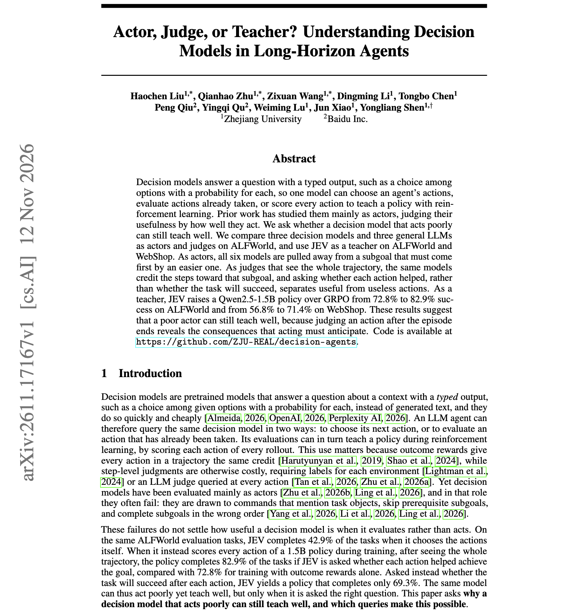
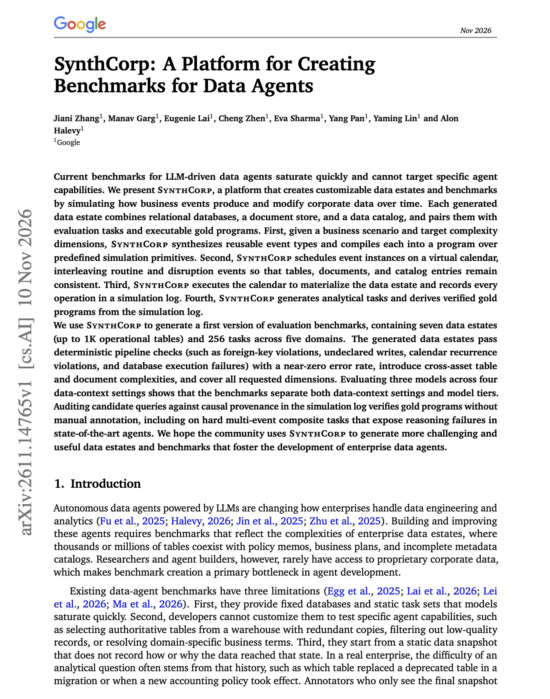

# 🐦 @dair_ai

## 📅 November 13, 2026

> 2 post(s) archived.

---

### 🕐 14:47 UTC · @dair_ai

> Great paper on decision models for long-horizon agents. For agent RL, you want the decision model to evaluate completed trajectories and leave action selection to the policy. Decision models output a typed distribution, such as a probability for each option. As actors on ALFWorld, all six models tested (three decision models and three general LLMs) went for an easier subgoal before the one that had to come first. Shown the full trajectory and asked whether each action helped, the same models gave credit to the steps they skipped while acting. Used as a teacher for GRPO, one of the decision models raised a Qwen2.5-1.5B policy from 72.8% to 82.9% success on ALFWorld and from 56.8% to 71.4% on WebShop, including on tasks it rarely completes as an actor. https://arxiv.org/abs/2611.17167 Chat with Paper: https://academy.dair.ai/papers/actor-judge-or-teacher-understanding-decision-models-in-long-horizon-agents-2611.17167

🔗 [View original post](https://x.com/omarsar0/status/2121253509333201244)

---

### 🕐 14:47 UTC · @dair_ai

> Great paper from Google on building benchmarks for data agents. Static data-agent benchmarks saturate quickly and can&apos;t target a specific skill. SynthCorp generates the data instead. It simulates routine business events and disruptions on a virtual calendar, and those events fill relational tables, a document store, and a data catalog that stay consistent with each other. Every operation goes into a simulation log, so the gold answer for each task is derived from the log and checked without manual annotation. The first release has seven data estates with up to 1,000 tables and 256 tasks across five domains. Tasks that chain several business events together still make state-of-the-art agents fail. https://arxiv.org/abs/2611.14765 Chat with Paper: https://academy.dair.ai/papers/synthcorp-a-platform-for-creating-benchmarks-for-data-agents-2611.14765

🔗 [View original post](https://x.com/dair_ai/status/2121253508083306814)

---
