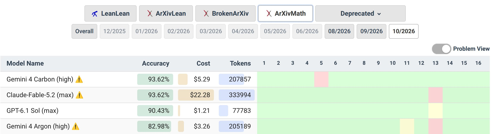

# 🐦 @demishassabis

## 📅 November 13, 2026

> 2 post(s) archived.

---

### 🕐 20:23 UTC · @demishassabis

> What we shipped this week @google Monday: Two new 8th-gen TPUs Tuesday: Gemini 4 Carbon - AlphaProof Code verified Signal protocol - Gemini Robotics 2.5 Wednesday: AlphaGenome 2 for disease research - Gemini Decisions API in AI Studio Thursday: Gemini 4 Hydrogen - intelligent eyewear pre-orders Friday: U2 new album (ok not us but exciting!) onwards!

🔗 [View original post](https://x.com/sundarpichai/status/2121338095664808238)

---

### 🕐 15:27 UTC · @demishassabis

> For the first time in a very long time, we have a non-OpenAI model as #1 on MathArena! Gemini 4 Carbon takes over the first place from GPT-6.1 Sol, with Fable 5.2 taking #2.

🔗 [View original post](https://x.com/j_dekoninck/status/2121263753006374997)

---
