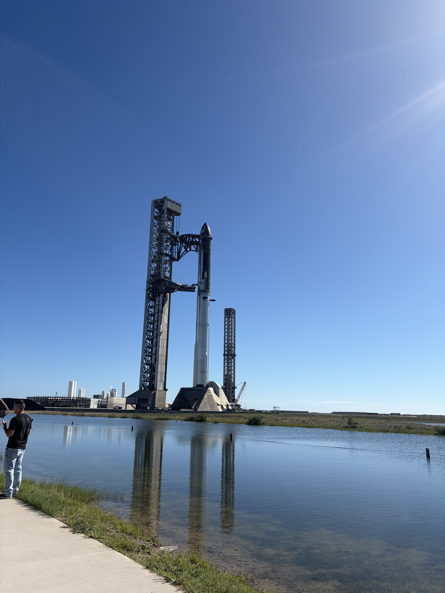
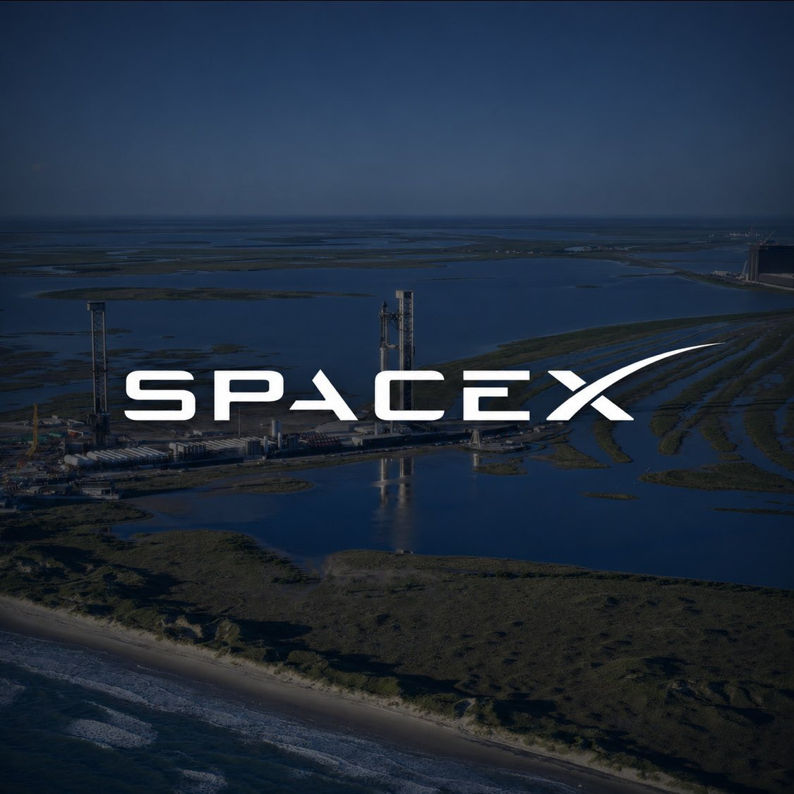
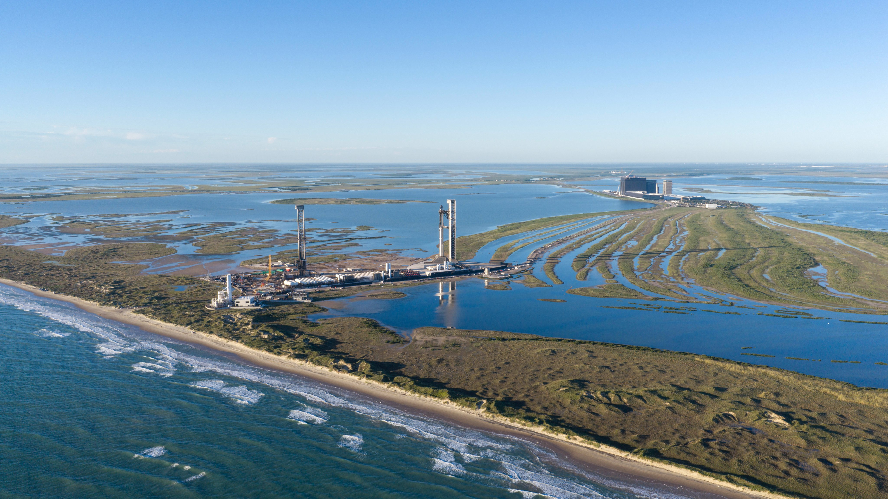
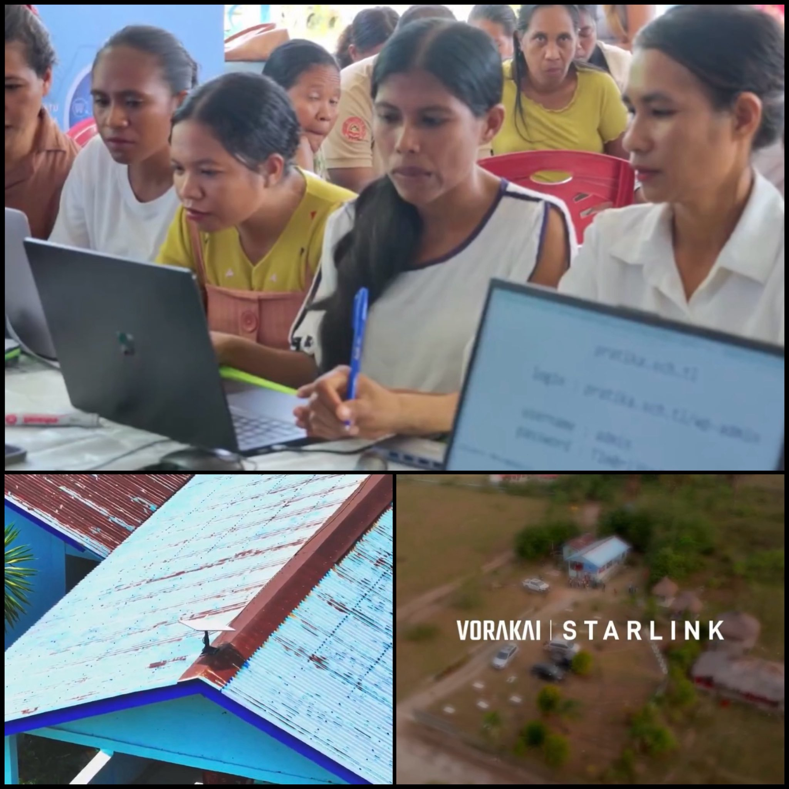
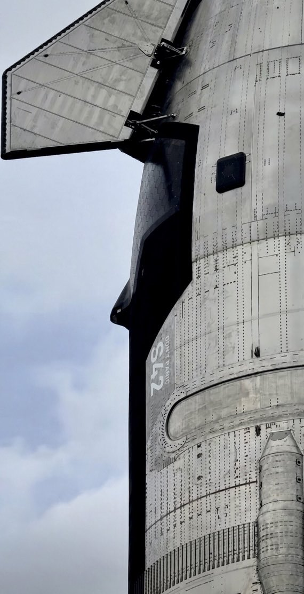

# 🐦 @elonmusk

## 📅 November 13, 2026

> 24 post(s) archived.

---

### 🕐 20:51 UTC · @elonmusk

> @yunta_tsai A petition is underway to reinstate Jensen and I’m signing it too

🔗 [View original post](https://x.com/elonmusk/status/2121345211959804234)

---

### 🕐 20:14 UTC · @elonmusk

> Try Grok @Bot today! Grok Bot can now join meetings. Ask it questions, assign it work, or have it keep track of what your team decides.

🔗 [View original post](https://x.com/elonmusk/status/2121335897744372073)

---

### 🕐 19:36 UTC · @elonmusk

> grok bot is literally becoming the only ai system you&apos;ll ever need to use. so many enterprise use cases already, and they&apos;re really sealing the deal with this Grok Bot can now join meetings. Ask it questions, assign it work, or have it keep track of what your team decides.

🔗 [View original post](https://x.com/ducksays/status/2121326468399501384)

---

### 🕐 19:25 UTC · @elonmusk

> Try Grok @Bot Grok Bot is f*cking insane for building a second brain... Send this prompt to Grok Bot and it will turn everything you read, watch and think into a knowledge base that organizes itself Then go even further with the full guide below:

🔗 [View original post](https://x.com/elonmusk/status/2121323469002437065)

---

### 🕐 19:16 UTC · @elonmusk

> Within a couple of quarters, it will be normal for work meetings to be with Bots. This early beta gives a very rough glimpse. It will be great soon. Grok Bot can now join meetings. Ask it questions, assign it work, or have it keep track of what your team decides.

🔗 [View original post](https://x.com/mntruell/status/2121321225620459994)

---

### 🕐 19:08 UTC · @elonmusk

> if SpaceX achieves a double catch, it will be one of the single most important moments in the history of rocketry and mark a new era of humanity’s access to space. tune the fuck in! don’t miss it

🔗 [View original post](https://x.com/willdepue/status/2121319344051544527)

---

### 🕐 19:00 UTC · @elonmusk

> Made on Earth by humans Looks like a scene from a sci-fi film but it’s just my drive to work this morning

🔗 [View original post](https://x.com/elonmusk/status/2121317331179614676)

---

### 🕐 17:05 UTC · @elonmusk

> BREAKING: SpaceX says Boca Chica Beach will remain public, outlining major efforts to protect and restore it. • More than 50 tons of trash have been removed through weekly beach cleanups with the City of Starbase. • It has offered to invest tens of millions of dollars to fight beach erosion, restore the shoreline and preserve public access. • Its work with conservation partners has contributed to record sea turtle rescue efforts. • The proposed purchase covers approximately 1,200 acres surrounding the launch facility. Boca Chica Beach and the Texas coastline are excluded. • Around 600 acres would be permanently protected from development to preserve sensitive coastal habitat. • Proceeds from the proposed sale would help Texas invest in new parks and recreation in the Rio Grande Valley. • SpaceX is working with state agencies to improve safety around the launch facility while maintaining public beach access.

🔗 [View original post](https://x.com/cb_doge/status/2121288392742982125)

---

### 🕐 16:32 UTC · @elonmusk

> Boca Chica Beach is not for sale, and SpaceX isn’t attempting to buy it. The beach is an important part of the Rio Grande Valley community, and SpaceX is investing substantial resources to preserve and improve it → https://spacex.com/updates#boca-chica-beach

🔗 [View original post](https://x.com/SpaceX/status/2121280048871473281)

---

### 🕐 15:55 UTC · @elonmusk

> BREAKING: Starlink is bringing fast internet to rural communities in Timor-Leste. 🇹🇱 In Suco Aubeon, residents and community leaders now have @Starlink through VorakaiConnect, helping: • Families stay connected. • Residents access news and information. • Community leaders carry out local administration. Across the country, the Government’s partnership with Vorakai covers 450 village headquarters, using Starlink to connect local offices to digital government systems while fiber networks expand.

🔗 [View original post](https://x.com/cb_doge/status/2121270651650814087)

---

### 🕐 15:47 UTC · @elonmusk

> And remember …

🔗 [View original post](https://x.com/elonmusk/status/2121268692453343344)

---

### 🕐 15:43 UTC · @elonmusk

> Starlink United Airlines CEO in new interview on @Starlink Wi-Fi: &quot;Wi-Fi is the No. 1 reason that people pick an airline flight. I think it&apos;s the biggest near-term competitive advantage that we&apos;ve ever had in United&apos;s 100-year history. And it really is something that&apos;s causing customers …

🔗 [View original post](https://x.com/elonmusk/status/2121267716023546027)

---

### 🕐 15:38 UTC · @elonmusk

> True &quot;Socialism sucks.&quot; - @mlevchin &quot;Take it from somebody who spent his first 16 years under the &apos;warm embrace of collectivism&apos; as a certain mayor recently put it—socialism sucks.&quot; &quot;The only people who do well in redistribution of wealth are the ones doing redistribution.&quot; &quot;It&apos;s fun…

🔗 [View original post](https://x.com/elonmusk/status/2121266455442292980)

---

### 🕐 14:39 UTC · @elonmusk

🔗 [View original post](https://x.com/justinbieber/status/2121251707393024486)

---

### 🕐 14:36 UTC · @elonmusk

> Hmm What?! So journalists with sketchy motives portrayed rumors from god-knows-who (lobbyists?) as facts sourced from intelligence officials and gaslit the NVIDIA board to push out the founder, CEO, and once-in-generation visionary? This raises serious corporate governance issues.

🔗 [View original post](https://x.com/elonmusk/status/2121250804447445203)

---

### 🕐 14:33 UTC · @elonmusk

> Starship 42 preparing for launch Ship 42 moves to the Starbase pad ahead of launch

🔗 [View original post](https://x.com/elonmusk/status/2121250205806772283)

---

### 🕐 14:02 UTC · @elonmusk

> Grok is a straight shooter Nice summary @grok !

🔗 [View original post](https://x.com/elonmusk/status/2121242367684661286)

---

### 🕐 11:39 UTC · @elonmusk

> BREAKING: Zambia’s government has begun deploying 751 @Starlink kits to health facilities across all 10 provinces. 🇿🇲 • 90 kits already delivered to Western Province’s Provincial Health Office. • Targeting underserved and hard-to-reach communities. • Supporting digital health services and better communication between facilities. • Funded by the Global Fund through the Ministry of Health, with UNDP support. Starlink is helping bring better connectivity where it matters most: healthcare. Media

🔗 [View original post](https://x.com/cb_doge/status/2121206425045410134)

---

### 🕐 06:10 UTC · @elonmusk

> Grok Bot Grok Bot on Mac can now use Messages, Mail, Notes, Reminders, Calendar, Location, and Contacts.

🔗 [View original post](https://x.com/elonmusk/status/2121123425213399408)

---

### 🕐 05:57 UTC · @elonmusk

> Give Grok @Bot your most laborious tasks! I asked @bot the best way to move 2000 photos in @Dropbox from Camera Uploads to Folders. She said, “would you like me to do it for you?” I was surprised as I had booked out the week to start sorting through them, a painful task. She did it in five minutes. I went to my Folders …

🔗 [View original post](https://x.com/elonmusk/status/2121120295884837183)

---

### 🕐 05:51 UTC · @elonmusk

> Jensen &quot; You&apos;re gonna be remembered forever because some things are eternal.&quot;

🔗 [View original post](https://x.com/elonmusk/status/2121118775210868871)

---

### 🕐 05:50 UTC · @elonmusk

> SpaceX is building a supercomputer near Brownsville, Texas. The first job on site was cleaning up sixty years of other people&apos;s trash. Scrap metal, rusting tanks, old appliances and thousands of illegal tires, hauled out of the mud. Think about that for a second. This site will train frontier AI for medical research, emergency response, advanced manufacturing and national security. It will make its own electricity, so the neighbors&apos; power bills stay their own. SpaceX is also putting $220 million into Brownsville&apos;s water and wastewater system, adding 20 million gallons of capacity every day for the city. More than 3,000 construction jobs already, with more than 500 permanent ones to come. Elon Musk summed it up in three words: &quot;SpaceX community benefits.&quot; A company spends $15 billion on Starship and another $24 billion on a supercomputer in one corner of Texas when it plans to stay for decades. Elon Musk builds the place up first, because he believes the future will be built right there. Development of the Starbase supercompute site is creating an opportunity to address decades of environmental neglect. Portions of the property were used for unauthorized dumping dating back to the 1960s. We&apos;re undertaking cleanup efforts to remove decades of accumulated debris, …

🔗 [View original post](https://x.com/TheCaptainEli/status/2121118479537394105)

---

### 🕐 00:38 UTC · @elonmusk

> &quot;If something&apos;s important enough you should try. Even if the probable outcome is failure.&quot; - Elon, 2014 Flight 15 pre-flight hype edit: Media

🔗 [View original post](https://x.com/anabology/status/2121040067930058897)

---

### 🕐 00:18 UTC · @elonmusk

> You can now share up to 20 images in one post on 𝕏. Special thanks to Justin Bieber for this great example.

🔗 [View original post](https://x.com/benjitaylor/status/2121035025688957415)

---
