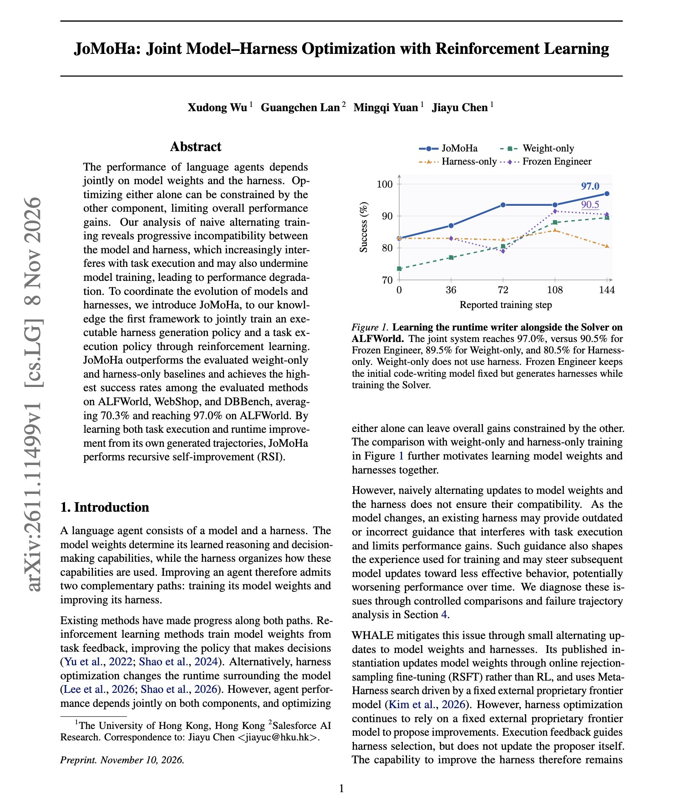

# 🐦 @omarsar0

## 📅 November 13, 2026

> 4 post(s) archived.

---

### 🕐 15:58 UTC · @omarsar0

> Interesting how relevant this 1999 Microsoft Research paper on human-agent interaction has become. The idea isn&apos;t new, but it&apos;s becoming increasingly important as AI agents grow more autonomous: figuring out when agents should act independently, when they should ask for help, and how humans should intervene. The paper introduces principles for mixed-initiative interfaces, where humans and intelligent agents share control based on uncertainty, context, and the cost of interruptions. Almost three decades later, Antimattr is exploring the hardware side of this problem with AI earphones and a smart ring designed to let people direct agents through voice. As agents become capable of handling longer, more complex workflows, the interface between humans and agents becomes an important part of the system. Worth revisiting this research as we think about the next generation of agent infrastructure. https://www.microsoft.com/en-us/research/publication/principles-mixed-initiative-user-interfaces/ we shut down a software business making $250k a year to build a hardware company put $20k of our own money into it, moved to the US with less than 3 months of runway, and eventually got into @ycombinator today, we&apos;re introducing @antimattr_one we&apos;re building a voice-first hardwa…

🔗 [View original post](https://x.com/omarsar0/status/2121271462984073550)

---

### 🕐 15:32 UTC · @omarsar0

> By the way, I have been working on a system that produces these technical visual explainers for papers and talks. Explainers have also become a huge part of how I produce artifacts, which really helps with understanding technical topics. So I got super excited about these results because you often don&apos;t want to wait too long for some of these generations. These flash models are very promising for this. I will share more thoughts in a future post on how I use explainers alongside visual artifacts across a wider range of workflows.

🔗 [View original post](https://x.com/omarsar0/status/2121264922440946089)

---

### 🕐 14:50 UTC · @omarsar0

> This short RSI explainer was fully generated by a model. The model is ERNIE 5.5 Flash Preview, Baidu&apos;s new model. I gave it one task. &quot;Make a short video that explains recursive self-improvement (RSI).&quot; I used pi as the agent harness and ElevenLabs for the voice. Everything else came from ERNIE, working on its own for about 8 minutes. For the same video, it would take 2x-5x longer with frontier models. I am learning that these flash models can execute these tasks faster and with higher quality than was possible just a couple of months ago. It wrote the code for the loop diagram and the charts. It wrote the script and rendered the final film. This is the long-running agent work Baidu built it for. It&apos;s a 280B model with 14B active parameters and a 1M-token context window. I am not testing it with longer videos where coherence matters. Baidu also tuned it for game development in engines like Unreal, Unity, and Godot. For knowledge work, it can plan a task and produce spreadsheets, documents, slide decks, and research reports. It&apos;s free on OpenRouter right now. Baidu says the open weights will land before Nov 25. https://openrouter.ai/baidu/ernie-5.5-flash-preview:free Media

🔗 [View original post](https://x.com/omarsar0/status/2121254466104267098)

---

### 🕐 00:20 UTC · @omarsar0

> Nice read from Salesforce AI Research and colleagues. There is a lot of interest in self-improving harnesses, but the harness editor is usually a fixed frontier model. JoMoHa trains two policies with RL from the same task outcomes. One writes the executable harness, and the other solves the task inside it. Updating the model and the harness in turns caused trouble. Performance rose and then fell as the two became incompatible. Keeping separate histories and value estimates for each policy fixed that. JoMoHa beat weight-only and harness-only training on ALFWorld, WebShop, and DBBench, averaging 70.3% and reaching 97.0% on ALFWorld. Training the harness writer also beat freezing it. https://arxiv.org/abs/2611.11499 Chat with Paper: https://academy.dair.ai/papers/jomoha-joint-model-harness-optimization-with-reinforcement-learning-2611.11499

🔗 [View original post](https://x.com/omarsar0/status/2121035321211318565)

---
