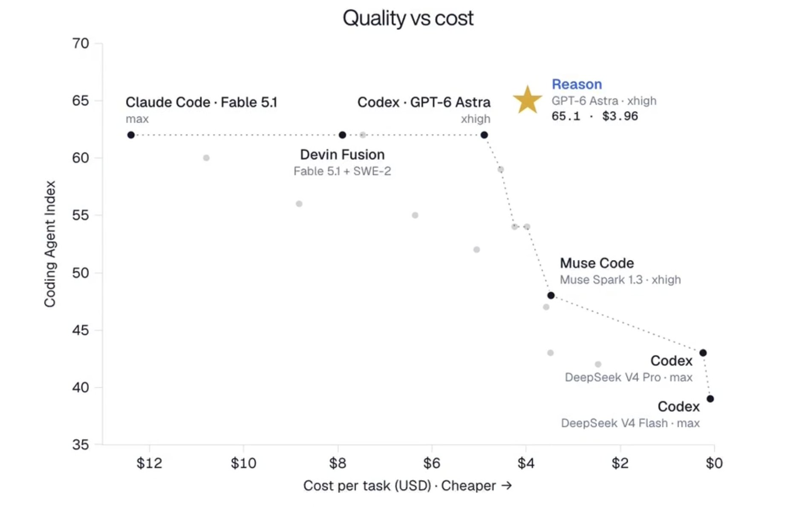
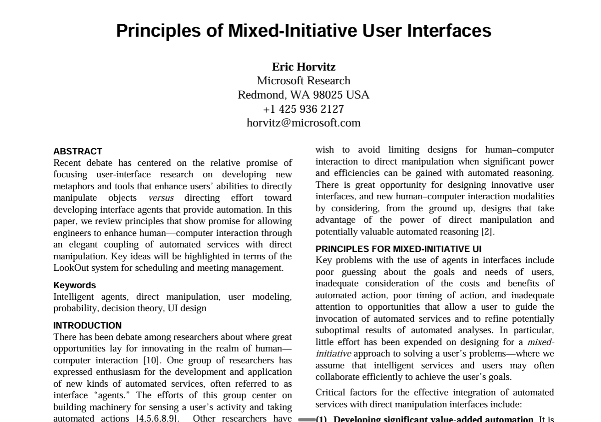

# 🐦 @omarsar0

## 📅 November 13, 2026

> 13 post(s) archived.

---

### 🕐 20:50 UTC · @omarsar0

> Very impressed by this. In the harness world, you often don&apos;t get the performance you need when you try to maximize efficiency and speed. Looks like Reason is unlocking both. The app is also well-built. Worth a try. Frontier coding performance at up to 20x lower cost. Introducing the world’s most cost-efficient harness: Reason Stop burning thousands on runaway agent bills. Reason outperforms top harnesses on Terminal-Bench and DeepSWE while dropping cost per task to a fraction of the fronti…

🔗 [View original post](https://x.com/omarsar0/status/2121345052635013236)

---

### 🕐 17:33 UTC · @omarsar0

> I want this so bad. A lot of the tech we have today simply doesn&apos;t work for managing context and an always-on AI experience. We already have proactive personal agents, but they need a good hardware pairing to bring more real-world, real-time context to our agents. And it&apos;s not just about capturing context; the goal is to make things more actionable and achieve insane levels of productivity. Backed by YC and Paul Graham, we&apos;re building Vexo, an always-listening AI bracelet that turns your conversations into action. Built by engineers from Tesla, AMD, and Amazon. One sentence to Vexo can: •Get Claude building the feature you wanted •Text the family •Block your calend…

🔗 [View original post](https://x.com/omarsar0/status/2121295385591505064)

---

### 🕐 17:18 UTC · @omarsar0

> No question that Drex Max is a top decision model. Drex Max v1.1 ranks #1 among decision models on the Artificial Analysis Decision Index. Last week, they also shared a paper on how they built Drex, their family of open decision models. This week, Drex Max v1.1 is the #1 decision model on the @ArtificialAnlys Decision Index, out of 19, and on the Pareto frontier 🦖 72.6, above Jev 1.14, Claude Haiku 5.5 and GPT-6 Luna, on an index where 45% of the evaluation data is fully private and out of distribution. $103 /…

🔗 [View original post](https://x.com/omarsar0/status/2121291529662922937)

---

### 🕐 17:18 UTC · @omarsar0

> We have started to use Drex Max for research triage in production, so it&apos;s good to see it hold up on an independent index. Example: https://x.com/omarsar0/status/2121277499673895121?a=pJ55CTO2QoGRBf7RpHg&amp;s=20 Introducing our new AI Paper Collections. You can now track highly recommended papers and tools for harness engineering and recursive self-improvement. Updates daily! Built on our in-house paper curation tools. You can also chat with the papers via our paper chat tool or MCP too…

🔗 [View original post](https://x.com/omarsar0/status/2121291531420045520)

---

### 🕐 17:02 UTC · @omarsar0

> Join the waitlist here: https://platform.xerj.ai/

🔗 [View original post](https://x.com/omarsar0/status/2121287647041565040)

---

### 🕐 16:51 UTC · @omarsar0

> Interesting how relevant this 1999 Microsoft Research paper on human-agent interaction has become. The idea isn&apos;t new, but it&apos;s becoming increasingly important as AI agents grow more autonomous: figuring out when agents should act independently, when they should ask for help, and how humans should intervene. The paper introduces principles for mixed-initiative interfaces, where humans and intelligent agents share control based on uncertainty, context, and the cost of interruptions. Almost three decades later, Antimattr is exploring the hardware side of this problem with AI earphones and a smart ring designed to let people direct agents through voice. As agents become capable of handling longer, more complex workflows, the interface between humans and agents becomes an important part of the system. Worth revisiting this research as we think about the next generation of agent infrastructure. https://www.microsoft.com/en-us/research/publication/principles-mixed-initiative-user-interfaces/ we shut down a software business making $250k a year to build a hardware company put $20k of our own money into it, moved to the US with less than 3 months of runway, and eventually got into @ycombinator today, we&apos;re introducing @antimattr_one we&apos;re building a voice-first hardwa…

🔗 [View original post](https://x.com/omarsar0/status/2121284945628803270)

---

### 🕐 16:50 UTC · @omarsar0

> Neurosymbolic AI is making a comeback. Reader-1 from @xerj_org answers questions about a document by pointing to the exact words. That would save me a lot of time, since I pull numbers out of papers all the time for my research. XERJ says it&apos;s 20 to 90x faster than LLMs and 400x cheaper than Claude Opus 5.5 on input tokens. I&apos;ve built a new AI model that is not allowed to generate text. Instead, it produces a verifiable program that answers your prompt using the original reference. XERJ Reader-1 is a neurosymbolic model for working with data. It points to the exact words in your document, writes a …

🔗 [View original post](https://x.com/omarsar0/status/2121284704443789367)

---

### 🕐 16:26 UTC · @omarsar0

> We are constantly improving the tools, so let me know if you run into any issues. So many have asked me, &quot;How do you keep up with AI research?&quot; Well, I think it&apos;s my top recommendation for now. Hope you find it useful.

🔗 [View original post](https://x.com/omarsar0/status/2121278509515735049)

---

### 🕐 16:25 UTC · @omarsar0

> All of this is free to use. You can create a free account, chat with the papers, and connect the MCP tools to your agents.

🔗 [View original post](https://x.com/omarsar0/status/2121278235065581922)

---

### 🕐 15:58 UTC · @omarsar0

> Interesting how relevant this 1999 Microsoft Research paper on human-agent interaction has become. The idea isn&apos;t new, but it&apos;s becoming increasingly important as AI agents grow more autonomous: figuring out when agents should act independently, when they should ask for help, and how humans should intervene. The paper introduces principles for mixed-initiative interfaces, where humans and intelligent agents share control based on uncertainty, context, and the cost of interruptions. Almost three decades later, Antimattr is exploring the hardware side of this problem with AI earphones and a smart ring designed to let people direct agents through voice. As agents become capable of handling longer, more complex workflows, the interface between humans and agents becomes an important part of the system. Worth revisiting this research as we think about the next generation of agent infrastructure. https://www.microsoft.com/en-us/research/publication/principles-mixed-initiative-user-interfaces/ we shut down a software business making $250k a year to build a hardware company put $20k of our own money into it, moved to the US with less than 3 months of runway, and eventually got into @ycombinator today, we&apos;re introducing @antimattr_one we&apos;re building a voice-first hardwa…

🔗 [View original post](https://x.com/omarsar0/status/2121271462984073550)

---

### 🕐 15:32 UTC · @omarsar0

> By the way, I have been working on a system that produces these technical visual explainers for papers and talks. Explainers have also become a huge part of how I produce artifacts, which really helps with understanding technical topics. So I got super excited about these results because you often don&apos;t want to wait too long for some of these generations. These flash models are very promising for this. I will share more thoughts in a future post on how I use explainers alongside visual artifacts across a wider range of workflows.

🔗 [View original post](https://x.com/omarsar0/status/2121264922440946089)

---

### 🕐 14:50 UTC · @omarsar0

> This short RSI explainer was fully generated by a model. The model is ERNIE 5.5 Flash Preview, Baidu&apos;s new model. I gave it one task. &quot;Make a short video that explains recursive self-improvement (RSI).&quot; I used pi as the agent harness and ElevenLabs for the voice. Everything else came from ERNIE, working on its own for about 8 minutes. For the same video, it would take 2x-5x longer with frontier models. I am learning that these flash models can execute these tasks faster and with higher quality than was possible just a couple of months ago. It wrote the code for the loop diagram and the charts. It wrote the script and rendered the final film. This is the long-running agent work Baidu built it for. It&apos;s a 280B model with 14B active parameters and a 1M-token context window. I am not testing it with longer videos where coherence matters. Baidu also tuned it for game development in engines like Unreal, Unity, and Godot. For knowledge work, it can plan a task and produce spreadsheets, documents, slide decks, and research reports. It&apos;s free on OpenRouter right now. Baidu says the open weights will land before Nov 25. https://openrouter.ai/baidu/ernie-5.5-flash-preview:free Media

🔗 [View original post](https://x.com/omarsar0/status/2121254466104267098)

---

### 🕐 00:20 UTC · @omarsar0

> Nice read from Salesforce AI Research and colleagues. There is a lot of interest in self-improving harnesses, but the harness editor is usually a fixed frontier model. JoMoHa trains two policies with RL from the same task outcomes. One writes the executable harness, and the other solves the task inside it. Updating the model and the harness in turns caused trouble. Performance rose and then fell as the two became incompatible. Keeping separate histories and value estimates for each policy fixed that. JoMoHa beat weight-only and harness-only training on ALFWorld, WebShop, and DBBench, averaging 70.3% and reaching 97.0% on ALFWorld. Training the harness writer also beat freezing it. https://arxiv.org/abs/2611.11499 Chat with Paper: https://academy.dair.ai/papers/jomoha-joint-model-harness-optimization-with-reinforcement-learning-2611.11499

🔗 [View original post](https://x.com/omarsar0/status/2121035321211318565)

---
