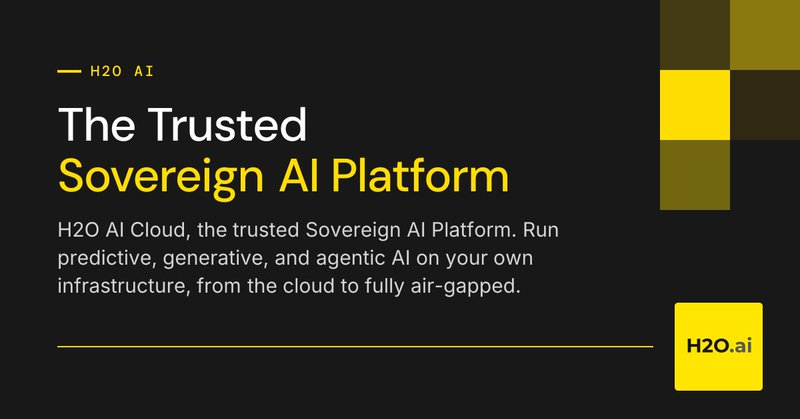

# 🐦 @rasbt

## 📅 November 13, 2026

> 1 post(s) archived.

---

### 🕐 19:12 UTC · @rasbt

> Wow that escalated quickly. Was gone for a few weeks and now pretty much everyone launched their own decision model copycats: - Sep 23: Together AI, Tev1-4B - Sep 24: Alibaba Cloud, decision-model - Sep 29: Liquid AI, d1 - Sep 30: Databricks, ai_decide - Oct 1: Amazon AWS, Strands Decider 2B - Oct 1: Cloudflare, Clef and Clef-flash (Clef-omni on Oct 9) - Oct 1: Perplexity, Decider (v1.3 on Nov 12) - Oct 6: OpenAI, Decisions API (GPT-6 Luna) - Oct 7: http://H2O.ai, H2O-Lightning-4B - Oct 7: Snowflake, Snowflake Decision - Oct 9: Microsoft, Microsoft-Decision-1 - Oct 15: IBM, Granite Switch 4.1 with Decision adapter - Oct 21: Baseten, Mammoth-1 and Elephant-1 - Nov 6: Salesforce, Koa Decisions - Nov 11: Google DeepMind, Gemini Decision 1 According to a Vercel report, 26% of requests are now routed through decision models 📈 Took a while, but here it is, a mega write-up on language models for text classification and, of course, Jev. It&apos;s basically a visual guide to RNNs, CNNs, transformers, and calibration, with hands-on experiments on accuracy and efficiency.

🔗 [View original post](https://x.com/rasbt/status/2121320349837263230)

---
