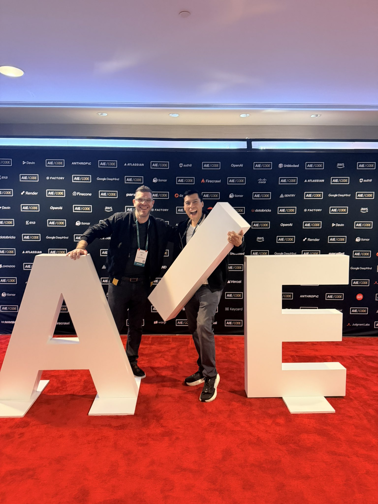
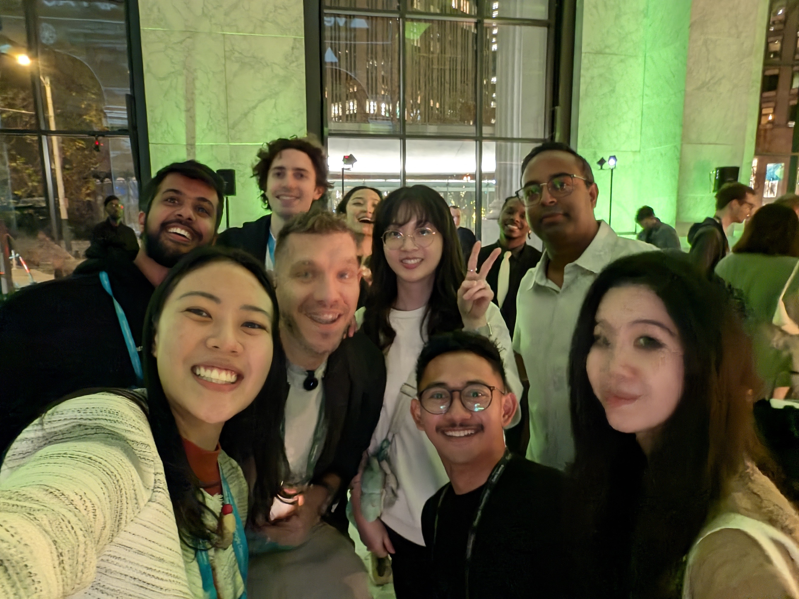
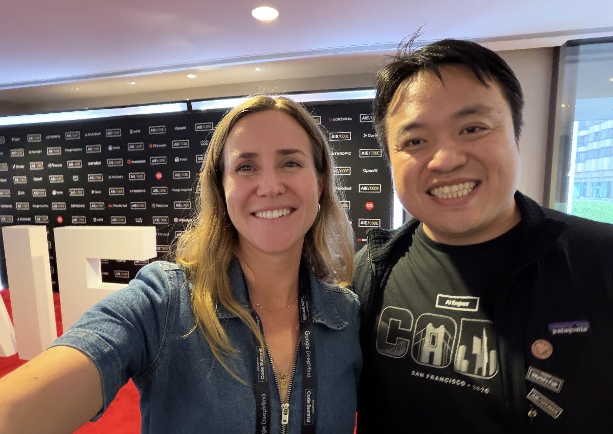
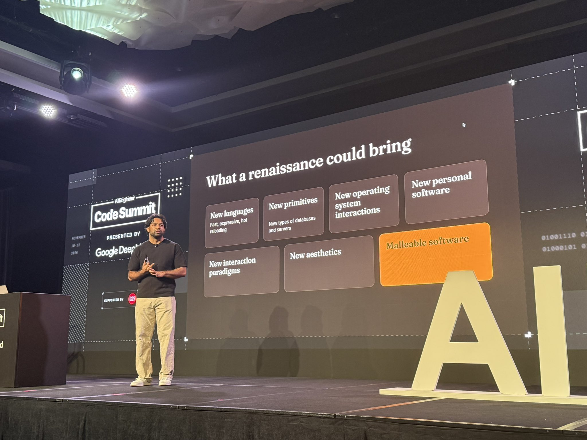
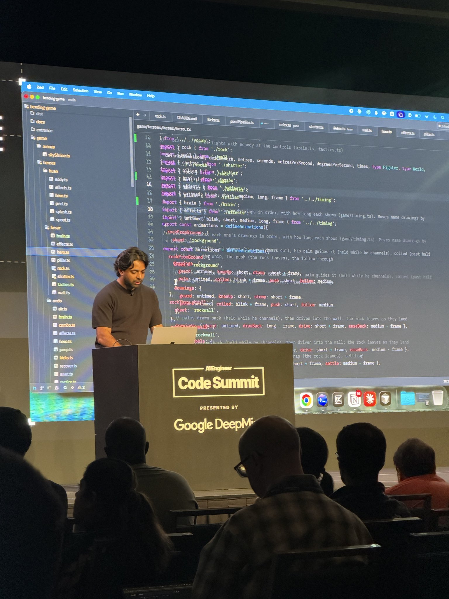
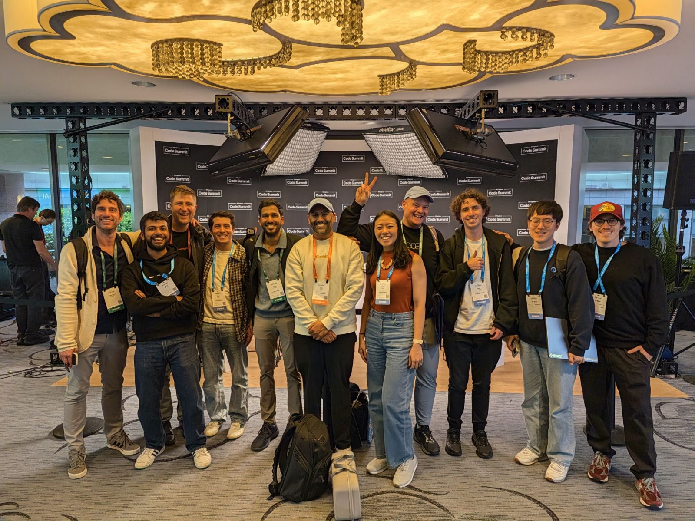
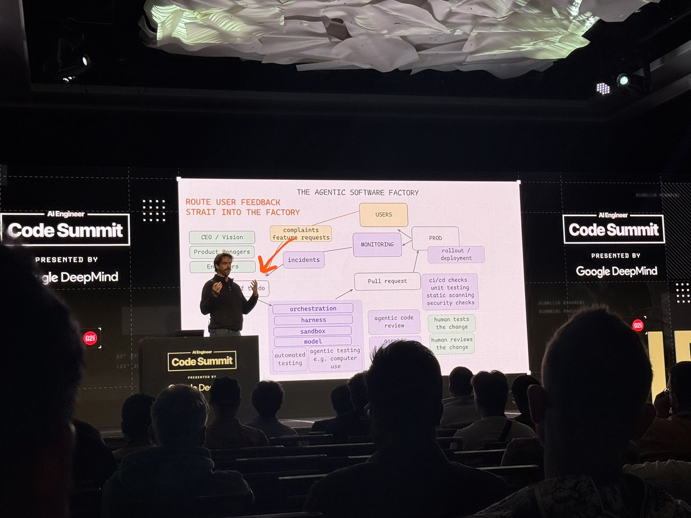
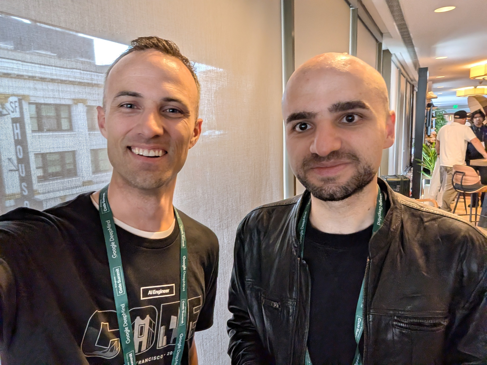

# 🐦 @swyx

## 📅 November 13, 2026

> 16 post(s) archived.

---

### 🕐 05:36 UTC · @swyx

> AIE code summit is done! @swyx said this was the 10th one! What a great event this is! Much higher quality folks, conversations are full of alpha, new ideas, zeitgeist updates is top notch! Also I heard X allows a photo dump now? Great for post event summary! This time besides doing the regular LIVE ThursdAI show, me and @RayFernando1337 ran around and did a hallway track stream, and talked to tons of speakers, attendees, and organizers. The event was impeccably organized yet again, this time with @Beccalytics and @g2i_ai great execution and taste! Food was dope, after parties and speakers dinners were superbly organized! Really my only complaint is WiFi but that&apos;s up to the hotel usually? But so many great folks are getting into the AIE circle, that it&apos;s more than compensates for the poor connectivity! Got to see old friends and make many many new ones, learn a ton about Factories from @dexhorthy @kentcdodds and @zachlloydtweets among others, formal verification from @poteto (also shared an actual poteto ha!) and type one models from @michellechen and @ivanleomk The three themes this time according to Swyx were: - Factories - Type One models - Dreaming bigger Saw an amazing crowd around @echelon - who represents the &quot;dream bigger&quot; at this event with ArtCraft 👏 And of course felt like a Billionaire hanging out with @DevinAI at the Token Billionaires lounge! (Huge shoutout to @mattbergland yes again!) If you feel FOMO - please do check out our coverage we had a lot of fun getting behind the scene and showing you the hallway track

🔗 [View original post](https://x.com/altryne/status/2121114914429501842)

---

### 🕐 05:26 UTC · @swyx

> Very cool humans hanging out at @aiDotEngineer ♥️ @poteto @altryne @osanseviero @EvanOtero @vamsibatchuk @ericavaneee @nafisazizir

🔗 [View original post](https://x.com/hellogabbo/status/2121112508849152350)

---

### 🕐 04:35 UTC · @swyx

> The @aiDotEngineer code summit went off 🚀 Huge congrats to @swyx on bringing so many amazing people together, really the 🐐🫶

🔗 [View original post](https://x.com/meganreyno/status/2121099689269535035)

---

### 🕐 03:53 UTC · @swyx

> and straight to broadway show rehearsal :) see you saturday Media [non tech, non work post] Some of you know I have a side gig singing Broadway musicals. Proud to announce we&apos;re back next week (right after AIE CODE)! http://bow.show Nov 14 3pm/7pm shows left (Nov 13 sold out) ft. our favorite songs from: - Tick Tick Boom - Hamilton - Grease - …

🔗 [View original post](https://x.com/swyx/status/2121088973372334443)

---

### 🕐 02:33 UTC · @swyx

> AIE Code Summit After loading... Media Media

🔗 [View original post](https://x.com/MarcBaiza/status/2121068981436198914)

---

### 🕐 02:28 UTC · @swyx

> it’s time to retvrn Apt closing to a great @aiDotEngineer with @trq212 writing code live, using an IDE.

🔗 [View original post](https://x.com/trq212/status/2121067561915916575)

---

### 🕐 02:02 UTC · @swyx

> A renaissance of software in 2027? Closing talk from @trq212 at @aiDotEngineer in two sentences: 2026 was the industrial revolution of software. Now let’s build its Renaissance. We’ve spent this year obsessing over software factories, coding agents, productivity, and how much software we can produce. And yes, the industrial revolution is happening. Software is becoming dramatically cheaper to build. But Thariq argues something equally exciting is happening: as AI gets better, we no longer have to adapt to how models prefer to work. We can make them work the way WE want. And that opens up an enormous creative frontier. New programming languages designed around human understanding. New databases. New operating systems. New interfaces. Decades of HCI research suddenly worth revisiting. His own experiment is a game where AI handles the complicated engine while he works in a human-readable language he designed to control every creative decision. The point is to stop accepting whatever software AI happens to generate and start shaping what software could actually become. The industrial revolution is about making more things, faster and cheaper. The Renaissance is about making things we couldn’t even conceive of before, with more creativity, quality, and soul. And… the Renaissance won’t happen automatically because models get smarter. We - you - have to build it. That’s a pretty exciting mission for 2027. Awesome conference, you have to watch it - and congrats to @swyx and the whole team with phenomenal 1,000,000 subscribers on YouTube 🎉

🔗 [View original post](https://x.com/TheTuringPost/status/2121060997964431640)

---

### 🕐 01:58 UTC · @swyx

> the production team got us a cake!! #aie1m Media ONE MILLION subscribers for @aiDotEngineer! What a way to close Code Summit 2026. Two days of software factories, human judgement, verification and agents that organize themselves. Flew in from Milan and would do it again tomorrow. Huge congrats to the whole team! @swyx

🔗 [View original post](https://x.com/swyx/status/2121060183988486493)

---

### 🕐 01:44 UTC · @swyx

> Quinn Slack (@sqs), Amp at #AIECode: the company of the future has code review, no PRs, no departments, and no roadmap. Media

🔗 [View original post](https://x.com/helloLizZhang/status/2121056582729699330)

---

### 🕐 01:39 UTC · @swyx

> Last talk of the conference, I think the first session that had source code on screen :)

🔗 [View original post](https://x.com/lucasmeijer/status/2121055438825234601)

---

### 🕐 01:23 UTC · @swyx

> What a week at @aiDotEngineer! S/o to @swyx for making it happen, and thanks to everyone who came by to say hi and celebrate the week of Gemini. 🚢

🔗 [View original post](https://x.com/EvanOtero/status/2121051314591572215)

---

### 🕐 01:23 UTC · @swyx

> This workflow is gold. I’ve been working on improving all my agents, and the quality of work they do. @dexhorthy made an amazing presentation, and I will be implementing all of this into my workflow

🔗 [View original post](https://x.com/calebhowell437/status/2121051174967410948)

---

### 🕐 01:22 UTC · @swyx

> New @dexhorthy manifesto just dropped 👀 https://www.slopmanifesto.com/

🔗 [View original post](https://x.com/andrewtorkbaker/status/2121050932993769486)

---

### 🕐 01:21 UTC · @swyx

> Super to chat with @jarredsumner at @aiDotEngineer about the future of programming languages and open source!

🔗 [View original post](https://x.com/kentcdodds/status/2121050834708647965)

---

### 🕐 01:21 UTC · @swyx

> Last year people laughed at the idea of &quot;vibe-coding Salesforce&quot;. Now? People realize you only ever need 1% of Salesforce, and more and more people can use an agent to build the 1% they need plus the other stuff that Salesforce would never have built. And I think we all know which would be better to use. “Why would you vibecode Salseforce? Why would you do that?? Would you be proud if you vibecoded a CRM and Salesforce came out the other end?” – @sqs on building a “new kind of company” at @aiDotEngineer

🔗 [View original post](https://x.com/sqs/status/2121050803024847011)

---

### 🕐 01:09 UTC · @swyx

> Spoke at @aiDotEngineer about what&apos;s changed about working with agents in @antigravity ! A lot of times dictating the exact steps keeps things in a local optimum. We should instead shift to defining what good looks like and free our agents to explore. Media

🔗 [View original post](https://x.com/ivanleomk/status/2121047741719814217)

---
