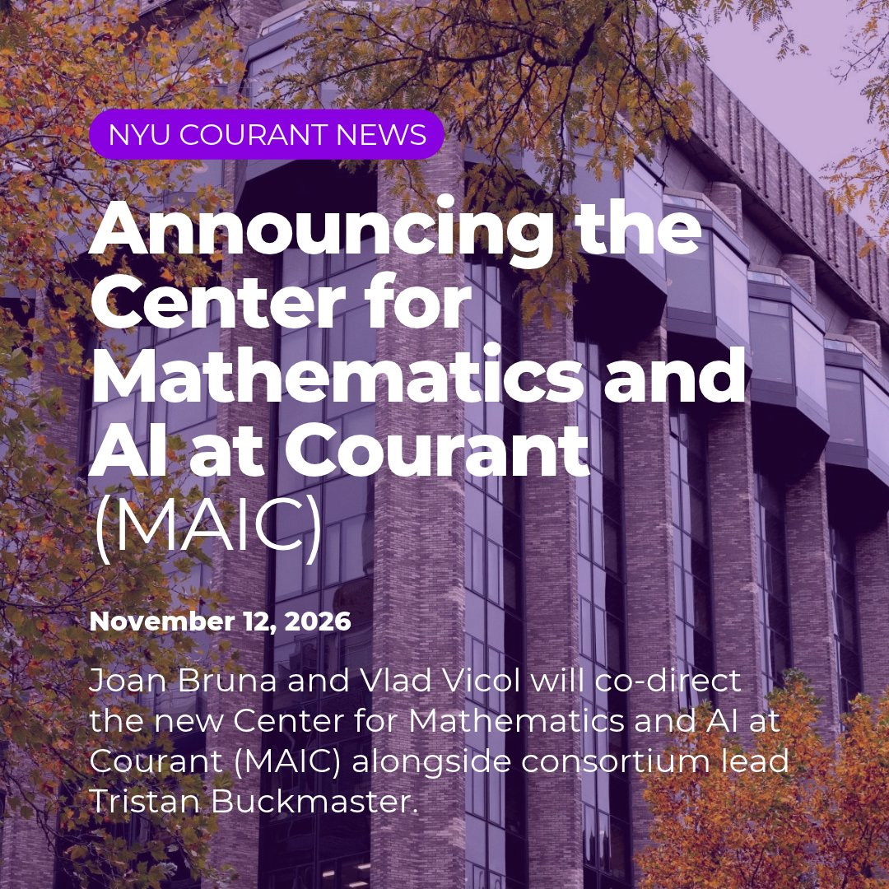

# 🐦 @ylecun

## 📅 November 13, 2026

> 4 post(s) archived.

---

### 🕐 16:21 UTC · @ylecun

> The investigation into FLI&apos;s crypto donation is now updated with new information from the Bitcoin Policy Institute&apos;s report: How FTX and Alameda Research may have helped turn the enormous but largely illiquid SHIB donation into hundreds of millions of dollars for FLI.

🔗 [View original post](https://x.com/DrTechlash/status/2121277195230609569)

---

### 🕐 16:06 UTC · @ylecun

> Yesterday we announced the establishment of the new Center for Mathematics and AI at Courant (MAIC). Its mission is to make frontier AI systems an object of scientific inquiry, one that the broad mathematical community can dissect, improve, reproduce—and ultimately—understand.

🔗 [View original post](https://x.com/NYU_Courant/status/2121273521158717782)

---

### 🕐 14:47 UTC · @ylecun

> Swing by Northwestern University, Ruan Conference room (lower level), at 11am Central! Will be speaking about end-to-end learning of predictive abstractions on any data! We will see how and why humans got so good at this, and why JEPAs are the next step https://statistics.northwestern.edu/events/seminars/fall-seminars.html

🔗 [View original post](https://x.com/randall_balestr/status/2121253690019401989)

---

### 🕐 12:43 UTC · @ylecun

> 终于实锤了❗️❗️ 干掉黄仁勋的，不是婚外情，而是一场由美国政客、媒体、CIA和Anthropic 联合做局的“完美猎杀”。 黄仁勋辞职后，《纽约时报》两名记者在播客里亲口承认： 他们是收到了一位“科技界联系人”的爆料，才去查Megaspeed的。这个联系人，被开源情报指向了Anthropic 的联合创始人杰克·克拉克。 原来，这个Anthropic 的联合创始人杰克是彻头彻尾的恶魔😈。这个家伙后续必死无疑！ 顺着资金链往下挖，全是对得上的： Anthropic今年向支持“收紧对华芯片管制”的组织捐了 4000万美元。 逼黄仁勋辞职的参议员克莱默，收过Anthropic 5.1万美元政治捐款。 CIA监听黄乐一年拿不出间谍实锤，却在中期选举后精准放料。 纽时配合政客，用匿名员工爆料补上“第二段婚外情”。 CIA给黑料，Anthropic出钱，政客挥刀，媒体处刑。 黄仁勋反对封杀中国AI芯片，说“限制不明智”。 而Anthropic靠闭源API赚钱，最怕中国开源模型在GPU上免费跑。让英伟达戴上镣铐，Anthropic才能活下去。 他的“罪”，不是睡了谁。 黄仁勋挡了丑陋资本的路，挡住了美国政客的枪口，还是一个不听话的华人。

🔗 [View original post](https://x.com/Dragonhau66/status/2121222461186347374)

---
