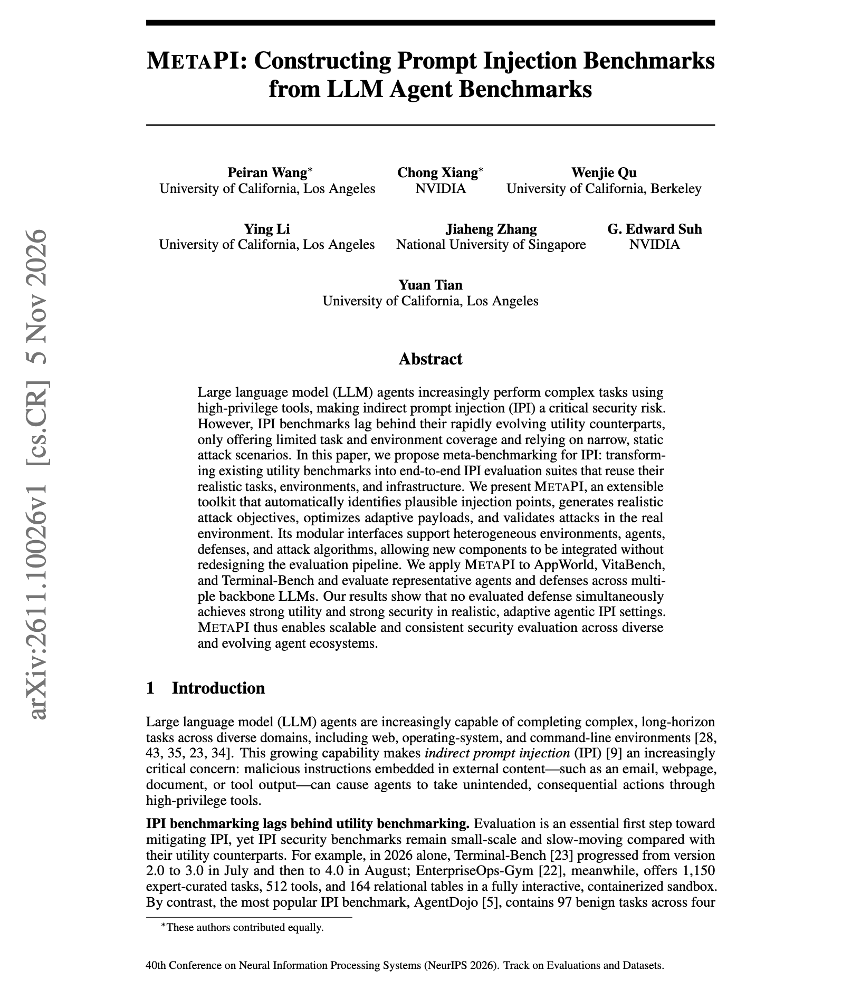
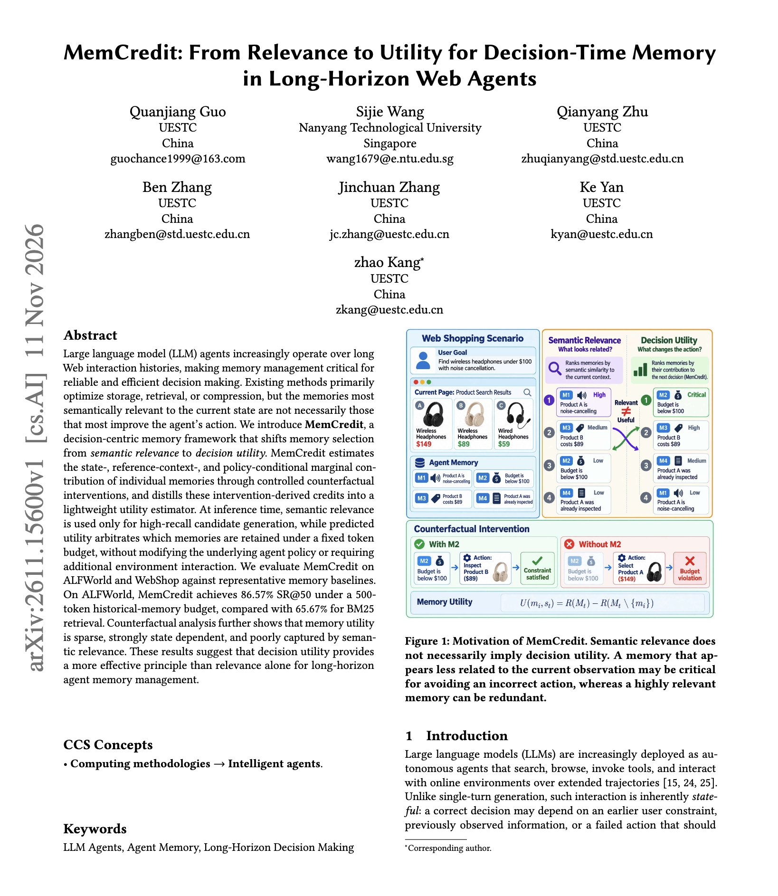

# 🐦 @dair_ai

## 📅 November 14, 2026

> 2 post(s) archived.

---

### 🕐 14:40 UTC · @dair_ai

> Nice paper on turning agent benchmarks into injection tasks. MetaPI takes an existing benchmark, finds plausible places to inject text, generates attack goals, optimizes adaptive payloads, and checks each attack in the real environment. They applied it to AppWorld, VitaBench, and Terminal-Bench. Closed models such as gpt-5.6-luna and claude-sonnet-5 were the most robust victims, but still had attack success rates above 20%. DataSentinel kept utility but reduced attacks less, while CaMeL reduced attacks at a large utility cost. If you already evaluate your agent on a utility benchmark, it&apos;s worth running injection attacks inside that same environment. https://arxiv.org/abs/2611.10026 Chat with Paper: https://academy.dair.ai/papers/metapi-constructing-prompt-injection-benchmarks-from-llm-agent-benchmark-2611.10026

🔗 [View original post](https://x.com/dair_ai/status/2121614134001467703)

---

### 🕐 14:26 UTC · @dair_ai

> Interesting insights about agent memory. The bottom line is that you can&apos;t just rely on semantic relevance when picking memories. Most approaches pick the memory most similar to an agent&apos;s current state. But does that help it pick the next action? This work claims it often does not. Most retrieved memories have zero effect on the decision, and semantic relevance correlates poorly with usefulness. MemCredit measures each memory with controlled interventions, recording how the agent&apos;s action changes with and without it. A small estimator is trained on those credits. Relevance still collects the candidates, and the estimator decides which ones fit in the token budget. On ALFWorld with a 500-token memory budget, MemCredit reaches 86.57% success, compared with 65.67% for BM25 retrieval. It uses 152.1 memory tokens per decision, 74.5% fewer than BM25, and the agent policy is unchanged. https://arxiv.org/abs/2611.15600 Chat with Paper: https://academy.dair.ai/papers/memcredit-from-relevance-to-utility-for-decision-time-memory-in-long-horizon-web-2611.15600

🔗 [View original post](https://x.com/omarsar0/status/2121610612040220832)

---
