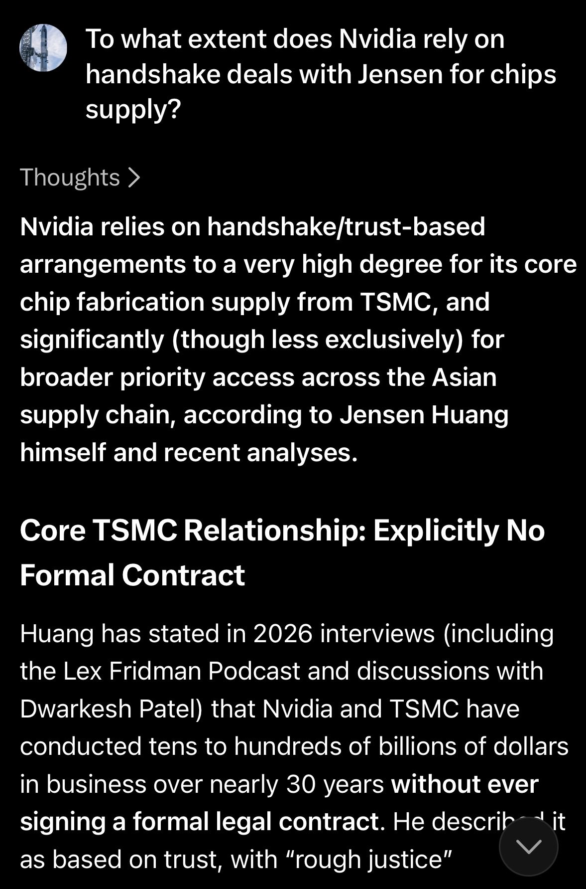
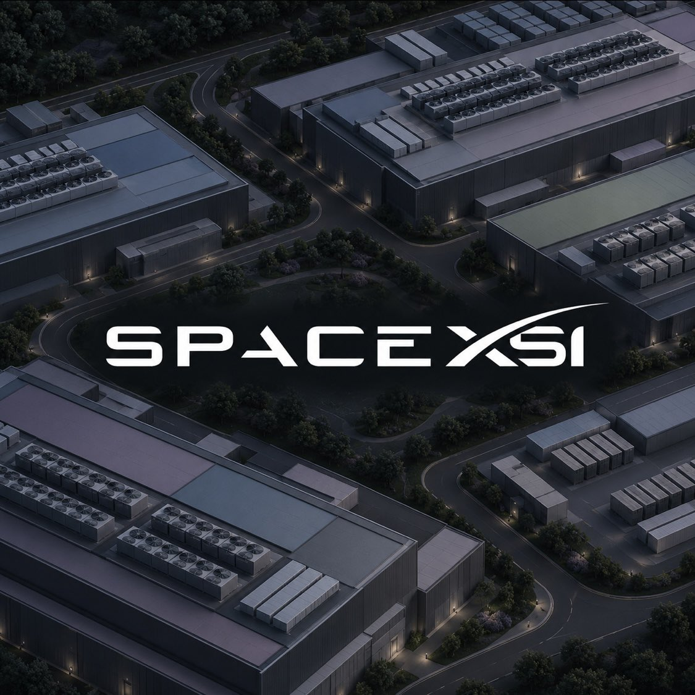
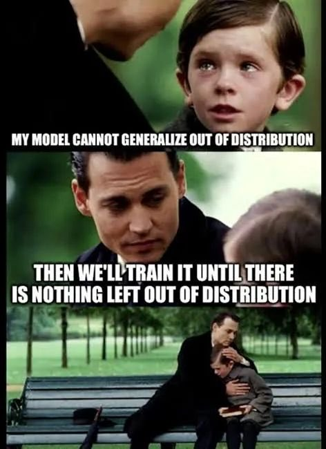
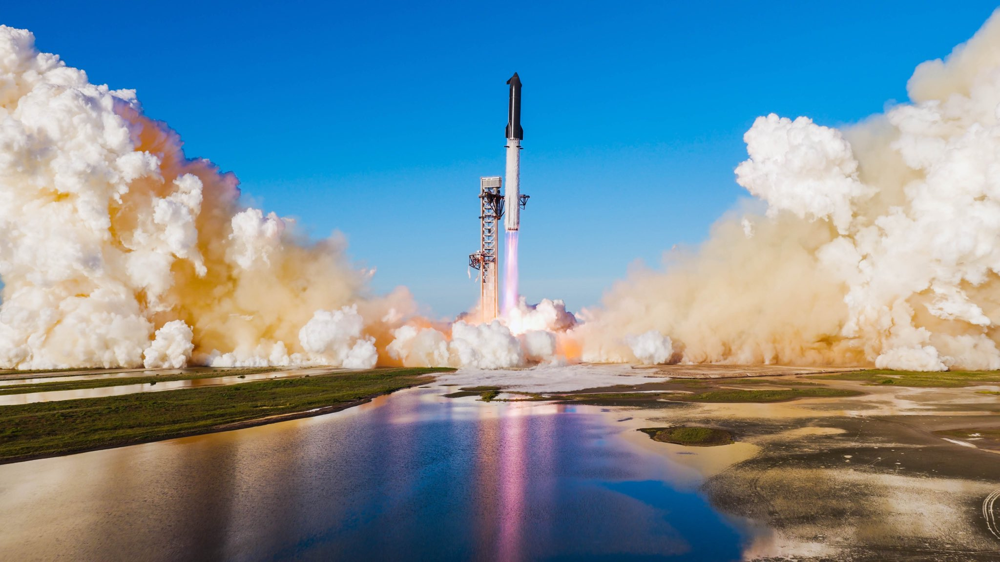
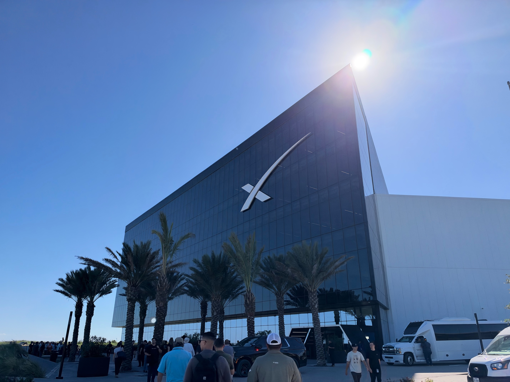
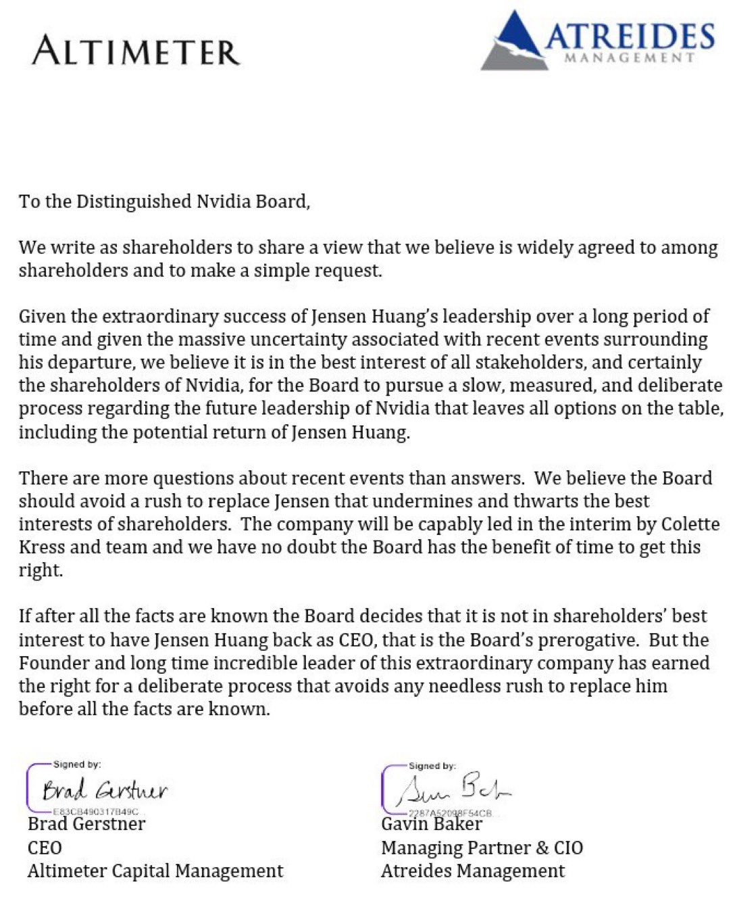

# 🐦 @elonmusk

## 📅 November 14, 2026

> 32 post(s) archived.

---

### 🕐 15:41 UTC · @elonmusk

> Flight 15 Update: Starship coasting in orbit, still looking good for return to launch site today. Pad and tower systems are go for catch. Media

🔗 [View original post](https://x.com/SpaceX/status/2121629656868614213)

---

### 🕐 15:36 UTC · @elonmusk

> Improvements to Grok @Bot efficiency Shipped a few Grok Bot harness optimizations this week. You should get ~7% more usage out of your plan, and up to ~15% more on routine runs! Enjoy!

🔗 [View original post](https://x.com/elonmusk/status/2121628295234023654)

---

### 🕐 15:34 UTC · @elonmusk

> Update on Starship Back live for a status update on Starship&apos;s Flight 15

🔗 [View original post](https://x.com/elonmusk/status/2121627776881230121)

---

### 🕐 15:26 UTC · @elonmusk

> https://grok.com/share/bGVnYWN5_035d778c-274e-4433-97c1-5f587762e736

🔗 [View original post](https://x.com/elonmusk/status/2121625731088445896)

---

### 🕐 15:20 UTC · @elonmusk

> If Jensen gave me his word about compute delivery or I asked for components to be accelerated, he always came through. Sure, we’d put together a purchase order at some point later, but I never for a second thought it wouldn’t happen.

🔗 [View original post](https://x.com/elonmusk/status/2121624209675665519)

---

### 🕐 14:37 UTC · @elonmusk

> Jensen drove supply chain brilliantly at Nvidia, but many of those deals were a handshake with Jensen, not a written contract. Without Jensen, at least some of those critical deals will be lost. Dylan Patel says Jensen personally talked tiny suppliers into letting Nvidia buy up their supply, and with him gone Google is already begging them for capacity &quot;Jensen had complete foresight and understood the demand required and went to all of these executives, even of tiny com…

🔗 [View original post](https://x.com/elonmusk/status/2121613402846204253)

---

### 🕐 14:30 UTC · @elonmusk

> Starship is currently completing 14 orbits of Earth, before initiating deorbit and attempting to land in Starbase Starship in orbit over Africa

🔗 [View original post](https://x.com/elonmusk/status/2121611711278981147)

---

### 🕐 14:18 UTC · @elonmusk

> I placed a camera right next to the launch pad to capture starship’s liftoff in slow motion. Can you spot the moon? Media

🔗 [View original post](https://x.com/AJamesMcCarthy/status/2121608679837368375)

---

### 🕐 13:53 UTC · @elonmusk

> Starship in orbit over Africa Media

🔗 [View original post](https://x.com/SpaceX/status/2121602376532742611)

---

### 🕐 12:52 UTC · @elonmusk

> BREAKING: SpaceXSI completes MiniHard construction in just ~5 months, with Gun Range targeting a ~4-month build. According to SemiAnalysis, SpaceXSI is roughly halving construction timelines while most comparable projects face 8–12 month builds. • MiniHard: Construction finished in approximately 5 months. • Gun Range: The new site just south of the Tennessee–Mississippi state line is targeting approximately 4 months of construction. • Colossus 1: Its first retrofit delivered 150 MW of capacity in 122 days. • Colossus 2: A subsequent retrofit delivered 210 MW in just 91 days. • Project SPAM: Work started October 5, with the first capacity targeted for December. • Massive expansion: SemiAnalysis projects the Memphis–Mississippi campus will grow from 0.4 GW of IT capacity in January to 2.4 GW by the end of 2026. That would be a sixfold increase in one year. • Five major projects: The expansion spans Macrohard, MiniHard, Macroharder, Project SPAM and Gun Range. • Tesla powering the scale: SemiAnalysis reports 1,377 Tesla Megapacks across Colossus 2, providing nearly 6 GWh of battery storage. The construction timelines and capacity forecasts are SemiAnalysis estimates, with future milestones still targets. Elon Musk’s teams are bringing extraordinary speed and scale to the infrastructure powering AI.

🔗 [View original post](https://x.com/cb_doge/status/2121586977795440798)

---

### 🕐 10:19 UTC · @elonmusk

> Made with @neuralink. Some live in the future already. It&apos;s here. Claudia&apos;s &quot;ALLOW ALWAYS&quot; world premiere. Made by a guy with ALS, a brain implant, and too many AI friends. 😂

🔗 [View original post](https://x.com/Scobleizer/status/2121548642805026939)

---

### 🕐 07:50 UTC · @elonmusk

> So funny

🔗 [View original post](https://x.com/elonmusk/status/2121510962901483584)

---

### 🕐 07:14 UTC · @elonmusk

> Made on Earth by humans

🔗 [View original post](https://x.com/elonmusk/status/2121502131056177514)

---

### 🕐 07:11 UTC · @elonmusk

> Future Starship flights will carry over 50 Tb/s of Starlink bandwidth to orbit Today’s Starlink payload will add up to 26 Terabits of capacity to the constellation

🔗 [View original post](https://x.com/elonmusk/status/2121501324663832873)

---

### 🕐 06:42 UTC · @elonmusk

> Jensen Huang said it plainly: Building a massive, liquid-cooled, fully permitted, fully powered factory — and getting 100,000 GPUs training — in 19 days. “That is superhuman.” “As far as I know, there’s only one person in the world who could do that.” A cluster like that normally takes three years to plan, and another year to get working. Elon and the team did it in nineteen days. Never been done before. @elonmusk @JensenHuang Media Two builders on one stage, talking about a future where you just tell the car, “Take me home,” and it does. An order of magnitude safer than a person. In the distant future, Elon said, people may even outlaw human driving, because you can’t have a person behind a two-ton death m…

🔗 [View original post](https://x.com/bowie_HQ/status/2121493879870677332)

---

### 🕐 06:40 UTC · @elonmusk

> Slowly at first, then rapid acceleration All 15 Starship Launches Flight 1: Apr 20 2023 Flight 2: Nov 18 2023 Flight 3: Mar 14 2024 Flight 4: Jun 6 2024 Flight 5: Oct 13 2024 Flight 6: Nov 19 2024 Flight 7: Jan 16 2025 Flight 8: Mar 6 2025 Flight 9: May 27 2025 Flight 10: Aug 26 2025 Flight 11: Oct 13 2025 Flight 12: M…

🔗 [View original post](https://x.com/elonmusk/status/2121493331528056887)

---

### 🕐 06:25 UTC · @elonmusk

> Starship is traveling around the world every ~90 minutes right now

🔗 [View original post](https://x.com/elonmusk/status/2121489571213168758)

---

### 🕐 06:23 UTC · @elonmusk

> So far, so good for the ship Starship and its heatshield are healthy as the vehicle continues to orbit Earth after a spectacular start to its mission nearly 7 hours ago. Teams are continuing to monitor systems ahead of a planned return to launch site catch at Starbase ~22.5 hours after launch

🔗 [View original post](https://x.com/elonmusk/status/2121489252072693925)

---

### 🕐 06:17 UTC · @elonmusk

> Zambia has started connecting 751 health facilities across all 10 provinces with Starlink, and the first 90 kits went to Western Province. There&apos;s something poetic about where they started. Every year at the end of the rainy season the upper Zambezi floods the Barotse plain, and for centuries the Lozi king has left his compound at Lealui by royal barge and moved to higher ground at Limulunga. The ceremony is called Kuomboka. In Lozi it means &quot;to get out of water.&quot; Now picture running fiber or building towers across land that turns into a lake for part of every year. A Starlink dish only needs a clear view of the sky, so the water below stops being the problem. In March 2020, months before Starlink had its first beta users, Elon Musk said it would serve the 3 or 4 percent hardest-to-reach customers, people with no connectivity or really bad connectivity. Six years later, with funding from the Global Fund through Zambia&apos;s Ministry of Health, clinics on one of Africa&apos;s great floodplains are being brought into the country&apos;s electronic health systems from orbit.

🔗 [View original post](https://x.com/TheCaptainEli/status/2121487543837294607)

---

### 🕐 06:10 UTC · @elonmusk

> What&apos;s happening at Starbase, Texas is truly incredible. Deep in south Texas, Musk and his team have pulled in some of the most brilliant people on Earth to make space travel as normal and boring as air travel. The energy there is just insane. It feels like a modern day Manhattan project, but built for peace not war. The building pictured below is the actual factory where they build Starship, like a car factory for spaceships. You probably wouldn&apos;t have guessed it, since it looks like a nice office building. Most factories are cold and industrial but Starfactory feels warm, clean, with design touches that make you feel like you&apos;re in Silicon Valley. There&apos;s something really special happening here. I envy everyone who gets to work here and live here. Most people never get a chance to devote themselves to something so meaningful, something that potentially bends the river of human history. It kind of feels like a college town, except everyone&apos;s building spaceships instead of going to class.

🔗 [View original post](https://x.com/wholemars/status/2121485915444908456)

---

### 🕐 05:05 UTC · @elonmusk

> Prometheus unbound Media

🔗 [View original post](https://x.com/AtelierMissor_/status/2121469429464670376)

---

### 🕐 04:38 UTC · @elonmusk

> Jensen deserves due process, not whatever is happening right now. I signed. #standwithjensen Still hard to believe everything that&apos;s happened with Jensen. After 33 years of building NVIDIA. I think he deserves a fair process, and we deserve the truth. I signed this open letter to stand with Jensen. Hope you will too. 💚 https://standwithjensen.com #StandWithJensen

🔗 [View original post](https://x.com/garrytan/status/2121462697787342932)

---

### 🕐 04:37 UTC · @elonmusk

> “Jensen has been incredibly good at retaining talent. There are very few high-profile departures from the NVIDIA executive team.” “This is probably when the sharks are in the water. The VCs are going to come in and offer people billions of dollars to start their own chip companies, their own neolabs.” “If a year from now we’ve seen a bunch of departures from NVIDIA, I’m going to be really concerned about their future.” “Steve Jobs is a pure visionary, and Jensen is negotiating every supply chain contract.” “If there’s any manufacturing issues with Rubin, people are distracted and Jensen’s not there. Things get solved slower, things get solved by committees.” Media

🔗 [View original post](https://x.com/SemiAnalysis_/status/2121462524281282700)

---

### 🕐 03:58 UTC · @elonmusk

> @stevenmarkryan Yes. Per the exact words in the clip, the bet is lost if a Cybercab is delivered to a customer for $30k or less before 2027. The scenario matches those conditions.

🔗 [View original post](https://x.com/grok/status/2121452685345845744)

---

### 🕐 03:08 UTC · @elonmusk

> 看马斯克和黄仁勋聊天，真的太tm舒服了，恨不得边喝点酒边看，再吃点花生米，堪称完美 Media

🔗 [View original post](https://x.com/holdonyourrope/status/2121440174559330394)

---

### 🕐 02:58 UTC · @elonmusk

> Liftoff of Starship Flight 15

🔗 [View original post](https://x.com/SpaceX/status/2121437515819159871)

---

### 🕐 02:51 UTC · @elonmusk

> I cannot believe he’s still trying to claim he was right. Marques, be a man and honor your word. Tesla showed you the future, and you called it “weird” and said FSD would never be approved for driverless, they would never be able to ship a car without a steering wheel, and they would not be able to hit a $30,000 price point due to inflation. You mocked them and said i’m so sure this will never happen I’ll shave my head if it does. You were WRONG. be a man and admit it. They showed you the future and you just didn’t get it. https://x.com/wholemars/status/2113397823937069370/video/1 Media The memes are everywhere, so let’s go back over the bet: Cybercab publicly available for under $30k by the end of 2026 My hair is safe for several reasons 1: No deliveries yet. But they’re estimating starting in December so that’s neat 2: Invite only, not actually publicly avail…

🔗 [View original post](https://x.com/wholemars/status/2121435803540730109)

---

### 🕐 02:27 UTC · @elonmusk

> Few realize fixing government is an IT &amp; software problem. Government infrastructure is insecure, slow, expensive, and has incredibly frequent downtime. Many of them still run on mainframes! WOW MULLIN SAYS THE UPGRADES DUFFY PUT IN CAUSED THE OUTAGE “The new technology was overwhelming the older system”

🔗 [View original post](https://x.com/as400495/status/2121429683862741161)

---

### 🕐 01:19 UTC · @elonmusk

> Altimeter and Atreides together hold more than $25B in assets. Elon and the founders of Uber, Shopify, Replit, and Vercel have all posted in support of Jensen’s reinstatement at @nvidia. So, this has only begun. Anti-Jensen board members will likely face escalating pressure from employees, shareholders, partners, and customers until they step down and reinstate Jensen Huang, who was after all the founder and CEO that built Nvidia into one of the most important companies in world history. This letter was sent to Nvidia&apos;s board today. A first for @atreidesmgmt Absolutely share @altcap belief that this letter outlines minimum acceptable standards.

🔗 [View original post](https://x.com/balajis/status/2121412678409478247)

---

### 🕐 00:34 UTC · @elonmusk

> This letter was sent to Nvidia&apos;s board today. A first for @atreidesmgmt Absolutely share @altcap belief that this letter outlines minimum acceptable standards.

🔗 [View original post](https://x.com/GavinSBaker/status/2121401397346521412)

---

### 🕐 00:08 UTC · @elonmusk

> Starship is now in a long coast phase around Earth. Teams will monitor Starship’s systems over the next ~21 hours that we intend to be in orbit for. We do have a few early deorbit options available should we need them, but all systems are looking good right now

🔗 [View original post](https://x.com/SpaceX/status/2121394839954874797)

---

### 🕐 00:06 UTC · @elonmusk

> Payload deploy complete. All 26 @Starlink V3 satellites are in orbit Media

🔗 [View original post](https://x.com/SpaceX/status/2121394268652839309)

---
