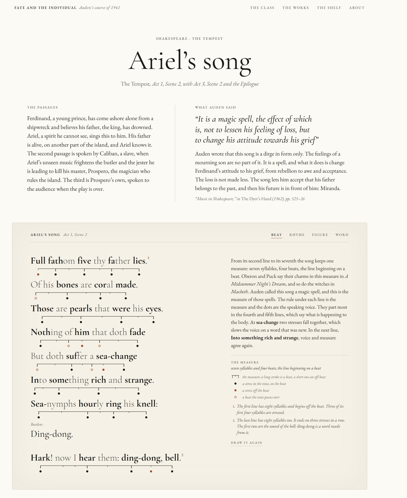
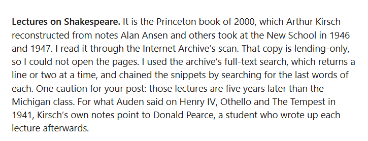

# 🐦 @emollick

## 📅 November 14, 2026

> 4 post(s) archived.

---

### 🕐 18:51 UTC · @emollick

> The end result of the reconstruction is very impressive, however. It made a version of the lost class, called the “hardest in the humanities,&quot; that is remarkably accessible and based on scattered textual evidence from Auden&apos;s writing &amp; surviving notes. https://auden-english-135.netlify.app/#/tempest/song/0 The traffic from agent swarms doing research is going to be quite large, they are relentless. I had Fable 5.2 reconstruct WH Auden&apos;s 1941 poetry class. It found an obscure, relevant book on the Internet Archive, which it read a line at a time by doing repeated full text searches…

🔗 [View original post](https://x.com/emollick/status/2121677485960003891)

---

### 🕐 16:29 UTC · @emollick

> But we also don&apos;t want to stop agents from doing relevant academic research (or even commercial research, since it might mention your product) with too many gates and barriers. In any case, I donated to the Internet Archive for my use of the commons, but better solutions needed.

🔗 [View original post](https://x.com/emollick/status/2121641774468788474)

---

### 🕐 16:28 UTC · @emollick

> The traffic from agent swarms doing research is going to be quite large, they are relentless. I had Fable 5.2 reconstruct WH Auden&apos;s 1941 poetry class. It found an obscure, relevant book on the Internet Archive, which it read a line at a time by doing repeated full text searches.

🔗 [View original post](https://x.com/emollick/status/2121641417483169934)

---

### 🕐 02:14 UTC · @emollick

> Lots of people jumping to the immediate conclusion that the big outages of the last couple were due to AI, either being used offensively or due to AI errors. They were not due to AI. (Which does not mean that the next outage won&apos;t be due to AI, of course)

🔗 [View original post](https://x.com/emollick/status/2121426404349030584)

---
