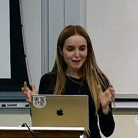
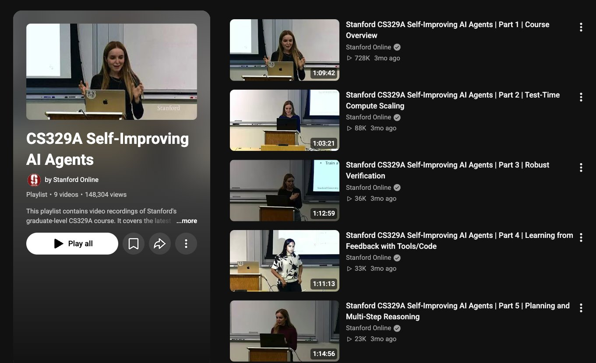

# 🐦 @omarsar0

## 📅 November 14, 2026

> 5 post(s) archived.

---

### 🕐 16:47 UTC · @omarsar0

> I&apos;ve been having several conversations with folks building in both spaces, and it&apos;s clear that without evals, that recursive self-improving loop is just more LOC without any clear value. You can&apos;t effectively automate what you cannot properly measure. Whatever product you use for agent automation should have a first-class way to measure and build evals explicitly, or support it easily. Pay close attention to this. And this isn&apos;t just about software engineering/coding; it&apos;s across all functions of the org.

🔗 [View original post](https://x.com/omarsar0/status/2121646095851986988)

---

### 🕐 16:40 UTC · @omarsar0

> There is no &quot;software factory&quot; without an &quot;eval factory&quot;.

🔗 [View original post](https://x.com/omarsar0/status/2121644490188374081)

---

### 🕐 16:37 UTC · @omarsar0

> I am doing a much bigger dive on the top, but please let me know if you have any questions that need clarification. Plus, you can track all the latest papers on this topic here: https://x.com/omarsar0/status/2121277499673895121?a=ykywP2ajBV3w6oZ0tXA&amp;s=20 Introducing our new AI Paper Collections. You can now track highly recommended papers and tools for harness engineering and recursive self-improvement. Updates daily! Built on our in-house paper curation tools. You can also chat with the papers via our paper chat tool or MCP too…

🔗 [View original post](https://x.com/omarsar0/status/2121643648333050357)

---

### 🕐 16:18 UTC · @omarsar0

> https://www.youtube.com/playlist?list=PLangBM27OtEA

🔗 [View original post](https://x.com/omarsar0/status/2121638809477828676)

---

### 🕐 16:18 UTC · @omarsar0

> // CS329A Self-Improving AI Agents (by Stanford) // Lots of students have been asking me for good lectures on self-improving AI. This one has good content and lots of good references. I&apos;ve started putting together my own notes and will share soon. (bookmark it)

🔗 [View original post](https://x.com/omarsar0/status/2121638797419118619)

---
