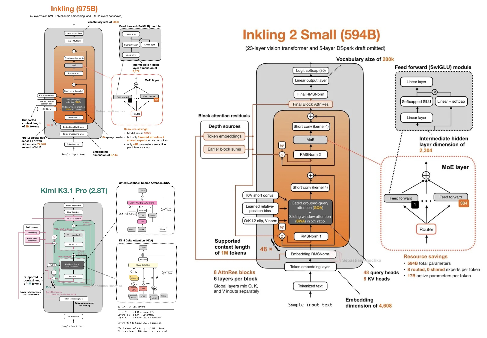

# 🐦 @rasbt

## 📅 November 14, 2026

> 2 post(s) archived.

---

### 🕐 14:38 UTC · @rasbt

> Inkling 2 Small took a while... but it&apos;s more interesting than I initially thought! Using attention residuals (like Kimi K3), but without the linear-attention hybrid. Food for discussion for the end-of-the-year architecture trends analysis!

🔗 [View original post](https://x.com/rasbt/status/2121613812990095543)

---

### 🕐 00:19 UTC · @rasbt

> Seb&apos;s Law, co-signed by another Seb Seb&apos;s Law: The widespread, transformative societal impact of AI is always approximately two years away, regardless of the current year.

🔗 [View original post](https://x.com/rasbt/status/2121397631192539435)

---
